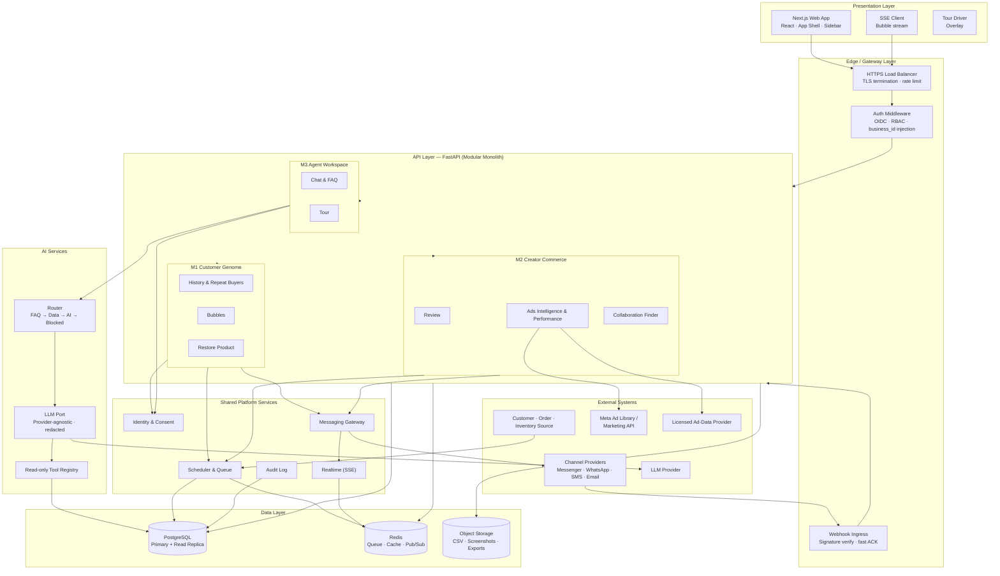
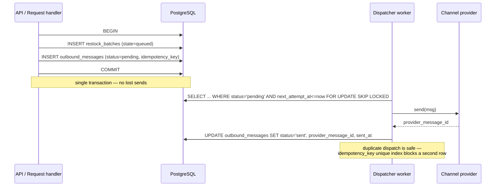
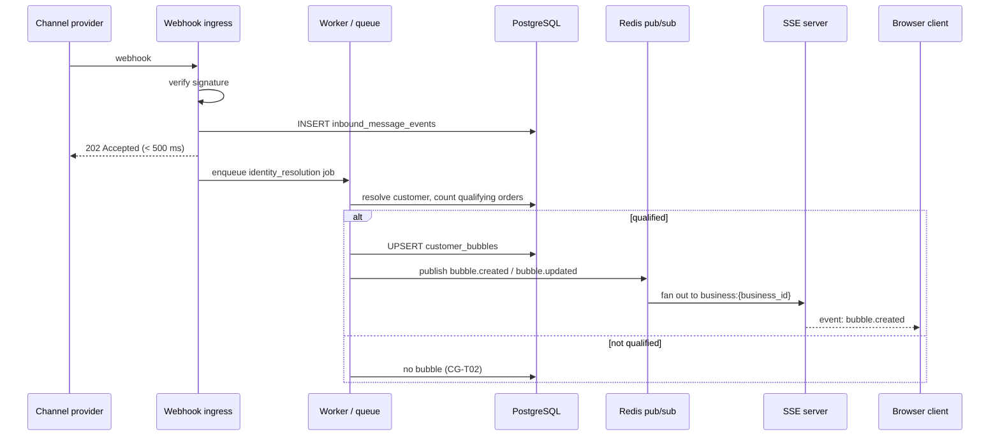
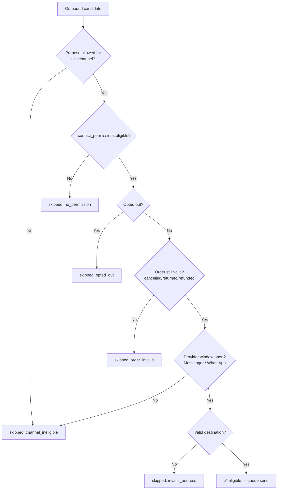
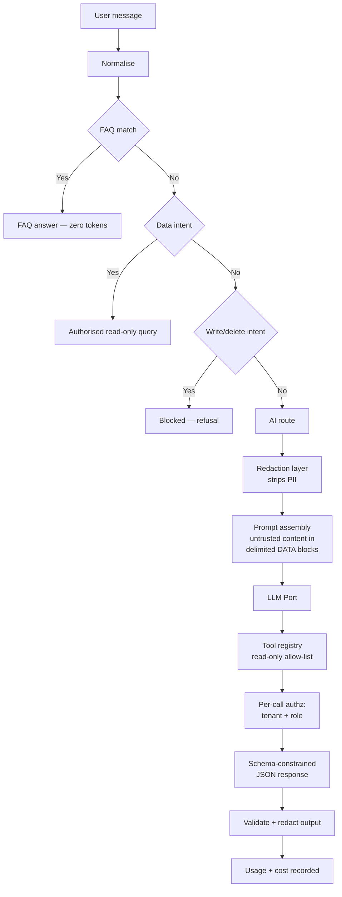
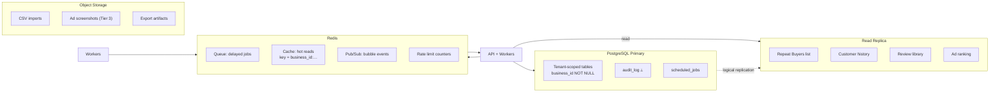
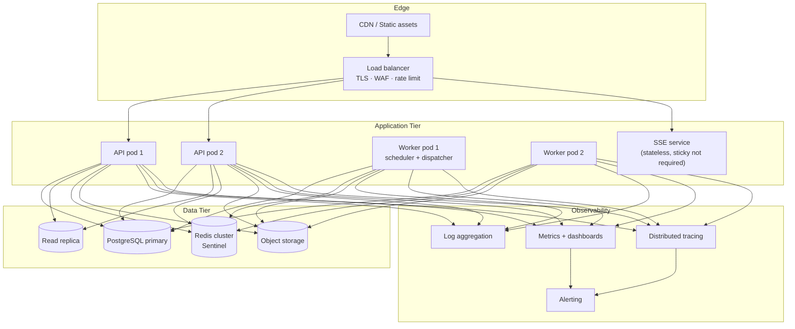
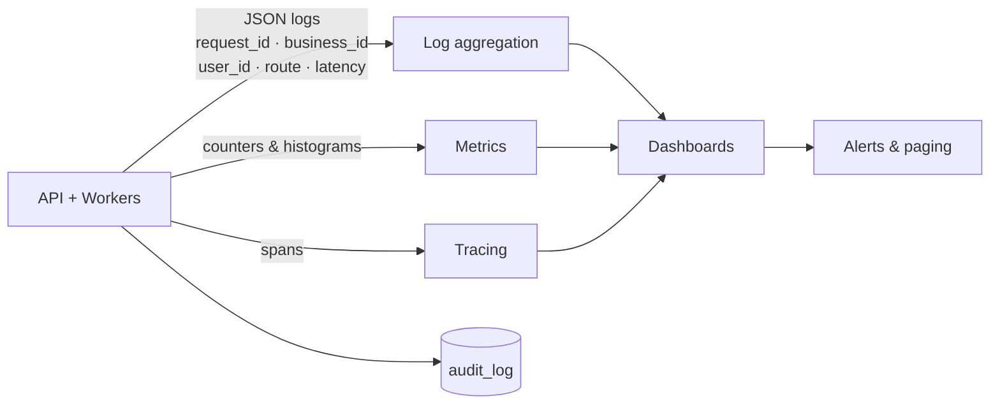

# System Architecture

**Project:** Xenovarients — Customer Genome · Creator Commerce · Agent Workspace
**Version:** 1.0 (derived from Master Project Documentation v3.0, 16 November 2026)
**Audience:** Architects, developers, DevOps, security reviewers, technical leads

---

## 1. Architectural Position

One tenant-aware application with clear service boundaries. Features share five platform services instead of each building its own messaging, identity and scheduling.

**Architecture principles**

| # | Principle | Implication |
|---|---|---|
| A1 | **Shared platform services over per-feature builds** | Messaging, identity, scheduling, realtime and audit are implemented once and consumed by every module. |
| A2 | **Modular monolith first** | One deployable API, internally separated by module and by service boundary. Extract a service only when a measured need (scale, isolation, ownership) justifies it. |
| A3 | **Tenant isolation is a platform concern** | `business_id` is injected at the middleware layer, not passed by callers. |
| A4 | **Async by default for anything slow** | Webhooks acknowledge in under 500 ms and hand work to the queue. |
| A5 | **Outbox for every send** | A business transaction and its outbound message row are committed together; a separate dispatcher sends. |
| A6 | **No fabricated data** | Unavailable is a first-class value with a reason, not a default. |
| A7 | **Boring, observable, reversible** | Structured logs, dashboards, feature flags, staged rollout, expand/contract migrations. |

---

## 2. Layered Architecture



---

## 3. Component Catalogue

### 3.1 Shared platform services

| Service | Responsibility | Interface | Owned data |
|---|---|---|---|
| **Identity & Consent** | Messaging identity links, contact permissions, opt-outs, consent records. Used by bubbles, Restore Product and Review. | `IdentityService.resolve(channel, channel_user_id) → Resolution`, `.link()`, `.check_permission()` | `messaging_identity_links`, `contact_permissions`, `review_permissions`, `identity_conflicts` |
| **Messaging Gateway** | Inbound: webhook signature check, idempotent event store. Outbound: channel adapters, send-time eligibility, rate limits, bounded retries, one delivery log for all purposes. | `Gateway.receive(channel, payload, signature)`, `.enqueue(outbound)`, `.dispatch()` | `inbound_message_events`, `outbound_messages`, `delivery_attempts` |
| **Scheduler & Queue** | Delayed jobs (review requests), batch sends (restock), retries, restock detection. | `Scheduler.schedule(type, run_at, payload, idempotency_key)`, `Worker.run()` | `scheduled_jobs`, `job_runs` |
| **Realtime** | Server-sent events per business for `bubble.created`, `bubble.updated`, `bubble.removed`. Clients reconnect and refetch. | `GET /api/realtime/stream`, `Realtime.publish(business_id, event)` | — (Redis pub/sub fan-out) |
| **Audit Log** | Batch approvals, exports, consent changes, identity links, role changes. | `Audit.record(action, target, before, after)` | `audit_log` |

### 3.2 Module components

| Component | Key responsibilities | Depends on |
|---|---|---|
| **Data Adapter** | Polls/pulls customers, orders, inventory; normalises phone/email; maps source status to the qualifying-order rule; stores raw payloads | Source system, Scheduler, PostgreSQL |
| **Identity Resolver** | Applies the resolution ladder; flags conflicts; never auto-merges | Identity & Consent, PostgreSQL |
| **Bubble Engine** | Qualification, upsert, state transitions, live figures, realtime emission | Identity Resolver, PostgreSQL, Realtime |
| **Restock Detector** | Detects unavailable→available transitions; creates restock events and owner notifications; **never sends messages** | Data Adapter, PostgreSQL, Notifications |
| **Batch Composer** | Resolves waiting lists, per-recipient channel selection, eligibility, stock warning, template preview | Identity & Consent, Messaging Gateway, PostgreSQL |
| **Dispatcher** | Claims pending outbound rows, applies rate limits, sends via adapters, records attempts, bounded retries | Messaging Gateway, Redis, PostgreSQL |
| **Review Scheduler** | Creates review requests on verified delivery; computes due times in business tz; cancels ineligible requests | Scheduler, Data Adapter, PostgreSQL |
| **Reply Matcher** | Token → thread → needs-assignment; preserves verbatim text | Messaging Gateway, PostgreSQL |
| **Consent Manager** | Issues consent asks, records the answer, enforces export gating, supports revocation | Identity & Consent, PostgreSQL, Audit Log |
| **Card Builder** | Generates cards from the verbatim reply; enforces the label and the no-platform-UI rule | PostgreSQL |
| **Ad Insight Service** | Tiered source selection (Meta API → licensed provider → manual intake); scoring; evidence; freshness | Meta API, licensed provider, Object Storage, LLM Port |
| **Ranking Engine** | Deterministic objective-aware ranking over stored snapshots | PostgreSQL |
| **Chat Router** | Normalisation, FAQ match, data intent, blocked-intent detection, AI fallback | FAQ registry, PostgreSQL, LLM Port |
| **FAQ Registry** | Entries, aliases, ownership, review dates, staleness flagging | PostgreSQL |
| **Tool Registry** | Static read-only tool allow-list with tenant/role re-check | PostgreSQL |
| **Usage Meter** | Records route, tokens, latency, cost per request | PostgreSQL |
| **Tour Driver** | Step navigation, target resolution, resilient skipping, progress persistence | PostgreSQL |

### 3.3 Channel adapters

| Channel | Transport | Eligibility conditions | Outbound purpose |
|---|---|---|---|
| Email | SMTP / transactional email API | Authenticated sending domain, valid address, unsubscribe link | restock, review_request, review_consent |
| SMS | Regional SMS gateway | Gateway configured, valid mobile number, opt-out honoured | restock, review_request, review_consent |
| Messenger | Meta Graph API | Platform-allowed window / message type valid at send time | restock, review_request, review_consent |
| WhatsApp | WhatsApp Business API | Approved template + recorded opt-in | restock, review_request, review_consent |

All adapters implement one interface: `send(msg) → SendReceipt` and `eligibility(recipient, at) → EligibilityResult`. Channel rules live in exactly one place (OD-05).

**Not a channel:** Collaboration Finder and Influencer Suggestions have no outbound capability. The outbound service rejects `purpose = collaboration` outright (CF-03).

---

## 4. Cross-Cutting Mechanisms

### 4.1 Tenant isolation

```mermaid
flowchart LR
    A[Request] --> B[Auth Middleware<br/>validate token]
    B --> C[Derive business_id + role<br/>from token claims]
    C --> D[Request Context<br/>business_id, role, user_id]
    D --> E[Repository Guard<br/>rejects any query without<br/>business_id predicate]
    E --> F[Data Access]
    C --> G[Cache key<br/>prefixed with business_id]
    C --> H[Realtime channel<br/>business:{id}]
    C --> I[Queue payload<br/>carries business_id]
```

- `business_id` is never read from a request body or query string; a body-supplied `business_id` is rejected.
- Every tenant-scoped table has `business_id NOT NULL` and includes it in its indexes.
- Row-Level Security in PostgreSQL is recommended as defence in depth.
- A cross-tenant test suite attempts reads on every tenant-scoped endpoint; all must return 403/404 with no leakage (RV-T11, Definition of Done).

### 4.2 Idempotency and the outbox pattern



| Level | Key | Table | Effect of a replay |
|---|---|---|---|
| Inbound event | `business_id + provider_event_id` | `inbound_message_events` | Second insert is swallowed → `duplicate: true` |
| Outbound message | sha256(business \| ref \| recipient \| channel) | `outbound_messages` | Unique index rejects → original message retained |
| Review request | `business_id + order_id` | `review_requests` | Second row rejected → one request per order |
| Consent record | `review_request_id` | `review_permissions` | One state per review |
| Scheduled job | `business_id + idempotency_key` | `scheduled_jobs` | One logical job per key |

### 4.3 Realtime (bubble stream)



- One SSE stream per authenticated business, opened from the app shell so it survives route changes.
- Client behaviour on reconnect: refetch the bubble list (`GET /api/customer-genome/returning-bubbles`) — SSE frames are treated as invalidation signals, not the source of truth.
- No browser push permission is requested (CG-11).

### 4.4 Eligibility engine

Send-time eligibility is a single decision point shared by Restore Product, Review and the Consent flow.



Evaluated twice: at preview time (so the owner sees the truth) and again at dispatch time (so a consent change between preview and send is respected — RP-08).

### 4.5 AI safety architecture



**Guarantees**

| Guarantee | Mechanism |
|---|---|
| Ad copy, reviews and customer text cannot change instructions | Untrusted content only ever appears inside clearly delimited data blocks; the system prompt states they are data to analyse |
| No write tools | The tool registry is a static allow-list; no dynamic registration path exists |
| Least data to AI | Redaction layer strips phone, email and full name before the provider call (OD-10) |
| Tenant + role enforced per tool call | Authorisation re-checked inside each tool, not only at the entry point |
| No invented facts | The prompt forbids guessing; missing data is explained; output is schema-validated |
| Cost control | Usage metered per request; per-business caps configurable (OD-10) |

---

## 5. Data Architecture



| Concern | Approach |
|---|---|
| Multi-tenancy | Shared schema, `business_id` discriminator, RLS as defence in depth |
| Read scaling | Read replica for list/report queries; Redis cache for hot endpoints (p95 < 500 ms target) |
| Concurrency | `FOR UPDATE SKIP LOCKED` for dispatcher claims; advisory locks for restock detection transitions |
| Migrations | Expand/contract with Alembic; no destructive change in the same release as the code that stops using the column |
| Backup | Point-in-time recovery on the primary; daily restore rehearsal |
| Retention | Per-entity retention per OD-07; purge jobs for chat, usage and delivery-attempt data |

**Data classification**

| Class | Examples | Handling |
|---|---|---|
| Public | Product names, public ad metadata, public collaborator info | Stored, displayable |
| Internal | Ad insights, snapshots, tour progress | Tenant-scoped |
| Personal | Names, phone numbers, emails, order history | Tenant-scoped, minimised, redacted before AI, access logged |
| Special | Review verbatim text, consent records | Tenant-scoped, immutable where required, consent-gated for export |
| Secret | OAuth tokens, webhook secrets | Encrypted at rest (KMS), never logged, never in exports |

---

## 6. Integration Architecture

| Integration | Direction | Protocol | Auth | Failure behaviour |
|---|---|---|---|---|
| **Customer/Order/Inventory source** | Inbound | Adapter (REST/DB/file) per OD-01 | Provider credentials from the secret store | Backfill + incremental sync with cursors; stale flag surfaced; no fabricated data |
| **Messenger (Meta)** | Bi | Webhook + Graph API | App secret / OAuth token | Signature mismatch → 401; API error → bounded retry |
| **WhatsApp Business** | Bi | Webhook + Cloud API | OAuth token + template approval | Template rejected → skipped with reason; window closed → ineligible |
| **SMS gateway** | Outbound | HTTP | API key | Provider 429 → retry after delay, bounded; failure → row `failed` |
| **Email provider** | Outbound | HTTPS API | API key | Transient error → retry; permanent (invalid address) → `failed` |
| **Meta Ad Library** | Outbound | Graph API | App token | Not covered → fall back to Tier 2, then Tier 3; never scrape |
| **Licensed ad provider** | Outbound | HTTPS | Licence key | Unavailable → Tier 3 |
| **LLM provider** | Outbound | HTTPS | API key | Down → chat degrades to FAQ + DATA with an explicit notice |
| **Identity provider** | Inbound | OIDC | — | Down → existing sessions continue until token expiry |

**Meta access lead time** — reading ad-account data requires Meta app review and business verification. This is started in Phase 0 because it routinely takes longer than the build itself.

---

## 7. Deployment Architecture



| Environment | Purpose | Data |
|---|---|---|
| `local` | Development via docker-compose (Postgres, Redis, mailhog) | Seeded fixtures |
| `ci` | Automated tests | Ephemeral per pipeline |
| `staging` | Pre-release verification and owner acceptance | Sanitised production-like data |
| `production` | Live | Real tenant data, encrypted, audited |

**Release strategy**

1. Code behind a per-tenant feature flag.
2. Migrations applied expand-only before the code ships.
3. Deploy → smoke tests → internal tenant → 5% → 25% → 100%.
4. Automatic rollback on error-rate breach.
5. Contract: backfill → switch reads → remove old path in a later release.

**CI/CD pipeline**

```
lint → unit → integration (docker-compose services)
      → migration up/down check → contract tests
      → security tests (tenant isolation, IDOR, signature)
      → build + scan images → deploy staging
      → smoke + E2E → owner acceptance → production
```

---

## 8. Availability, Performance and Capacity

| Target | Value | Mechanism |
|---|---|---|
| Bubble latency | ≤ 5 s p95 from webhook receipt | Fast ACK, queue hop, SSE push; the SSE frame is the invalidation signal |
| Read latency | < 500 ms p95 | Indexes, read replica, Redis cache |
| Availability | 99.5% | Multi-AZ API pods, DB failover, Redis Sentinel, worker autoscaling, graceful degradation of AI and ads features |
| Webhook processing | At-least-once with idempotent handling | Unique event IDs; duplicates absorbed |
| Throughput assumption | Peak burst of inbound messages and batch sends | Horizontal API scaling, batched dispatcher claims, per-channel rate limits |
| Chat concurrency | Bursty, low volume | Stateless API; the LLM path is the only cost-bearing route and is capped |

---

## 9. Observability Architecture



| Signal | Content |
|---|---|
| **Logs** | JSON with `request_id`, `business_id`, `user_id`, `route`, `latency_ms`, `outcome`. No secrets, no PII. |
| **Traces** | API → queue worker → channel adapter → provider, with the correlation id propagated through the job payload. |
| **Metrics** | Webhook receipt rate; bubble latency p95; qualification rate; outbound per channel; delivery success/failure by error code; retry counts; restock detection lag; review due/sent rate; reply match rate; consent distribution; chat route mix; AI tokens and cost per tenant; SSE connections. |
| **Alerts** | Delivery failure rate breach; queue age breach; bubble p95 > 5 s; error rate > 2%; AI cost anomaly; webhook signature failure spike. |
| **Dashboards** | Delivery outcomes per channel; AI cost per tenant per day; funnel inbound → qualified → bubble → linked; funnel due → sent → replied → consented → exported. |
| **Audit** | Immutable trail surfaced to Owner/Admin: batch approvals, exports, consent changes, identity links, role changes. |

---

## 10. Security Architecture

| Layer | Control |
|---|---|
| **Transport** | TLS 1.2+ everywhere, HSTS, internal traffic encrypted |
| **Edge** | WAF, IP and tenant rate limiting, request size caps |
| **Authentication** | OIDC/OAuth2, short-lived access tokens, hashed refresh tokens |
| **Authorisation** | RBAC per endpoint from the roles matrix; Owner-only on restock approval, ad connection, review export, FAQ/tour management |
| **Tenant isolation** | `business_id` injection at the middleware layer, repository guard, RLS, mandatory cross-tenant tests |
| **Webhook security** | HMAC-SHA256 constant-time comparison, timestamp replay window, secret rotation |
| **Secret management** | Managed secret store; no secrets in code, images, logs or client bundles |
| **Token protection** | OAuth access tokens encrypted at rest with KMS envelope encryption; rotated; never logged |
| **Application security** | Parameterised queries only; no raw HTML rendering of customer text or ad copy; sanitised rich text |
| **AI security** | Untrusted content isolated in delimited blocks; schema-constrained output; read-only tool allow-list; PII redaction |
| **Auditability** | Immutable audit log with actor, timestamp, target and before/after hash |
| **Supply chain** | Locked dependencies, automated scanning, signed and digest-pinned images |

---

## 11. Feature-to-Service Mapping

| Feature | Identity & Consent | Messaging Gateway | Scheduler & Queue | Realtime | Audit Log | LLM |
|---|---|---|---|---|---|---|
| Repeat Buyers & History | ○ | | ● | | | |
| Returning Customer Bubbles | ● | ● | ● | ● | ○ | |
| Restore Product | ● | ● | ● | ○ | ● | |
| Review | ● | ● | ● | | ● | |
| Meta Ads Intelligence | | | ● | | ○ | ● (scoring) |
| My Ads Performance | | | ● | | ○ | |
| Collaboration Finder | | | ● | | | |
| Smart Chat Assistant | ● | | | | ● | ● |
| Website Tour | | | | | | |

● primary owner  ○ secondary / read

---

## 12. Evolution Path

The system is a modular monolith by design. Extraction triggers, when met:

| Extract when | Candidate | Rationale |
|---|---|---|
| Sustained queue load justifies independent scaling, or a provider requires a separate deployment | Messaging Gateway | Outbound throughput and provider-specific concerns are self-contained |
| External partners need direct ad-data consumption, or ad analysis becomes compute-heavy | Ads Insight Service | Heavy scraping-free ingestion and scoring workloads |
| Tenant volume or isolation requirements grow | Tenant-scoped data plane | Sharding by `business_id` with the same repository contract |

Rules for extraction: the extracted service keeps the same interface and owns its tables exclusively; the API layer calls it over a network boundary with the same auth model; no module may reach into another module's tables.

---

## 13. Architecture Decisions

| # | Decision | Rationale | Status |
|---|---|---|---|
| AD-1 | Modular monolith over microservices | One deployable with internal boundaries delivers faster at this scale; extraction paths are defined (Section 12) | RECOMMENDED |
| AD-2 | Shared platform services over per-feature messaging/identity/scheduling | Avoids divergent behaviour for consent, idempotency and delivery | APPROVED |
| AD-3 | SSE over WebSockets for realtime | One-way push only; simpler reconnection and proxy behaviour | RECOMMENDED |
| AD-4 | Outbox pattern for every outbound send | Business state and send intent commit together; no lost or phantom sends | APPROVED |
| AD-5 | PostgreSQL as the primary store | Relational integrity and unique constraints are load-bearing for idempotency and consent | APPROVED |
| AD-6 | Ad intelligence limited to Tier 1/2/3 legal sources | Never bypass platform restrictions by scraping | APPROVED |
| AD-7 | FAQ and data routes never touch the LLM | Zero cost for common questions; the model is reserved for genuinely unique ones | APPROVED |
| AD-8 | Tool registry is a static read-only allow-list | Structural guarantee that the agent cannot mutate data | APPROVED |
| AD-9 | Shared schema with `business_id` discriminator | Simple to operate; RLS and repository guard provide isolation | RECOMMENDED (OD-03) |
| AD-10 | Provider-agnostic `LLMPort` | Keeps OD-10 (provider, model, cost caps, redaction) a configuration change | RECOMMENDED |

---

## 14. Traceability

| Requirement | Architecture section |
|---|---|
| CG-05…CG-11 Bubbles | §2 Realtime, §4.3 Realtime mechanism |
| CG-03 Identity matching | §4.1 Tenant isolation, §3.2 Identity Resolver |
| RP-06…RP-08 Channel routing and idempotency | §3.3 Channel adapters, §4.2 Outbox, §4.4 Eligibility |
| RP-04 Restock detection | §3.2 Restock Detector |
| RV-02…RV-07 Review pipeline | §3.2 Review Scheduler, Reply Matcher |
| RV-09…RV-12 Consent and cards | §3.2 Consent Manager, Card Builder |
| MI-01…MI-05 Ad intelligence | §3.2 Ad Insight Service, §6 Integration tiers |
| MP-01…MP-04 Own ads | §3.2 Ranking Engine, §3.2 Ad Insight Service |
| CF-03 No outreach | §3.3 Channel adapters |
| AW-04…AW-08 Chat routing and safety | §4.5 AI safety architecture |
| AW-10…AW-11 Tour | §3.2 Tour Driver |
| NFR performance/reliability | §8 Availability, Performance and Capacity |
| NFR observability | §9 Observability Architecture |
| NFR security | §10 Security Architecture |
| Tenant isolation | §4.1 |
