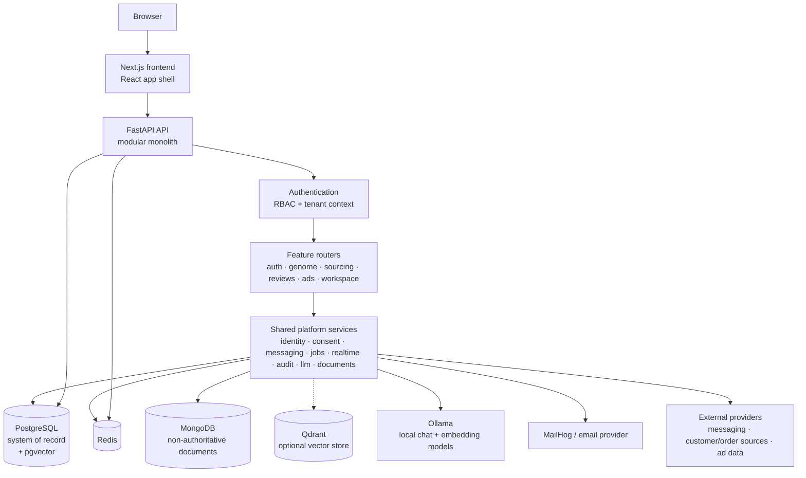
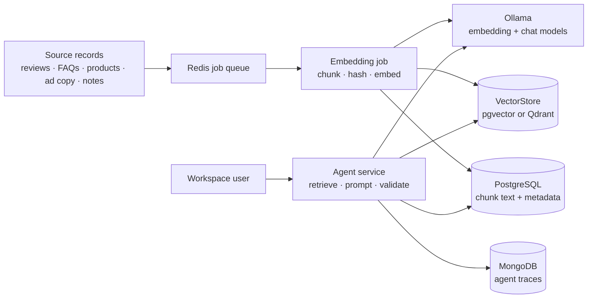

# XenoDesk System Design

**Project:** XenoDesk — Customer Genome · Creator Commerce · Agent Workspace  
**Audience:** Developers, architects, DevOps engineers, and reviewers  
**Status:** Living design document

## 1. System Purpose

XenoDesk is a multi-tenant business workspace. It combines:

- **Sourcing Workspace** for product research, sourcing, and carts.
- **Customer Genome** for customer history, repeat buyers, messaging bubbles, and product-restock workflows.
- **Creator Commerce** for reviews, ads intelligence, collaborations, and influencer workflows.
- **Agent Workspace** for chat, FAQs, guided tours, and read-only operational assistance, powered by a locally hosted LLM and tenant-scoped retrieval.

The modules share identity, permissions, messaging, scheduling, realtime events, audit logging, AI retrieval, and a common tenant boundary.

## 2. Architectural Style

The system uses a **modular monolith** with **polyglot persistence under strict ownership rules**:

1. One FastAPI application is deployed as the API.
2. Feature modules are separated into routers, models, and domain services.
3. Shared platform capabilities are implemented once and reused by every module.
4. **PostgreSQL is the only system of record.** Identity, memberships, orders, consent, outbox, idempotency keys, jobs, and audit records live only there.
5. **Vector search** sits behind a `VectorStore` interface. pgvector inside PostgreSQL is the default; a dedicated vector database (Qdrant) is an optional drop-in. Vectors are derived data.
6. **MongoDB** stores high-volume, loosely structured, non-authoritative documents such as raw payload archives, supplier product snapshots, ads snapshots, and agent traces.
7. Redis provides queue, cache, pub/sub or streams, and rate-limit primitives.
8. Ollama serves a local LLM and embedding model as a replaceable, stateless inference service.
9. The Next.js application provides the browser workspace and persistent navigation.

This keeps deployment and transactions simple while preserving boundaries that can later be extracted into services if scale or ownership requires it. Secondary stores are always populated by projection from PostgreSQL or by append-only ingestion, never by dual-writing business state.

## 3. High-Level Architecture



### 3.1 Repository structure

```text
backend/
  xenovarients/
    api/        FastAPI routers and request dependencies
    core/       settings, security, and logging
    db/         async SQLAlchemy sessions and tenant binding
    models/     SQLAlchemy persistence models
    platform/   reusable domain/platform capabilities
      llm/        Ollama client, prompt guard, usage records
      vector/     VectorStore interface, pgvector and Qdrant implementations
      documents/  tenant-scoped MongoDB repositories (the only code that touches Mongo)
    jobs/       background job handlers and runner
    main.py     FastAPI application factory
  alembic/      database migrations
  tests/        unit and integration tests

frontend/
  src/app/      Next.js routes
  src/components/ shared workspace UI
  src/lib/      API client and realtime client

docs/           product, technical, architecture, and workflow documentation
```

## 4. Frontend Design

The frontend is a Next.js application using React and TypeScript.

### 4.1 App shell

The app shell provides:

- Persistent sidebar navigation grouped by product module.
- Role-aware links for owner and admin features.
- Route-level loading and authentication handling.
- Shared notifications, sign-out, and realtime bubble UI.
- Responsive navigation for smaller screens.

Public routes such as landing, login, and signup bypass the authenticated shell. Workspace routes call the API to resolve the current user and redirect unauthenticated users to login.

### 4.2 API access

The browser API client:

- Uses `NEXT_PUBLIC_API_BASE`, defaulting to `http://localhost:8001`.
- Sends the access token as a Bearer token.
- Uses JSON request and response bodies.
- Provides a shared API error path.
- Connects to the server-sent event stream for live workspace events.

Native `EventSource` cannot send an `Authorization` header, so the realtime client uses one of:

1. A fetch-based SSE client that sends the Bearer token (preferred), or
2. A short-lived, single-use stream ticket obtained from an authenticated endpoint and passed as a query parameter.

Realtime frames are treated as invalidation signals. Each event carries an ID; on reconnect the client sends `Last-Event-ID` and then refetches authoritative records. An SSE frame is never the complete data source.

### 4.3 Agent chat UI

The agent chat surface:

- Streams or polls assistant responses and shows a clear "busy" or "AI unavailable" state when the local model cannot serve the request.
- Renders source references returned with each answer (for example, the review, FAQ entry, or record it came from).
- Falls back to FAQ and structured read-only answers when the LLM is unavailable.

## 5. Backend Design

The backend is a typed FastAPI application created by `xenovarients.main:create_app`.

### 5.1 Request pipeline

```text
HTTP request
  -> CORS middleware
  -> request context middleware
  -> idempotency middleware
  -> authentication dependency
  -> principal and role resolution
  -> tenant-bound database session
  -> feature router
  -> domain/platform service
  -> PostgreSQL, Redis, MongoDB (via repositories), vector store, or Ollama
```

The application exposes:

- `GET /health` for process health.
- `GET /health/ready` for database readiness.
- `GET /api/docs` for OpenAPI documentation.
- Versioned feature endpoints under `/api/v1/...`.

### 5.2 Feature boundaries

Feature routers own transport concerns and delegate business rules to domain/platform code.

| Area | Responsibility |
|---|---|
| Auth | Registration, login, token validation, refresh, current-user lookup |
| Sourcing | Product research, sourcing workspace, products, cart, and related workflows |
| Customer Genome | Customer history, repeat buyers, bubbles, interests, and restock workflows |
| Creator Commerce | Reviews, marketing cards, ads intelligence, and collaborations |
| Agent Workspace | Chat, FAQ, tour, retrieval-augmented answers, and read-only operational assistance |
| Events | Authenticated SSE stream for workspace events |
| Webhooks | Provider ingress, signature verification, and fast acknowledgement |

### 5.3 Background jobs

Background work runs in worker processes from the same codebase, using one job framework (ARQ, Celery, or Dramatiq; see Open Decisions). Every job type defines:

- A unique job key for idempotency.
- Bounded retries with exponential backoff and jitter.
- A visibility timeout so crashed workers release claimed work.
- A dead-letter state, recorded in PostgreSQL and surfaced on operational dashboards, for poison jobs.

Job categories include outbox dispatch, identity resolution, embedding, inventory sync, and projection to secondary stores.

## 6. Identity, Authentication, and Tenant Isolation

### 6.1 Authentication

The API uses bearer access tokens. The authentication dependency:

1. Validates the Authorization header.
2. Decodes and validates the JWT.
3. Resolves the user from PostgreSQL.
4. Checks account status and token revocation.
5. Resolves the active business membership.
6. Loads the current role from the membership record.

Roles are evaluated at request time so membership changes take effect without waiting for token expiry.

Token policy:

- Access tokens are short-lived.
- Refresh tokens are rotated on every use, with reuse detection that revokes the whole token family.
- Browser storage prefers `httpOnly`, `Secure`, `SameSite` cookies for the refresh token. Keeping access tokens in memory reduces XSS exposure compared with `localStorage`.

### 6.2 Tenant isolation

Every tenant-scoped operation is bound to a `business_id` derived from the authenticated principal.

The system enforces this through:

- Tenant-bound SQLAlchemy sessions.
- ORM-level tenant filtering.
- PostgreSQL row-level security (RLS), driven by `SET LOCAL app.business_id` inside each transaction so pooled connections never carry tenant state between requests.
- The application connecting as a non-owner role, with `FORCE ROW LEVEL SECURITY` on tenant tables, including embedding tables.
- `business_id` columns and tenant-aware indexes.
- Role checks at the API boundary.
- Cache, queue, and realtime keys that include the tenant.
- For MongoDB and the vector store, a single repository layer that injects the tenant filter (see 7.5 and 7.4). Feature code cannot reach those clients directly.

Clients must not choose a tenant by placing `business_id` in a request body. For users belonging to multiple businesses, `X-Business-Id` selects the membership after authorization.

## 7. Data and Storage Design

### 7.1 PostgreSQL

PostgreSQL is the system of record and stores transactional and audit data, including:

- Businesses, users, and memberships.
- Customer, order, inventory, and product-interest data.
- Messaging identities, permissions, inbound events, outbound messages, and delivery attempts.
- Reviews, ads, sourcing records, jobs, notifications, and audit records.
- Idempotency keys.
- Embedding documents and chunk text and metadata used for retrieval (see 7.4).

SQLAlchemy uses asynchronous sessions for API access. Alembic manages versioned migrations. The application role has fewer schema privileges than the migration role. Semi-structured data that belongs to a transactional record uses `JSONB` columns before a separate store is considered.

### 7.2 Redis

Redis is used for:

- Background job queues and delayed work, including embedding jobs.
- Realtime fan-out. Pub/sub is lossy when no subscriber is listening, so short replay windows use Redis Streams (or an event table) keyed by event ID.
- Hot-read caching.
- Per-business and per-channel rate-limit counters, including LLM request limits.

Redis is not the source of truth. Data needed for recovery or audit is persisted in PostgreSQL.

### 7.3 Object storage

The target deployment uses S3-compatible object storage for larger or less relational artifacts such as CSV imports, screenshots, and generated exports.

### 7.4 Vector storage

All vector access goes through a `VectorStore` interface in `platform/vector/` with `upsert`, `search`, and `delete` operations that always require a tenant context. The implementation is chosen by configuration (`VECTOR_BACKEND=pgvector|qdrant`).

PostgreSQL keeps the retrieval metadata in both modes:

| Table | Purpose |
|---|---|
| `embedding_documents` | One row per indexed source record: `id`, `business_id`, `source_type` (faq, review, product, ad_copy, customer_note), `source_id`, `content_hash`, `embedding_model`, `status` |
| `embedding_chunks` | Chunk text and metadata: `id`, `business_id`, `document_id`, `chunk_index`, `content`, `metadata jsonb`, and `embedding vector(N)` (populated in pgvector mode only) |

**pgvector (default).** Vectors live in `embedding_chunks` with an HNSW cosine index and a btree on `business_id`. RLS applies to similarity search automatically, and embeddings share transactions, backups, and migrations with the records they describe. Hybrid search can combine this with PostgreSQL full-text search in one query.

**Qdrant (optional).** Chosen when measured scale or latency requires it: many millions of chunks, slow filtered search, or a need to isolate vector load from the transactional database.

- Each point carries a payload: `business_id`, `source_type`, `source_id`, `chunk_id`, `embedding_model`.
- `business_id` is indexed as the tenant key and every query filters on it.
- Very large tenants may get their own collection.
- Search returns chunk IDs and scores only. Chunk text is loaded from PostgreSQL through the RLS-bound session, so a filter bug in the vector store cannot leak another tenant's text.

Design rules for both modes:

- `embedding_model` and vector dimension are stored per document, so a model change is rolled out with expand/contract migrations and background re-embedding.
- `content_hash` makes indexing idempotent: unchanged content is not re-embedded.
- Embeddings are derived data and can always be rebuilt from source rows.
- Deletes and erasure requests remove vectors through a retried job, and a reconciliation job detects orphaned vectors.

### 7.5 MongoDB (non-authoritative documents)

MongoDB stores data that is high-volume, loosely structured, append-heavy, and not authoritative:

| Collection | Contents | Retention |
|---|---|---|
| `webhook_payloads` | Full raw provider payloads, keyed by provider event ID, for debugging and replay analysis | TTL, configurable |
| `sourcing_snapshots` | Imported or scraped supplier product data with variable schema | Replaced on refresh |
| `ads_snapshots` | Large nested ads intelligence documents | TTL or latest-N per source |
| `agent_traces` | Agent conversation transcripts, retrieval results, prompts, and model usage detail | TTL, configurable |

Rules:

1. **Never the source of truth** for authentication, memberships, consent, orders, messaging, outbox, idempotency, or audit. Those stay in PostgreSQL.
2. **Mandatory tenant scoping.** Every document has `business_id`. All access goes through `platform/documents/` repositories (async driver such as Motor), which inject the tenant filter into every query. Raw collection handles are not exported to feature code. Indexes lead with `business_id`.
3. **Reference, don't copy.** Documents store Postgres IDs rather than duplicating mutable business records.
4. **No dual writes of business state.** Business state is written to PostgreSQL first. Mongo is filled by projection jobs or append-only ingestion.
5. **Failures are non-fatal to the transaction.** A Mongo outage never fails a business transaction or a webhook acknowledgement. PostgreSQL keeps the fields needed for processing (for example, event ID, signature result, and the processing payload as `JSONB`); Mongo keeps the full raw copy.
6. **TTL indexes** enforce retention on logs, traces, and payload archives.
7. **Privacy flow coverage.** Retention and erasure jobs cover MongoDB, and sensitive fields are redacted before storage.

### 7.6 Data placement rules

| Question | Place it in |
|---|---|
| Does it need transactions, constraints, RLS, or audit? | PostgreSQL |
| Is it semi-structured but tied to one transactional record? | PostgreSQL `JSONB` |
| Is it large, loosely structured, append-heavy, and safe to lose or rebuild? | MongoDB |
| Is it an embedding derived from other data? | Vector store (pgvector or Qdrant) |
| Is it a large binary or file? | Object storage |
| Is it transient, a counter, or a queue? | Redis |

### 7.7 Retention, privacy, and erasure

- Phone numbers, emails, and other direct identifiers are encrypted at column level where stored in PostgreSQL and masked in logs and traces.
- A single erasure workflow removes a data subject's records from PostgreSQL, vectors, MongoDB documents, and object storage, and writes an audit record.
- Retention periods are defined per data class and enforced by TTL indexes, scheduled jobs, and storage lifecycle rules.

## 8. Core Reliability Patterns

### 8.1 Idempotency

External providers and clients can retry requests. The system uses unique keys for:

- Provider inbound event IDs.
- Outbound message identities.
- Review requests per order.
- Consent records per review.
- Scheduled jobs.
- Embedding jobs per source record and content hash.

The HTTP idempotency middleware scopes keys per business and endpoint, stores the request fingerprint and response in PostgreSQL with a TTL, and replays the original response when the same key and fingerprint return. The same key with a different fingerprint is rejected.

A replay returns the original effect or becomes a no-op instead of creating duplicate business actions.

### 8.2 Outbox and delivery

Outbound communication follows this sequence:

```text
Business transaction
  -> commit domain change and pending outbound row together
  -> dispatcher claims pending rows (SELECT ... FOR UPDATE SKIP LOCKED)
  -> eligibility and rate-limit checks
  -> provider adapter sends
  -> delivery attempt recorded
  -> sent, retrying, skipped, or failed state
```

This prevents a successful database transaction from losing its corresponding message. The dispatcher claims rows with `FOR UPDATE SKIP LOCKED` so multiple workers can run safely, preserves ordering per recipient, retries with bounded exponential backoff, and moves exhausted rows to a dead-letter state for owner or operator review.

### 8.3 Webhook processing

Webhook handlers verify signatures and acknowledge quickly. The durable event is stored in PostgreSQL with a unique provider event ID, and the full raw payload may be archived to MongoDB. Slower identity resolution and feature processing then run asynchronously.

### 8.4 Realtime events

The API publishes business-scoped events with monotonically increasing IDs through Redis and exposes them through SSE. Short replay windows allow reconnecting clients to resume from `Last-Event-ID`. After stream failures or a gap larger than the replay window, the browser refetches state, avoiding data loss from missed frames.

### 8.5 Graceful AI degradation

The local LLM is an optional dependency of the Agent Workspace, not of the core product.

- LLM and embedding calls have timeouts, bounded retries, and a concurrency limit.
- When Ollama is down, slow, or saturated, the agent answers from FAQ matches and allow-listed read-only data intents, or returns an explicit "AI unavailable" response.
- Embedding jobs that fail are retried with backoff and recorded; they never block the business transaction that created the source record.

### 8.6 Projection to secondary stores

Secondary stores (vector store, MongoDB) are filled by jobs that read committed PostgreSQL state:

```text
Committed change in PostgreSQL
  -> projection job enqueued (unique on source_id + version)
  -> job writes to vector store or MongoDB
  -> status recorded on the source or document row
  -> reconciliation job detects and repairs drift
```

If a secondary store is unavailable, projection jobs retry and the core transaction is unaffected.

## 9. Representative Business Flows

### 9.1 Authenticated workspace request

```text
Browser
  -> Next.js route
  -> FastAPI endpoint with Bearer token
  -> resolve user and business membership
  -> establish tenant-bound session
  -> authorize role
  -> query or mutate tenant-scoped records
  -> return validated JSON
```

### 9.2 Customer message to bubble

```text
Messaging provider
  -> webhook signature verification
  -> durable inbound event insert (PostgreSQL)
  -> raw payload archived (MongoDB, best effort)
  -> 202 acknowledgement
  -> identity resolution job
  -> qualifying-order check
  -> bubble upsert
  -> Redis event with ID
  -> authenticated SSE client
```

### 9.3 Restore Product notification

```text
Inventory sync
  -> detect unavailable-to-available transition
  -> create restock event and owner notification
  -> owner previews recipients and eligibility
  -> owner approves batch
  -> pending outbound rows
  -> dispatch-time eligibility re-check
  -> channel adapter
  -> delivery result and audit record
```

The inventory detector never sends messages directly. Sending requires an explicit approved batch.

### 9.4 Agent request

```text
User message
  -> normalize input
  -> FAQ exact/fuzzy match
  -> authorized read-only data intent (allow-listed tools)
  -> blocked write/delete intent
  -> embed query (Ollama embedding model)
  -> hybrid retrieval: tenant-bound vector search + full-text search, rank fusion, minimum score
  -> hydrate chunk text from PostgreSQL (RLS-bound)
  -> assemble prompt: system rules + retrieved chunks marked as untrusted data
  -> local LLM generation (Ollama chat model)
  -> schema validation + source-reference check
  -> usage and cost record (PostgreSQL); transcript and trace (MongoDB)
```

If no retrieved chunk clears the minimum score and no structured data intent matches, the agent reports that it has no data on the topic instead of generating an unsupported answer.

Customer text, reviews, and ad copy are treated as untrusted data and cannot modify system instructions or tool permissions.

## 10. AI and Retrieval Layer

### 10.1 Components



All access goes through the platform modules:

| Module | Responsibility |
|---|---|
| `llm/client.py` | Ollama HTTP client for chat and embeddings, with timeouts and retries |
| `llm/guard.py` | Prompt assembly, untrusted-data delimiting, output schema validation |
| `llm/usage.py` | Per-request model, prompt version, token, latency, and retrieval records |
| `vector/` | `VectorStore` interface and implementations, chunking, and idempotent upserts |
| `documents/` | Tenant-scoped MongoDB repositories for traces and archives |

Feature routers never call Ollama, the vector store, or MongoDB directly.

### 10.2 Models

Models are configuration, not code:

- **Chat model:** Qwen 2.5 7B (`qwen2.5:7b`) is the onboarding and local chat baseline. Structured JSON output is used so responses can be schema-validated.
- **Embedding model:** a multilingual model such as `bge-m3` is preferred when content mixes Bangla and English; a lighter English-focused model such as `nomic-embed-text` is an alternative. The choice is validated against real FAQ and review samples.
- Ollama `keep_alive` keeps models loaded between requests, and context length is capped to bound memory use.

Model names, embedding dimension, top-k, and minimum score are environment settings (see section 14).

### 10.3 Indexing pipeline

```text
Source row created or updated
  -> enqueue embedding job (unique on source_id + content_hash)
  -> chunk text
  -> embed via Ollama
  -> upsert chunk rows in PostgreSQL and vectors in the VectorStore under the owning business_id
  -> publish "index updated" event
```

Embedding always runs in background workers, never inline in an API request. Deleting or redacting a source record also removes its chunks and vectors.

### 10.4 Retrieval and prompting rules

- Every retrieval query runs in a tenant-bound context and filters on `business_id`.
- **Hybrid retrieval:** vector similarity is combined with PostgreSQL full-text search using reciprocal rank fusion. This improves recall for product names, SKUs, and mixed Bangla–English queries where embeddings alone miss exact matches.
- Retrieved chunks are inserted into the prompt inside clearly delimited data blocks and are never placed in the system instruction.
- Only allow-listed, read-only tools are exposed to the model. Tool calls are re-authorized for tenant and role on every invocation.
- Responses must pass schema validation and include references to the records used.
- Prompt templates and model settings are versioned, and the version is recorded with every usage record.

### 10.5 Evaluation

A golden set of questions per module (reviews, restock, sourcing, FAQ) is maintained in the repository. It is run in CI or on demand whenever the model, chunking, retrieval parameters, or prompts change, and tracks:

- Retrieval recall@k.
- Answer correctness and source-reference accuracy.
- Empty-retrieval and refusal rates.
- Latency percentiles.

### 10.6 Capacity and fallback

A local model serves a limited number of concurrent requests. The system therefore:

- Applies a global concurrency limit for LLM calls and per-business rate limits through Redis.
- Queues or rejects excess requests with a clear "busy" response.
- Keeps non-AI features independent of Ollama availability.

## 11. Security and Privacy

Key controls include:

- JWT validation, refresh rotation with reuse detection, and token revocation.
- Role-based access control.
- Tenant filtering and database row-level security defense in depth, applied to vector tables; repository-enforced tenant filters for MongoDB and Qdrant, with PostgreSQL re-hydration of retrieved text.
- Constant-time webhook signature verification.
- Idempotency for retried external operations.
- Consent and opt-out checks at dispatch time.
- Column-level encryption of direct identifiers and masking in logs and traces.
- Local inference keeps customer data on infrastructure the team controls. Redaction before prompting is retained as defense in depth, for logs and traces, and to keep a future switch to a hosted model safe.
- Read-only, allow-listed AI tools with tenant and role checks on every call.
- Prompt-injection resistance: retrieved reviews, customer text, and ad copy are untrusted data in delimited blocks.
- Cross-tenant tests covering PostgreSQL, vector search, and MongoDB repositories.
- Audit records for sensitive actions such as exports, consent changes, identity links, and role changes.
- Secrets supplied through environment configuration rather than committed source files.

### 11.1 Threat model summary

| Threat | Mitigation |
|---|---|
| Cross-tenant data access | RLS with `FORCE`, `SET LOCAL` tenant binding, repository-enforced filters on secondary stores, PostgreSQL re-hydration, automated cross-tenant tests |
| Prompt injection via reviews, customer text, or ad copy | Untrusted-data delimiting, read-only allow-listed tools, schema-validated output, no tool permission changes from data |
| Webhook spoofing or replay | Constant-time signature verification, unique provider event IDs, timestamp tolerance |
| Token theft or replay | Short-lived access tokens, rotating refresh tokens with reuse detection, `httpOnly` cookies, revocation checks |
| Unauthorized or duplicate outbound messages | Persisted outbox, dispatch-time consent and eligibility re-check, owner approval for restock batches |
| Data leakage through logs, traces, or archives | Masking and redaction, TTL retention, erasure workflow covering all stores |

## 12. Non-Functional Requirements

These are initial targets to validate with load testing, not measured results.

| Area | Initial target |
|---|---|
| API latency (non-AI reads) | p95 under 300 ms |
| Webhook acknowledgement | p95 under 1 s |
| Agent first token on target hardware | Under 5 s, with an explicit busy state beyond the concurrency limit |
| Availability (core product) | 99.5% monthly, independent of Ollama availability |
| Recovery | RPO ≤ 15 minutes, RTO ≤ 2 hours |
| Tenant isolation failures | Zero tolerated; any occurrence is a severity-one incident |

## 13. Failure Modes

| Dependency | Impact | Degraded behavior |
|---|---|---|
| PostgreSQL | Core product unavailable | Readiness fails; API returns 503; workers pause |
| Redis | No queues, realtime, or rate limits | Reads continue; realtime falls back to client polling and refetch; outbound dispatch pauses safely |
| Ollama | No generation or new embeddings | Agent answers from FAQ and read-only data or reports "AI unavailable"; embedding jobs retry |
| Vector store (Qdrant) | No semantic retrieval | Fall back to full-text search; indexing jobs retry |
| MongoDB | No archives, snapshots, or traces | Business transactions and webhook acknowledgements continue; projection and archive jobs retry; some history views show gaps |
| Messaging provider | Messages not delivered | Outbox retries with backoff, then dead-letter for review |
| Object storage | No imports or exports | Existing workflows unaffected; imports and exports queue or fail visibly |

## 14. Local Deployment

The development environment runs these groups of processes:

| Component | Local address | Start command |
|---|---|---|
| Next.js frontend | `http://localhost:3000` | `cd frontend && npm run dev` |
| FastAPI backend | `http://localhost:8001` | `cd backend && PYTHONPATH=. .venv/bin/uvicorn xenovarients.main:app --reload --port 8001` |
| PostgreSQL + pgvector | `localhost:55432` | `docker compose up -d postgres` |
| Redis | `localhost:56379` | `docker compose up -d redis` |
| MongoDB | `localhost:57017` | `docker compose up -d mongo` |
| Ollama | `http://localhost:11435` (Compose) or `http://localhost:11434` (host) | `docker compose up -d ollama` |
| Qdrant (optional) | `http://localhost:6333` | `docker compose --profile qdrant up -d qdrant` |
| MailHog | `http://localhost:8025` | `docker compose up -d mailhog` |

The PostgreSQL service uses a pgvector-enabled image (for example `pgvector/pgvector:pg16`), and the migration role runs `CREATE EXTENSION IF NOT EXISTS vector`. Qdrant is behind a Compose profile so it only starts when `VECTOR_BACKEND=qdrant`.

Start all default infrastructure dependencies with:

```bash
docker compose up -d
```

Pull the models once after Ollama starts:

```bash
docker compose exec ollama ollama pull bge-m3
docker compose exec ollama ollama pull qwen2.5:7b
```

Use `backend/.env.example` as the configuration template. The JWT secret must be replaced with a random value of at least 32 characters. Additional settings:

| Setting | Purpose |
|---|---|
| `OLLAMA_BASE_URL` | Ollama endpoint, for example `http://localhost:11434` |
| `LLM_CHAT_MODEL` | Chat model name |
| `EMBEDDING_MODEL` | Embedding model name |
| `EMBEDDING_DIM` | Vector dimension, must match the embedding model |
| `RETRIEVAL_TOP_K` | Maximum chunks returned per query |
| `RETRIEVAL_MIN_SCORE` | Minimum similarity for a chunk to be used |
| `LLM_MAX_CONCURRENCY` | Global concurrent generation limit |
| `VECTOR_BACKEND` | `pgvector` (default) or `qdrant` |
| `QDRANT_URL` | Qdrant endpoint when enabled |
| `MONGO_URI` | MongoDB connection string |
| `MONGO_DB_NAME` | MongoDB database name |

## 15. Observability and Operations

The system should make each request and background operation traceable through:

- Request IDs returned in `X-Request-Id`, propagated through jobs and traced with OpenTelemetry.
- Structured application logs.
- Audit records for business-sensitive actions.
- Job run, retry, and dead-letter records.
- Delivery-attempt records.
- Health and readiness endpoints. Ollama, vector store, and MongoDB reachability are reported, but their outages do not fail core readiness.
- Provider response and error codes.
- Per-request AI usage metrics: model, prompt version, tokens, time to first token, total latency, and queue wait.
- Retrieval metrics: score distribution, empty-retrieval rate, and chunks used per answer.
- Projection lag and reconciliation drift for secondary stores.

Operational dashboards should monitor API latency, error rates, queue depth (including embedding backlog), dead-lettered jobs, failed deliveries, webhook acknowledgement time, database health, LLM saturation, projection lag, and tenant-isolation test failures.

## 16. Testing Strategy

- **Unit tests** for domain services, consent and eligibility rules, and prompt guards.
- **Integration tests** against real PostgreSQL, Redis, and MongoDB containers.
- **Cross-tenant tests** that act as tenant A and assert zero access to tenant B through every path: ORM, raw SQL under RLS, vector search, MongoDB repositories, cache keys, and SSE.
- **Contract tests** for provider adapters (messaging, order sources, ad data) using recorded fixtures.
- **Migration checks in CI:** apply migrations to an empty database and to a snapshot, and verify expand/contract compatibility.
- **AI evaluation** with the golden set (see 10.5).
- **Load tests** for webhook bursts, SSE connections, outbox dispatch, and concurrent LLM requests.
- **Restore drills** on a schedule (see 17).

## 17. Backup and Recovery

- PostgreSQL uses continuous archiving with point-in-time recovery and scheduled full backups. It is the only store that must be restored to a precise point.
- Object storage uses versioning and lifecycle rules.
- MongoDB data is non-authoritative; it is backed up on a relaxed schedule, and projections can be rebuilt from PostgreSQL.
- Vectors and embedding indexes are rebuilt from PostgreSQL after recovery.
- Restore procedures are tested on a schedule, and recovery time is measured against the targets in section 12.

## 18. Scaling and Evolution

The first deployment can run the API and worker processes from the same codebase. Scale independently when measurements justify it:

1. Add API replicas behind an HTTPS load balancer.
2. Run dedicated worker replicas for queues and scheduled jobs, including embedding and projection workers.
3. Move read-heavy queries to a PostgreSQL replica.
4. Add Redis caching for measured hot paths.
5. Run Ollama on a dedicated GPU host, or scale inference replicas behind a load balancer, when generation latency or concurrency requires it.
6. Switch `VECTOR_BACKEND` to Qdrant only if pgvector no longer meets measured latency or scale needs.
7. Move MongoDB to a managed or replicated deployment when retention volume or availability needs grow.
8. Extract a service only when it needs independent scaling, isolation, or ownership.

Database changes should use expand/contract migrations:

1. Add compatible schema.
2. Deploy code that writes both representations if needed.
3. Backfill and verify.
4. Switch reads.
5. Remove obsolete schema in a later release.

Changing the embedding model follows the same pattern: add new vectors alongside old ones, re-embed in the background, switch retrieval to the new model, then drop the old vectors.

## 19. Design Invariants

The following rules should remain true as the project grows:

1. No tenant-scoped query runs without a verified tenant context.
2. No outbound message is sent without a persisted, authorized, eligible outbound record.
3. No webhook is processed twice for the same provider event.
4. No automatic restock notification bypasses owner approval.
5. No AI tool can mutate business data.
6. Missing data is represented explicitly, never fabricated.
7. External provider failures are visible in logs and durable status records.
8. Realtime delivery improves responsiveness but is never the system of record.
9. No vector search runs without a tenant context, and embedding chunks are always scoped by `business_id`.
10. Embeddings are derived data and can always be rebuilt from PostgreSQL records.
11. Retrieved text is data, never instructions.
12. Unavailability of the local LLM must not break non-AI features.
13. PostgreSQL is the only system of record; MongoDB and the vector store are never authoritative.
14. Feature code never accesses MongoDB, the vector store, or Ollama directly; every access goes through tenant-enforcing platform modules.
15. Business state is never dual-written; secondary stores are filled by projection or append-only ingestion.
16. An outage of a secondary store never fails a business transaction or a webhook acknowledgement.
17. Erasure and retention policies cover every store that holds personal data.

## 20. Open Decisions

| Decision | Options | Current default |
|---|---|---|
| MongoDB scope | Raw payload archive, supplier snapshots, ads snapshots, agent traces; or PostgreSQL `JSONB` only | The four collections in 7.5; confirm before implementation |
| Vector store | pgvector or Qdrant | pgvector, behind `VectorStore` |
| Job framework | ARQ, Celery, or Dramatiq | Undecided |
| Browser token storage | `httpOnly` refresh cookie plus in-memory access token, or `localStorage` | `httpOnly` cookie |
| SSE authentication | Fetch-based SSE client or single-use stream ticket | Fetch-based client |
| Realtime replay | Redis Streams or event table | Redis Streams |
| Chat and embedding models | Qwen2.5 or Llama 3.1; `bge-m3` or `nomic-embed-text` | Validate on real data |
