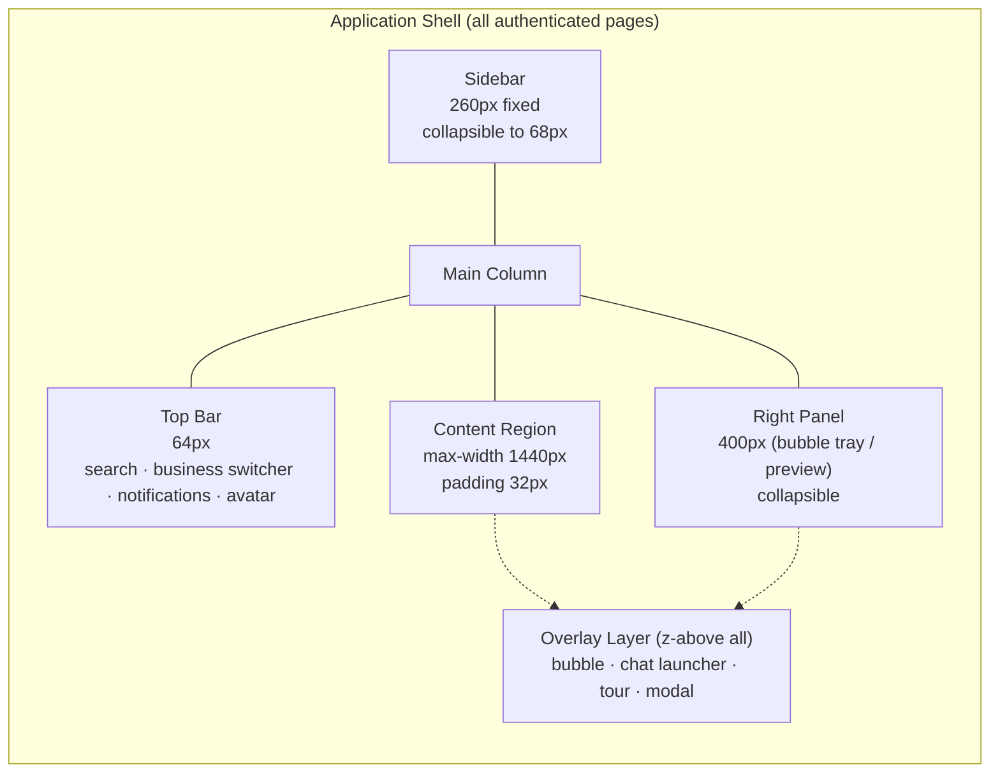
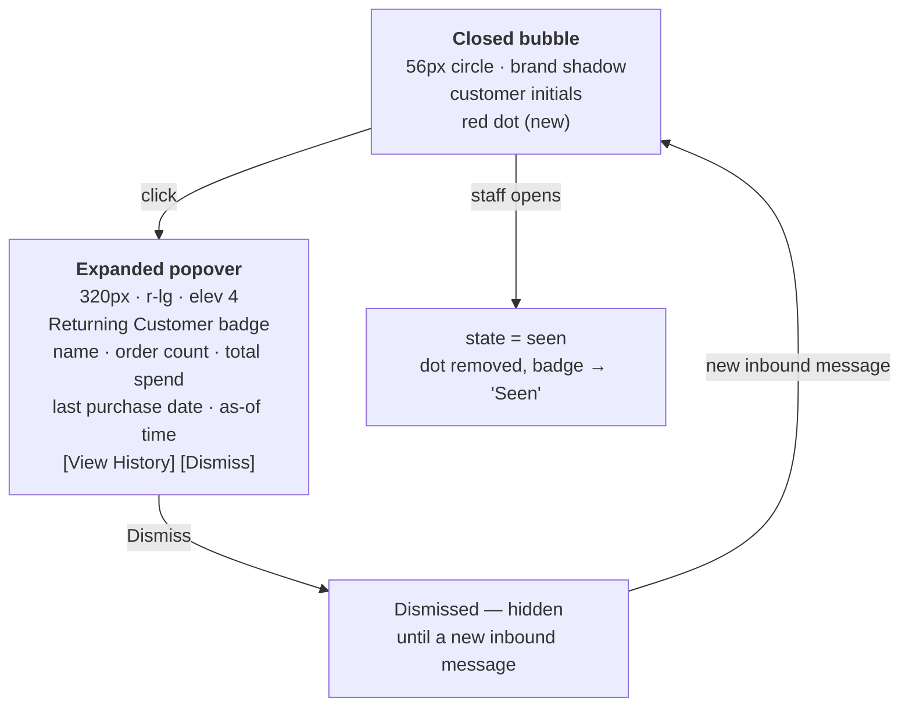
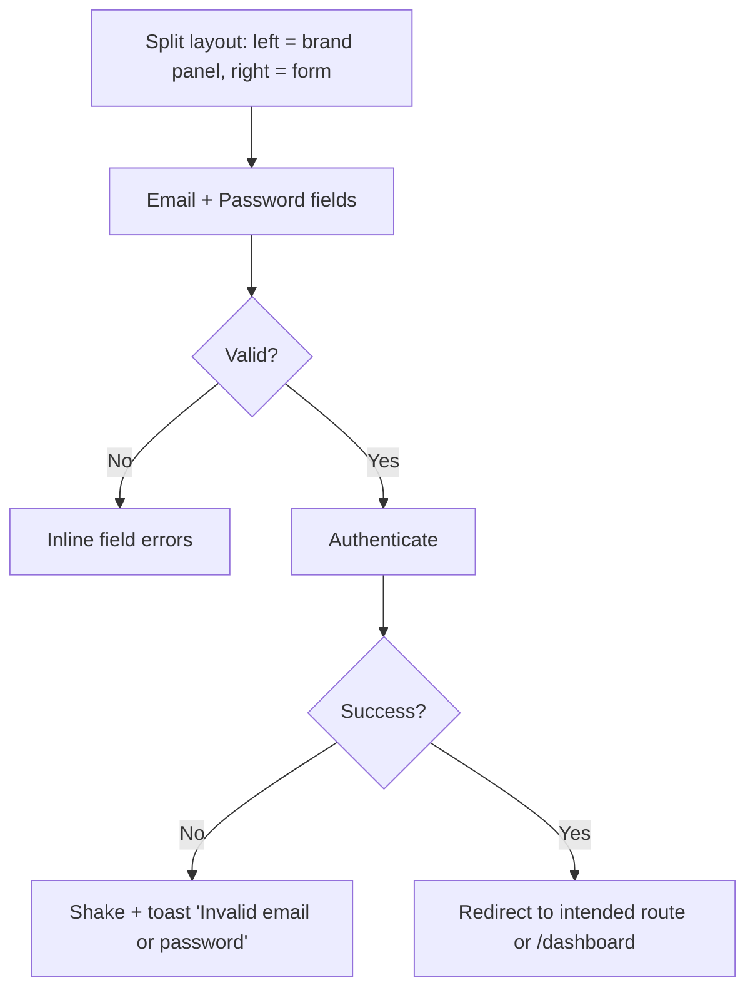
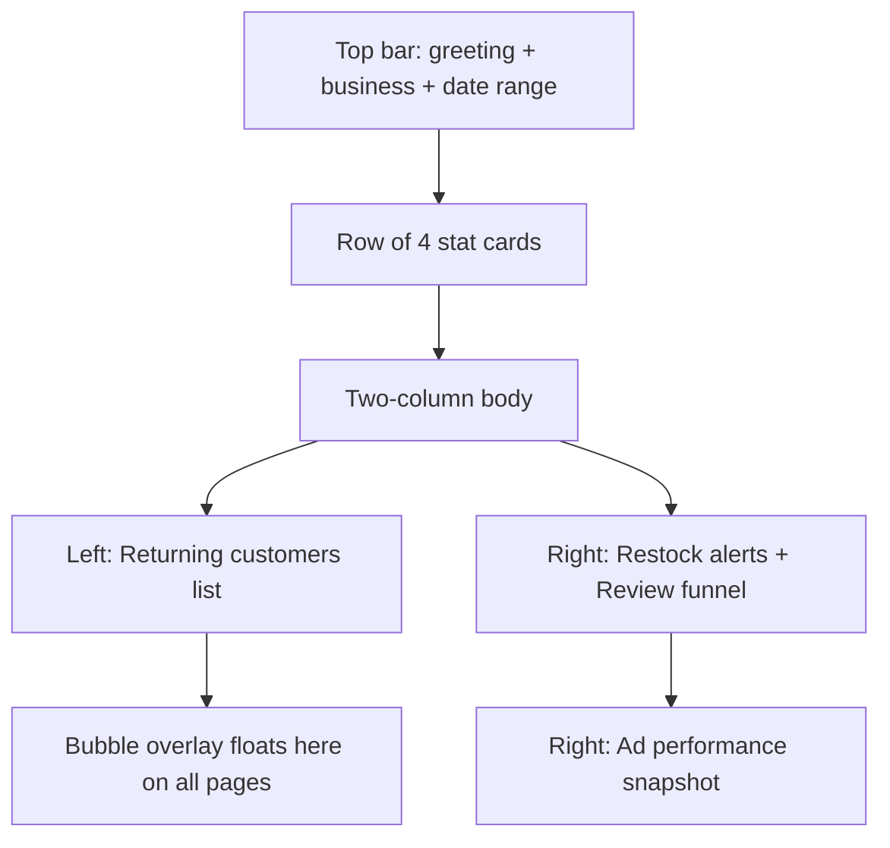
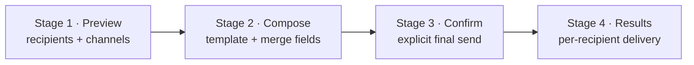
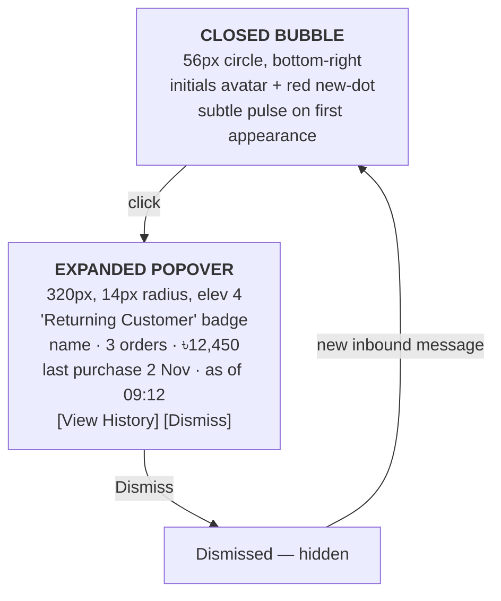

# UI/UX Design Document

**Project:** Xenovarients — Customer Genome · Creator Commerce · Agent Workspace
**Version:** 1.0 (derived from Master Project Documentation v3.0, 16 November 2026)
**Audience:** Product, Design, Front-end developers, QA, Stitch prompt operators

---

## 1. Purpose

This document specifies the complete user interface for Xenovarients: the design system, **every screen and page** the product contains, the states each screen must handle, and a **ready-to-paste Google Stitch prompt for every page**.

**How to use the Stitch prompts**

1. Each screen in §6–§11 has a `### Stitch Prompt` block.
2. Copy the block body verbatim into Stitch (`stitch.withgoogle.com`) → *Generate Screen from Text* → paste → generate.
3. Generate the **design system first** (once per project, §4), then pass its `assetId` to every subsequent generation so all screens stay visually consistent.
4. Set `deviceType`:
   - `DESKTOP` for all primary screens (the product is a desktop dashboard; staff work on it).
   - `MOBILE` for the responsive variants marked **M** in the screen tables.
5. Regenerate a screen with `edit_screens` when a screen's Stitch output needs correction, using the "Refinement" line at the end of each prompt.

> **Note on the existing `Desigen.md`** — that file documents the *Figma marketing site* design system (pastel color blocks, `figmaSans`, pill buttons). It is a **different product surface** and does not describe this dashboard. This document defines the SaaS design system for Xenovarients. If the marketing site style is wanted for a public landing page later, it can be reused as a separate theme — but the app screens below are built on the system defined here.

---

## 2. Product Context Driving the Design

| Product truth | Design consequence |
|---|---|
| Staff work in a dashboard shell all day | Persistent sidebar + top bar; dense, scannable lists over landing-page layouts |
| Bubbles appear on **every** page while a customer messages | Bubble must float above all content, survive route changes, be dismissible without losing context |
| Nothing is sent without explicit human confirmation | Every destructive/broadcast action ends in a dedicated preview → confirm → result screen |
| Unavailable data is a first-class value | A dedicated "Not available / Not visible" visual treatment, never a blank cell or a zero |
| Consent governs use, not sentiment | Consent state is a **prominent chip** on every review row, not a hidden column |
| Roles: Owner / Admin / Staff | Role-gated actions are visibly disabled with an explanatory tooltip, never silently hidden |
| FAQ answers cost zero, AI costs money | The chat shows the route (`FAQ` / `DATA` / `AI`) and token/cost per answer |
| Bangladesh market, Bangla + English | Bangla-first-ready type scale; no latin-only assumptions; local phone/number formatting |
| Trust-critical, customer-facing data | High information density, generous hit targets, explicit confirmation for anything irreversible |

---

## 3. Information Architecture

### 3.1 Route map

```mermaid
flowchart TB
    AUTH["/auth/login · /auth/signup<br/>(unauthenticated)"]
    APP["Application Shell<br/>Sidebar + Top Bar + Content + Bubble Layer"]

    AUTH --> APP

    APP --> DASH["/dashboard<br/>S-01 Main Dashboard"]
    APP --> M1["M1 · Customer Genome"]
    APP --> M2["M2 · Creator Commerce"]
    APP --> AW["M3 · Agent Workspace"]
    APP --> SYS["System"]

    M1 --> S02["/customer-genome/repeat-buyers<br/>S-02"]
    M1 --> S03["/customer-genome/customers/:id/history<br/>S-03"]
    M1 --> S04["/customer-genome/restore-product<br/>S-04"]
    M1 --> S05["/customer-genome/waiting-lists<br/>S-05"]
    M1 --> S06["/customer-genome/restock-events<br/>S-06"]
    M1 --> S07["/customer-genome/restock-events/:id/preview<br/>S-07"]
    M1 --> M01["MODAL S-19 Link Customer"]

    M2 --> S08["/creator-commerce/reviews<br/>S-08 Review Library"]
    M2 --> S09["/creator-commerce/reviews/:id<br/>S-09 Review Detail"]
    M2 --> S10["/creator-commerce/reviews/settings<br/>S-10 Review Settings"]
    M2 --> S11["/creator-commerce/reviews/cards<br/>S-11 Marketing Cards"]
    M2 --> S12["/creator-commerce/reviews/export<br/>S-12 Export"]
    M2 --> S13["/creator-commerce/ads/insights<br/>S-13 Ads Insights"]
    M2 --> S14["/creator-commerce/ads/performance<br/>S-14 My Ads Performance"]
    M2 --> S15["/creator-commerce/collaborations<br/>S-15 Collaboration Finder"]

    AW --> S16["/workspace/chat<br/>S-16 Chat Assistant"]
    AW --> S18["/workspace/faqs<br/>S-18 FAQ Management"]
    AW --> S19["/workspace/tour<br/>S-19 Tour Management"]

    SYS --> S17["/notifications<br/>S-17 Notifications Center"]
    SYS --> S20["/settings/account<br/>S-20 Account Settings"]
    APP -.-> BUB["OVERLAY S-16b Returning Bubble<br/>(all pages)"]
    APP -.-> TOUR["OVERLAY S-17b Website Tour"]
    APP -.-> CHAT["LAUNCHER Floating Chat"]

    style M1 fill:#e8f0fe,stroke:#4285f4
    style M2 fill:#fef7e0,stroke:#fbbc04
    style AW fill:#e6f4ea,stroke:#34a853
    style BUB fill:#fce8e6,stroke:#ea4335
```



**Two modals** (`M-01` Link Customer, `M-02` Link / Unlink Identity) open from S-03 and S-16b. They are listed in the screen inventory in §5 and have Stitch prompts in §10.

### 3.2 Sidebar structure

Per the spec's sidebar positions:

```
┌─────────────────────────────────────────────────────┐
│  ◆ Xenovarients          [business switcher ▾]      │
├─────────────────────────────────────────────────────┤
│  ▣ Dashboard                              S-01      │
│                                                      │
│  ▸ CUSTOMER GENOME                                  │
│    1  Repeat Buyers & History          S-02 / S-03  │
│    2  Returning Bubbles   (badge 🔴)   S-16b         │
│    4  Restore Product                   S-04..S-07   │
│                                                      │
│  ▸ CREATOR COMMERCE                                  │
│    1  Review                            S-08..S-12   │
│    2  Meta Ads Intelligence             S-13         │
│    3  My Ads Performance                S-14         │
│    4  Collaboration Finder              S-15         │
│    5  Influencer Suggestions  (opt.)    S-15b        │
│                                                      │
│  ▸ AGENT WORKSPACE                                   │
│    ●  Smart Chat Assistant             S-16         │
│    ●  Website Tour                     S-17b        │
│    ●  FAQ & Tour Management            S-18 / S-19   │
├─────────────────────────────────────────────────────┤
│  🔔 Notifications (badge)                S-17       │
│  ⚙  Settings                            S-20       │
└─────────────────────────────────────────────────────┘
```

**Sidebar rules**

| Rule | Behaviour |
|---|---|
| Bubbles are sidebar position **2** under Customer Genome | Clicking scrolls the bubble tray open in the right-hand panel; bubbles themselves float over the page (S-16b) |
| Restore Product is the **4th** item under Customer Genome | Numbered 4 as specified — positions 3 is reserved/collapsed under "Repeat Buyers & History" expansion |
| Module groups are collapsible | Group headers are collapsible; collapsed state persists per user |
| Unread badge on Returning Bubbles | Live count of bubbles in `new` state; updates over SSE |
| Influencer Suggestions is optional | Hidden entirely when the feature flag is off; shows a small "Optional" tag when on |
| Role gating | Owner-only items (ad connections, exports, batch approval) show a lock icon + tooltip for Admin/Staff |

### 3.3 Global layout



**Breakpoints**

| Name | Width | Layout |
|---|---|---|
| 4k | 1920px | Content max-width 1440px, gutters expand, right panel 460px |
| Desktop-XL | 1440px | Default |
| Desktop | 1280px | Right panel becomes an overlay drawer |
| Tablet | 960px | Sidebar collapses to icon rail (68px); tables drop the 3rd column |
| Mobile-L | 768px | Sidebar becomes a sheet; tables become stacked cards; bubble dock to bottom |
| Mobile | 560px | Single column; sticky bottom action bar; bubble dock full-width bottom sheet |

---

## 4. Design System

### 4.1 Color tokens

```
/* ── Brand ── */
--brand-900: #0B1220;   /* near-black navy — primary text & nav */
--brand-700: #16233D;
--brand-500: #2B4C8C;
--brand-100: #E8F0FE;   /* M1 tint — Customer Genome */

/* ── Module accents ── */
--m1-accent:   #2B6BE4;   /* Customer Genome  */
--m1-surface:  #EAF1FE;
--m2-accent:   #C6891B;   /* Creator Commerce  */
--m2-surface:  #FDF3E0;
--m3-accent:   #1F8A5B;   /* Agent Workspace  */
--m3-surface:  #E6F4EC;

/* ── Neutral ── */
--ink:        #0F1622;   /* primary text */
--ink-2:      #475467;   /* secondary text */
--ink-3:      #8A94A6;   /* tertiary / placeholder */
--surface:    #FFFFFF;
--surface-2:  #F6F8FB;   /* page background */
--surface-3:  #EEF2F7;   /* table header, inset panels */
--hairline:   #E3E8EF;
--hairline-2: #CFD6E0;

/* ── Semantic ── */
--success:    #17875B;  --success-bg: #E7F6EF;
--warning:    #B26B00;  --warning-bg: #FFF4E0;
--danger:     #C4342B;  --danger-bg:  #FDECEA;
--info:       #2563EB;  --info-bg:    #EAF1FE;
--neutral-bg: #EEF2F7;

/* ── Bubble / live ── */
--bubble-live:  #EA4335;  /* new-message dot */
--bubble-glow:  rgba(235,67,53,0.18);

/* ── Unavailable data treatment ── */
--unavailable:  #98A2B3;  /* "Not available" glyph + text */
--unavailable-bg: #F2F4F7;
```

**Color rules**

| Rule | Detail |
|---|---|
| Module accent tints the active nav item and the module's primary CTA only | Never decorative gradients |
| Green is **never** used for "online/active" alone | Status chips always carry a text label, not colour alone (accessibility) |
| Red is reserved for destructive actions and the live-bubble dot | Never a page background |
| Unavailable data is a **grey chip**, never a blank or a zero | This is the "no fabricated data" principle made visible |
| Danger buttons use a filled red only at the final confirm step | The preview screen uses an outlined variant to create a deliberate pause |

### 4.2 Typography

| Token | Size | Weight | Line height | Tracking | Use |
|---|---|---|---|---|---|
| `display-xl` | 32px | 700 | 1.15 | -0.6px | Dashboard hero metric, page titles |
| `display-lg` | 24px | 650 | 1.2 | -0.4px | Section headers |
| `headline` | 18px | 600 | 1.35 | -0.2px | Card titles, list section headers |
| `body-lg` | 16px | 500 | 1.5 | 0 | Table primary cell, emphasised body |
| `body` | 14px | 400 | 1.55 | 0 | Default body, table secondary cell |
| `body-sm` | 13px | 400 | 1.5 | 0 | Dense table, helper text |
| `label` | 12px | 600 | 1.4 | 0.2px | Form labels, table headers (uppercase) |
| `caption` | 11px | 500 | 1.4 | 0.3px | Timestamps, "as of", badges (uppercase) |
| `mono-num` | 14px | 600 | 1.4 | 0 | Currency and count columns (tabular figures) |

**Font stacks**

| Role | Stack |
|---|---|
| Sans | `Inter, "Noto Sans Bengali", system-ui, -apple-system, "Segoe UI", sans-serif` |
| Mono / numerals | `"JetBrains Mono", "SF Mono", ui-monospace, monospace` |

**Rules**

- `Noto Sans Bengali` is listed immediately after `Inter` so Bangla renders correctly without a separate font load decision.
- All numeric columns use `font-variant-numeric: tabular-nums` so figures align.
- Uppercase is reserved for `label` and `caption` only — never body copy.
- Minimum body size is 13px; dense tables never go below 12px.

### 4.3 Spacing & radius

| Token | Value | Use |
|---|---|---|
| `space-1` | 4px | Icon-to-label gap |
| `space-2` | 8px | Chip internals, tight stack |
| `space-3` | 12px | Table cell padding (vertical) |
| `space-4` | 16px | Card gap, form field gap |
| `space-5` | 24px | Card padding, list item gap |
| `space-6` | 32px | Section gap, content padding |
| `space-7` | 48px | Page-section rhythm |
| `space-8` | 64px | Hero spacing |

| Radius token | Value | Use |
|---|---|---|
| `r-sm` | 6px | Chips, small badges, icon buttons |
| `r-md` | 10px | Inputs, buttons, list rows, cards |
| `r-lg` | 14px | Panels, modals, right-drawer |
| `r-xl` | 20px | Hero panels, large feature cards |
| `r-full` | 999px | Avatars, pills, the bubble itself |

### 4.4 Elevation

| Level | Treatment | Use |
|---|---|---|
| 0 | No shadow, no border | Page background, flat rows |
| 1 | `1px solid var(--hairline)` | Cards, tables, inputs |
| 2 | `0 1px 2px rgba(15,22,34,.04), 0 4px 12px rgba(15,22,34,.06)` | Dropdowns, hover cards |
| 3 | `0 8px 24px rgba(15,22,34,.10), 0 2px 6px rgba(15,22,34,.06)` | Modals, drawers |
| 4 | `0 16px 48px rgba(15,22,34,.16)` | Bubble popover, chat launcher panel |
| Scrim | `rgba(15,22,34,.55)` | Behind modals, tour spotlight |

### 4.5 Core components

| Component | Spec |
|---|---|
| `button-primary` | Height 40px (44px touch), padding 0 18px, `r-md`, brand-900 fill / white text, 500 weight. Hover: brand-700. Focus: 2px `--info` ring at 2px offset. Disabled: 40% opacity + `cursor:not-allowed` + tooltip. |
| `button-secondary` | Same metrics, transparent fill, `1px solid var(--hairline-2)`, ink text. Hover: `--surface-2` fill. |
| `button-danger` | Filled `--danger`. **Only** on the final step of a multi-step action. |
| `button-ghost` | Text-only, ink-2 → ink on hover, `r-md`, min 32px. Used for table row actions. |
| `button-icon` | 36px square, `r-md`, hairline border, `r-full` variant for the bubble/close icons. |
| `input` | Height 40px, `r-md`, `1px solid var(--hairline-2)`, padding 0 12px. Focus: `1px solid --info` + 3px `--info` @12% ring. Error: `1px solid --danger` + error text below in 12px. |
| `select` | Same as input + chevron right, 40px. |
| `textarea` | Min 96px, padding 10px 12px, resize vertical. |
| `switch` | 40×22px track, `r-full`, on = module accent, off = `--hairline-2`. Always paired with a visible label. |
| `checkbox` / `radio` | 18px, `r-sm` (checkbox) / `r-full` (radio), accent = module colour. |
| `chip` | Height 24px, `r-full`, 12px 10px, `r-sm` for square-ish tags. Variants: neutral, success, warning, danger, info, unavailable (grey). |
| `status-chip` | Same as chip + a 6px dot. **Colour is never the only signal** — the label always states the state. |
| `table` | Header row: `--surface-3`, `label` typography, uppercase, 12px. Rows: 1px `--hairline` divider, 56px min height, hover `--surface-2`. Sticky header on scroll. Numeric columns right-aligned + tabular. |
| `data-table-empty` | Full-width block: illustration-free icon in `--ink-3`, title, one-line explanation, optional primary CTA. Never a blank table. |
| `unavailable-chip` | Grey pill reading `Not available` / `Not visible` / `N/A, tracking not available`. With a `?` info icon whose tooltip states the reason. **This component is mandatory for every unknown value.** |
| `stat-card` | `--surface`, `r-lg`, 1px hairline, padding 20px. Label (uppercase 12px), value (`display-lg`, tabular), delta chip, "as of" caption. |
| `card` | `--surface`, `r-lg`, hairline border, padding 20–24px. Header = title + optional actions + optional description. |
| `timeline` | Vertical 1px rule, 12px dot per event, content card to the right. Used for customer history and review replies. |
| `filter-bar` | Sticky row under the page header: search input, multi-select filters, date range, view toggle, result count, "Clear all". |
| `pagination` | Cursor-based; shows "Showing 1–50 of 312" + Prev/Next. No page-number grid on large tables. |
| `alert` | Inline banner, left 3px colour bar. Variants: info, success, warning, danger. Used for stock warnings, consent blocks, stale-data notices. |
| `modal` | Centre, max-width per variant, `r-xl`, elevation 3, scrim behind. Esc closes; focus trapped; scroll locked. |
| `drawer` | Right edge, width 480px (400 on desktop-XL), elevation 3, slides in. Used for the bubble tray and batch preview side-by-side. |
| `popover` | Anchored to a trigger, `r-md`, elevation 2, 320px max. Used for the bubble card. |
| `toast` | Bottom-right (top-centre on mobile), 4s auto-dismiss, variants matching semantic colours, with an undo action where reversible. |
| `skeleton` | Shimmer blocks matching the final layout's geometry. Used instead of spinners for table and card loads. |
| `tooltip` | Delay 400ms, max 240px, `r-sm`, elevation 3, 12px text. Used for role-lock explanations and "as of" details. |
| `avatar` | 36px (list) / 44px (card) / 28px (table), `r-full`, initials, deterministic colour from customer ID hash. |

### 4.6 Bubble component (signature UI element)

The Returning Customer Bubble is the most important custom component in the product.



| State | Visual | Behaviour |
|---|---|---|
| **New** | 56px circle, red dot top-right, subtle pulse animation (once, then static) | Click expands the popover |
| **Seen** | Same circle, no dot, badge reads `Seen` | Click expands; no auto-collapse |
| **Dismissed** | Hidden | A new inbound message re-opens it (state → New) |
| **No confident match** | Circle shows `?` avatar, no red dot, grey border | Popover says "Identity not linked yet" + **[Link customer]** button. **Never shows any customer's figures.** |
| **Mobile** | Docked to the bottom-right as a 56px circle; tap opens a bottom sheet | Same content and actions |

**Bubble card content (CG-07)**

| Element | Source | Missing-value treatment |
|---|---|---|
| Initials avatar | `customers.name` | `?` |
| `Returning Customer` badge | `is_returning_customer = true` | **Badge omitted entirely** when false |
| Name | `customers.name` | `Unnamed customer` chip |
| Previous orders | Live qualifying-order count | `0` |
| Total purchase amount | Live sum, net of refunds | `—` |
| Last purchase date | `last_purchase_at` | `No purchase recorded` |
| "as of" time | `data_as_of` | Always shown |
| `[View History]` | `history_url` | Disabled when no customer |
| `[Dismiss]` | — | Always available |

### 4.7 Accessibility requirements

| Requirement | Rule |
|---|---|
| Contrast | All text ≥ 4.5:1; large text and icons ≥ 3:1. Status colour is never the sole signal. |
| Keyboard | Every interactive element reachable by Tab. Bubble opens with Enter/Space, closes with Esc, focus returns to the trigger. |
| Focus visible | 2px `--info` ring on every focusable element, never removed. |
| Modal focus | Focus is trapped inside; returns to the invoking element on close. |
| Tour | Esc always dismisses the tour; the overlay never traps a user in a broken step (AW-11). |
| Chat | The launcher is a labelled button; the transcript is an `aria-live="polite"` region. |
| Table | Header cells use `scope`; row actions have accessible names including the row context ("Link Ayesha"). |
| Motion | `prefers-reduced-motion` disables the bubble pulse and all transitions. |
| Screen reader | Unavailable values announce as "Not available" — never as empty. |

---

## 5. Authoritative Screen Inventory

**26 screens · 12 routes · 3 overlays · 2 modals**

| ID | Screen | Route | Type | Requirements | Roles |
|---|---|---|---|---|---|
| **S-01** | Main Dashboard | `/dashboard` | Page | CG-01, RP-04, RV-11, MP-03 | All |
| **S-02** | Repeat Buyers | `/customer-genome/repeat-buyers` | Page | CG-01 | All |
| **S-03** | Customer History | `/customer-genome/customers/:id/history` | Page | CG-02, CG-03 | All |
| **S-04** | Restore Product | `/customer-genome/restore-product` | Page | RP-01, RP-02 | All |
| **S-05** | Waiting Lists | `/customer-genome/waiting-lists` | Page | RP-02, RP-03 | All |
| **S-06** | Restock Events | `/customer-genome/restock-events` | Page | RP-04 | All |
| **S-07** | Batch Preview & Confirm | `/customer-genome/restock-events/:id/preview` | Page | RP-05…RP-10 | **Owner** |
| **S-08** | Review Library | `/creator-commerce/reviews` | Page | RV-01, RV-11 | All |
| **S-09** | Review Detail | `/creator-commerce/reviews/:id` | Page | RV-07, RV-08, RV-09 | All |
| **S-10** | Review Settings | `/creator-commerce/reviews/settings` | Page | RV-03, RV-05 | Owner, Admin |
| **S-11** | Marketing Cards | `/creator-commerce/reviews/cards` | Page | RV-10 | Owner, Admin |
| **S-12** | Review Export | `/creator-commerce/reviews/export` | Page | RV-12 | Owner, Admin |
| **S-13** | Ads Insights | `/creator-commerce/ads/insights` | Page | MI-01…MI-05 | All |
| **S-14** | My Ads Performance | `/creator-commerce/ads/performance` | Page | MP-01…MP-04 | **Owner** |
| **S-15** | Collaboration Finder | `/creator-commerce/collaborations` | Page | CF-01…CF-03, IF-01 | All |
| **S-15b** | Influencer Suggestions | `/creator-commerce/collaborations/influencers` | Page | IF-01, IF-02 | All (optional) |
| **S-16** | Chat Assistant | `/workspace/chat` | Page | AW-01…AW-09 | All |
| **S-16b** | Returning Bubble Overlay | *(global overlay)* | Overlay | CG-05…CG-11 | All |
| **S-17** | Notifications Center | `/notifications` | Page | RP-04, RV-07, MP-03 | All |
| **S-17b** | Website Tour Overlay | *(global overlay)* | Overlay | AW-10, AW-11 | All |
| **S-18** | FAQ Management | `/workspace/faqs` | Page | AW-03, AW-04 | Owner, Admin |
| **S-19** | Tour Management | `/workspace/tour` | Page | AW-10, AW-11 | Owner, Admin |
| **S-20** | Account & Settings | `/settings/account` | Page | §2.2 roles | All |
| **S-21** | Sign In | `/auth/login` | Page | — | — |
| **S-22** | Sign Up | `/auth/signup` | Page | — | — |
| **M-01** | Link Customer Modal | *(modal)* | Modal | CG-03, CG-10 | All |
| **M-02** | Link / Unlink Identity Modal | *(modal)* | Modal | CG-03 | All |

---

# 6. Authentication Screens

## S-21 · Sign In

**Route:** `/auth/login` · **Roles:** Public



**Elements:** brand logo, product one-liner, email field, password field with reveal toggle, "Remember me", `[Sign in]` primary, "Forgot password" link, "Create an account" link, right-rail trust points (tenant isolation, data minimisation), language switcher (Bangla/English — OD-13).

**States:** default · field error · submitting (button spinner) · invalid credentials · account locked · source unavailable.

### Stitch Prompt — S-21 Sign In

```
Design a desktop sign-in page for a B2B SaaS dashboard product called "Xenovarients".

Layout: a centered 440px wide sign-in form on a white card, floating on a soft light-grey background
(#F6F8FB). The card has white fill, 1px border #E3E8EF, 14px corner radius, no heavy shadow.

Top of card: a 28px square dark navy logo mark (#0B1220) with white "X" glyph, then the wordmark
"Xenovarients" in 20px semibold #0F1622. Below it a 14px grey line of body copy: "Know your
customers, market with evidence, and get unstuck quickly."

Form fields stacked with 16px gaps, each 40px tall, 10px radius, 1px border #CFD6E0, 12px horizontal
padding, label above in 12px uppercase semibold #475467:
- "EMAIL" — placeholder "name@business.com"
- "PASSWORD" — placeholder "••••••••", with a small eye icon toggle on the right

Below fields: a row with a checked blue checkbox plus "Remember me" on the left, and a right-aligned
blue text link "Forgot password?".

Then a full-width primary button, 40px tall, 10px radius, dark navy #0B1220 fill with white text
"Sign in".

Below that, centered 14px copy: "New to Xenovarients?" followed by a blue link "Create an account".

Below the card, a small centered trust strip in 12px grey text separated by a middle dot:
"Tenant-isolated data · Consent-first messaging · No data sold".

At the very bottom right of the page, a small text link "English / বাংলা" in 13px.

Style: clean, calm, professional B2B SaaS aesthetic. Inter font. No illustrations, no gradients,
no emoji. Generous whitespace. Everything left-aligned inside the card.

Responsive: on mobile the card goes full-width with 20px side margins and fills the viewport height.
```

---

## S-22 · Sign Up

**Route:** `/auth/signup` · **Roles:** Public

**Elements:** business name, business timezone (default `Asia/Dhaka`), owner email, password + strength meter, terms checkbox, `[Create account]`, "Already have an account? Sign in". A 3-step indicator (Business → Owner account → Done).

**States:** default · validation error · password too weak (live meter: weak / fair / strong) · email already registered · business name taken.

### Stitch Prompt — S-22 Sign Up

```
Design a desktop sign-up page for a B2B SaaS product called "Xenovarients".

Layout: a 480px wide white card centered on a #F6F8FB background, 1px border #E3E8EF, 14px radius.

At the very top inside the card, a horizontal 3-step progress indicator with small circles connected
by thin lines: step 1 "Business" is a filled dark navy circle, steps 2 "Owner account" and 3 "Done" are
outlined grey circles. Small 12px labels underneath each.

Below: a dark navy 28px logo mark with "X" glyph, "Xenovarients" 20px semibold, and 14px grey
subtitle "Create your business workspace".

Form fields with 16px gaps, 40px tall, 10px radius, 1px #CFD6E0 border, 12px uppercase semibold labels:
- "BUSINESS NAME" — placeholder "e.g. Rokomari BD"
- "BUSINESS TIME ZONE" — a select showing "Asia/Dhaka (UTC+6)" with a chevron on the right
- "YOUR EMAIL" — placeholder "owner@business.com"
- "PASSWORD" — placeholder "••••••••", with a right-aligned small text meter below reading
  "Strong" in green

Below the password field, a small 12px grey helper line: "Use at least 12 characters with a number and
a symbol."

Then a row: an unchecked square checkbox in dark navy and 13px text "I agree to the Terms of Service and
Privacy Policy".

Then a full-width dark navy #0B1220 button, 40px tall, 10px radius, white text "Create business
workspace".

Below, centered 14px: "Already have an account? Sign in" with "Sign in" as a blue link.

Style: clean professional B2B SaaS, Inter font, no illustrations or gradients, generous whitespace.
```

---

# 7. Module 1 — Customer Genome

## S-01 · Main Dashboard

**Route:** `/dashboard` · **Requirements:** CG-01, RP-04, RV-11, MP-03



**Elements**

| Region | Content |
|---|---|
| Header | "Good morning, Ayesha" · business name · last-sync chip with a tooltip |
| Stat row | Returning customers today · Repeat buyers · Active waiting-list entries · Reviews awaiting consent · AI cost this month |
| Left column | "Returning customers" mini-list — avatar, name, channel, order count, total, `View history` |
| Right column | "Restock alerts" (product, variant, stock vs demand, `Preview batch`) · "Review funnel" (due → sent → replied → consented) · "Ad performance" (spend, ROAS, `N/A` chip if untracked, last-synced) |
| Global | Bubble overlay (S-16b), chat launcher, notification bell |

**States:** first-run (empty with onboarding tiles + `Start the tour` CTA) · partial data (some modules unconfigured — show a setup card, not an error) · source unavailable (amber alert with last-updated time) · all good.

### Stitch Prompt — S-01 Main Dashboard

```
Design a desktop dashboard for a B2B SaaS product called "Xenovarients" — a customer intelligence
and marketing tool for online sellers.

Overall shell: a fixed 260px left sidebar in white with a 1px right border #E3E8EF, a 64px top bar,
and a light grey page background #F6F8FB with white content cards.

Sidebar: dark navy #0B1220 logo square with "X" and wordmark "Xenovarients" at top, then a business
switcher row showing "Rokomari BD" with a chevron. Nav items in 14px #475467 with small outline icons:
"▣ Dashboard" (active, with a 3px dark navy left bar and #0F1622 bold text), then grouped section
headers in 11px uppercase grey: "CUSTOMER GENOME" with items "Repeat Buyers & History" and
"Returning Bubbles" (with a small red dot badge showing 7) and "Restore Product"; "CREATOR
COMMERCE" with "Review", "Meta Ads Intelligence", "My Ads Performance", "Collaboration Finder";
"AGENT WORKSPACE" with "Smart Chat Assistant", "Website Tour", "FAQ & Tour Management". At the bottom,
a divider, then "Notifications" with a badge and "Settings".

Top bar: left shows breadcrumb "Dashboard"; right shows a search field, a "Connect Meta ads" outlined
button, a bell icon with a red badge, and a 32px circular avatar with initials "AR".

Content area, max-width 1440, 32px padding:

1. Page header row: a 28px semibold headline "Good morning, Ayesha", 14px grey subtext "Here's what
   happened across your business", and on the right a small grey chip "Last synced 4 minutes ago" with
   a refresh icon.

2. A row of 4 stat cards (white, 14px radius, 1px border, 20px padding, equal width with 16px gaps):
   - "RETURNING CUSTOMERS TODAY" / big number "24" / small green chip "↑ 12%"
   - "REPEAT BUYERS" / "186" / small grey chip "of 412 customers"
   - "WAITING LIST ENTRIES" / "37" / small amber chip "5 need restock"
   - "REVIEWS AWAITING CONSENT" / "9" / small grey chip "This week"
   Each card has a 12px uppercase grey label, a 28px semibold tabular number, and a 12px chip below.

3. Two-column layout below, 2fr 1fr with 24px gap:
   LEFT (white card): header "Returning customers" with a "View all" blue text link on the right. Below
   it a table with columns: an unnamed avatar circle column, NAME (semibold 14px), CHANNEL (grey chip),
   ORDERS (right-aligned tabular), TOTAL SPENT (right-aligned tabular with currency), LAST ACTIVE
   (grey), and a "View history" ghost button. Five rows of sample data.
   RIGHT column has three stacked white cards:
   - "Restock alerts" — a small warning-colored dot, "Classic Cotton T-Shirt — M" product name, "Stock
     12 · 34 waiting", and a small outlined button "Preview batch".
   - "Review funnel" — a horizontal 4-segment bar (Due 14, Sent 11, Replied 6, Consented 4) with a
     legend below.
   - "Ad performance" — "Spend ৳12,400" and "ROAS" followed by a grey pill reading "N/A, tracking not
     available", plus a tiny grey caption "Synced 2 hours ago".

Style: clean dense professional B2B SaaS dashboard, Inter font, 13-14px body, hairline borders, no
gradients, no illustrations, minimal shadows (cards use borders, not drop shadows).
```

---

## S-02 · Repeat Buyers

**Route:** `/customer-genome/repeat-buyers` · **Requirements:** CG-01

**Elements:** filter bar (search, order-count range, date range, sort, export for Owner/Admin) · stat strip (total repeat buyers, new this week, average orders, average spend) · table (avatar, name, contact, order count, last purchase, new-order indicator, `View history`, row overflow menu with `Add to waiting list` / `Link identity`) · pagination.

**Empty states:** "No repeat buyers yet — customers with two or more qualifying orders appear here." · "Customer data is still loading — first sync in progress." · "Customer data is temporarily unavailable. Last updated {time}."

### Stitch Prompt — S-02 Repeat Buyers

```
Design a desktop "Repeat Buyers" list page for a B2B SaaS customer intelligence product.

Shell: 260px white left sidebar with 1px right border, 64px top bar, page background #F6F8FB.
Sidebar shows a dark navy logo square "X" with "Xenovarients", a business switcher "Rokomari BD", and
nav items with "Repeat Buyers & History" highlighted as active (dark navy 3px left bar, bold #0F1622
text). The rest of the nav groups mirror: Customer Genome (Returning Bubbles with red badge, Restore
Product), Creator Commerce (Review, Meta Ads Intelligence, My Ads Performance, Collaboration Finder),
Agent Workspace (Smart Chat Assistant, Website Tour, FAQ & Tour Management), then Notifications and
Settings at the bottom.

Content area, 32px padding:

1. Page header: 28px semibold headline "Repeat Buyers", 14px grey subtext "Customers with two or more
   qualifying orders", and on the right two buttons: an outlined "Export" and a solid dark navy
   "Add customer".

2. A row of 4 compact stat chips on one white card, separated by vertical hairlines: "TOTAL REPEAT
   BUYERS 186", "NEW THIS WEEK 12", "AVG ORDERS 3.4", "AVG SPEND ৳8,240".

3. A sticky filter bar, white card, 14px radius: a 260px search input with magnifier icon and
   placeholder "Search name, phone or email"; a select "Orders: 2+"; a select "Last purchase: Any time";
   a select "Sort: Most orders"; and on the right grey text "186 customers" with a "Clear all" link.

4. A large white table card, 14px radius, with a header row in light grey #EEF2F7 with 12px uppercase
   grey labels: CUSTOMER, CONTACT, ORDERS, TOTAL SPENT, LAST PURCHASE, and a right-aligned ACTIONS
   column. Rows 64px tall separated by hairlines. Each row: a 36px circular avatar with initials,
   customer name in semibold 14px with a small green "New" chip for some rows, contact in 13px grey
   monospace-ish, order count right-aligned in tabular numerals, total spent right-aligned with ৳
   prefix, last purchase in grey 13px, and two small outlined buttons "View history" and a
   three-dot icon button.

5. Bottom of the card: left "Showing 1–50 of 186", right small pagination buttons.

Style: clean, dense, professional B2B SaaS, Inter font, hairline borders, no shadows on cards, no
illustrations, no gradients.
```

---

## S-03 · Customer History

**Route:** `/customer-genome/customers/:id/history` · **Requirements:** CG-02, CG-03

**Elements:** customer header card (avatar, name, contact, total orders, total spend, last purchase, `Link identity` / `Add to waiting list` actions, identity-links panel) · filters (date range, product, order status) · chronological order timeline (date, order ID, product list, quantity, total, status chip, per-order `unresolved` markers) · summary side column (spend over time mini-chart, most-bought products).

**States:** no orders · source unavailable · order with missing product data shown as `Unresolved` · identity conflict banner.

### Stitch Prompt — S-03 Customer History

```
Design a desktop "Customer History" profile page for a B2B SaaS customer intelligence product.

Shell: 260px white sidebar with 1px right border, 64px top bar, #F6F8FB page background. Sidebar
has the dark navy "X" logo and "Xenovarients", business switcher "Rokomari BD", and nav with "Repeat
Buyers & History" active (dark navy left bar, bold text). Other groups: Customer Genome, Creator
Commerce, Agent Workspace, plus Notifications and Settings.

Content, 32px padding:

1. A white header card, 14px radius, 24px padding. Left: a 56px circular avatar with initials "AR" and
   the name "Ayesha Rahman" in 22px semibold, below it contact details in 14px grey "•••• •••• 8811" and
   "ayesha@email.com". To the right, three inline stat blocks separated by vertical hairlines:
   "ORDERS 3", "TOTAL SPENT ৳12,450", "LAST PURCHASE 2 Nov 2026". At the far right two buttons: an
   outlined "Link identity" with a link icon, and a solid dark navy "Add to waiting list".

2. Below, a filter row: date range button "Last 12 months", select "Product: All", select "Status:
   All", and grey text "3 orders".

3. Main content in two columns, 2fr 1fr, 24px gap:
   LEFT white card titled "Order timeline" with a vertical timeline: a 1px grey vertical rule with
   small dots, and each entry a white sub-card with 16px padding showing a date "2 Nov 2026" in bold
   14px with an order id "#ORD-10432" in 12px grey chip beside it, then product rows with a small
   40px square product thumbnail placeholder, product name, "× 2" quantity, right-aligned price, and
   a status chip "Completed" in green. The second entry shows one line with the text "Product details
   unresolved" in a grey pill. The third entry shows a cancelled order with a red "Cancelled" chip and
   the amount struck through.
   RIGHT column: a white card "Spend over time" showing a simple grey bar chart with 6 bars and month
   labels; below it a white card "Most bought" listing three products with small thumbnails, names and
   counts.

Style: clean dense professional B2B SaaS, Inter font, hairline borders, light shadows only on floating
elements, no gradients, no illustrations.
```

---

## S-04 · Restore Product

**Route:** `/customer-genome/restore-product` · **Requirements:** RP-01, RP-02

**Elements:** page header with `Add to waiting list` and `Import CSV` buttons · tab strip (Restock Events | Waiting Lists) · explainer banner ("Nothing is sent automatically — you approve every batch") · recent restock events table.

### Stitch Prompt — S-04 Restore Product

```
Design a desktop "Restore Product" page for a B2B SaaS product that notifies customers when an
out-of-stock item returns.

Shell: 260px white sidebar with 1px right border, 64px top bar, #F6F8FB page background. Sidebar:
nav with the Customer Genome group expanded showing "Repeat Buyers & History", "Returning Bubbles"
(red badge), and "Restore Product" marked ACTIVE with a dark navy 3px left bar and bold #0F1622 text.
Creator Commerce and Agent Workspace groups below. Notifications and Settings at the bottom.

Content, 32px padding:

1. Page header row: 28px semibold headline "Restore Product", 14px grey subtext "Win back customers
   who asked for an out-of-stock item". On the right: an outlined button "Import CSV" with an upload
   icon, and a solid dark navy button "+ Add to waiting list".

2. Directly below, a full-width info banner with a soft blue background #EAF1FE, a 3px blue left border,
   a blue info icon, and 14px text: "Nothing is sent automatically. A restock event only notifies you —
   you review and approve every batch before a single message goes out."

3. A tab strip: "Restock events" (active, dark navy underline) and "Waiting lists".

4. A white card containing a table with a light grey header row, 12px uppercase grey labels: PRODUCT,
   VARIANT, RESTOCKED, STOCK, WAITING, STATUS, and a right ACTIONS column. Four rows. Row 1: "Classic
   Cotton T-Shirt", variant chip "Medium", "12 Nov 2026", stock "12", waiting "34" in amber, a green
   chip "Not notified", and an outlined button "Preview batch". Row 2 has stock "3" and waiting "28"
   with an amber chip "Stock below demand". Row 3 stock "45" waiting "6" with a grey chip "Notified" and
   a ghost button "View history".

5. Bottom of card: "Showing 4 of 12 events" with pagination.

Style: clean dense professional B2B SaaS, Inter font, hairline borders, colored status chips, no
illustrations, no gradients, minimal shadow.
```

---

## S-05 · Waiting Lists

**Route:** `/customer-genome/waiting-lists` · **Requirements:** RP-02, RP-03

**Elements:** product/variant grouping accordion · per-entry row (customer, requested date, quantity, contact channel, source) · `Add entry` inline form · `Import CSV` · variant separation is explicit (a variant switcher that never mixes variants in one view).

### Stitch Prompt — S-05 Waiting Lists

```
Design a desktop "Waiting Lists" page for a B2B SaaS product that tracks customers waiting for
out-of-stock items.

Shell: 260px white sidebar with 1px right border, 64px top bar, #F6F8FB page background. Sidebar nav
with Customer Genome expanded and "Restore Product" active (dark navy left bar, bold text); other
groups: Creator Commerce, Agent Workspace; bottom Notifications and Settings.

Content, 32px padding:

1. Header row: 28px semibold "Waiting Lists", 14px grey subtext "Grouped by product and variant".
   Right side: outlined "Import CSV" and solid dark navy "+ Add entry".

2. A variant picker row: two large selectable product cards side by side. First card (selected, 2px
   dark navy border, white fill) shows product name "Classic Cotton T-Shirt" in 15px semibold and a row
   of variant pills where "Medium" is a filled dark navy pill and "Large" and "Small" are grey outline
   pills, plus "24 waiting". Second card (unselected, 1px grey border) shows "Slim Fit Denim" and "9
   waiting". Add a small helper line in 12px grey below: "Variants are never mixed."

3. A white table card for the selected variant, header row light grey with 12px uppercase labels:
   CUSTOMER, REQUESTED, QUANTITY, CONTACT CHANNEL, SOURCE, and ACTIONS. Five rows: avatar with
   initials plus name in semibold and email in grey below; a date; a right-aligned quantity; a grey chip
   "Email" / "WhatsApp"; a small outlined tag "Product page" / "Bubble" / "CSV import"; and a ghost
   "Remove" text button.

4. Bottom-right of the card header: a small panel "Add entry" as a right-side drawer is described as
   open, overlapping the card edge with 14px radius and a soft shadow, containing 3 stacked inputs
   ("CUSTOMER", "PRODUCT & VARIANT", "QUANTITY (optional)") and a dark navy "Add to waiting list"
   button at the bottom plus a grey "Cancel" link.

Style: clean dense professional B2B SaaS, Inter font, hairline borders, no gradients, no illustrations.
```

---

## S-06 · Restock Events

**Route:** `/customer-genome/restock-events` · **Requirements:** RP-04

**Elements:** restock event table (product, variant, detected at, stock after, waiting demand, notified state, `Preview batch` action) · detail drawer showing the event timeline (detected → owner notified → previewed → batch approved → delivery results).

### Stitch Prompt — S-06 Restock Events

```
Design a desktop "Restock Events" page for a B2B SaaS product that detects when an out-of-stock
product becomes available again.

Shell: 260px white sidebar with 1px right border, 64px top bar, #F6F8FB page background, nav with
Customer Genome expanded and "Restore Product" active (dark navy left bar). Other groups below; bottom
Notifications and Settings.

Content, 32px padding:

1. Header: 28px semibold "Restock Events", 14px grey subtext "Detected automatically from your
   inventory source. Nothing is sent until you approve it." Right side: a select "All products" and an
   outlined "Refresh" button with a refresh icon.

2. A white table card, light grey header row with 12px uppercase labels: PRODUCT, VARIANT, DETECTED,
   STOCK AFTER, WAITING DEMAND, NOTIFICATION, ACTIONS. Four sample rows. Example row: "Classic Cotton
   T-Shirt" semibold, variant chip "Medium", "12 Nov 2026, 09:41" grey, stock "12" tabular, waiting
   demand "34" in amber with a small warning triangle, notification state a green chip "Owner notified",
   and a dark navy small button "Preview batch" on the second row.

3. On the right side, a 400px detail drawer is open, white with a left hairline and soft shadow, titled
   "Restock event" with a small close X. Inside a vertical timeline with 4 completed steps (a filled
   navy dot with a check): "Detected from inventory" with timestamp; "Owner notified"; "Batch previewed";
   "Batch approved by Ayesha". Below the timeline, a summary box with two rows: "Waiting list 34" and
   "Stock after 12", and below that an amber warning banner: "Stock (12) is lower than waiting demand
   (34). The message will not promise a reservation."

4. Below the timeline card, a small grey caption "Last inventory sync 12 Nov 2026, 09:40".

Style: clean dense professional B2B SaaS, Inter font, hairline borders, colored chips, soft shadow only
on the drawer, no gradients, no illustrations.
```

---

## S-07 · Batch Preview & Confirm — **Owner only**

**Route:** `/customer-genome/restock-events/:id/preview` · **Requirements:** RP-05…RP-10

> This is the most safety-critical screen in the product. Three stages, one page, no auto-send.



| Stage | Elements |
|---|---|
| **1 Preview** | Recipient table (customer, channel, message preview, eligibility status, skip reason), summary counts (eligible / skipped / total), stock warning banner, channel fallback note |
| **2 Compose** | Template editor with merge-field chips (`{customer_name}`, `{request_date}`, `{product_name}`, `{business_name}`), live preview against a selected recipient, char counter, "no reservation promise" validation warning |
| **3 Confirm** | Single irreversible-looking confirmation panel — "Send 34 messages", a checkbox `I confirm these recipients and messages`, and the `Send` button disabled until checked |
| **4 Results** | Per-recipient delivery table: pending / sent / delivered / failed / skipped + reason, retry counts, `Download log` |

**States:** no waiting-list entries for this variant · all recipients ineligible · stock below demand · partial send failure · idempotent replay (shows "Already sent — no duplicate messages created").

### Stitch Prompt — S-07 Batch Preview and Confirm

```
Design a desktop "Restock notification batch" page for a B2B SaaS product — the final approval screen
before messages are sent to customers.

Shell: 260px white sidebar with 1px right border, 64px top bar, #F6F8FB page background, nav with
Customer Genome expanded and "Restore Product" active (dark navy left bar). Other groups below.

Content, 32px padding:

1. A 4-step horizontal stepper across the top with small numbered circles connected by lines:
"1 Preview" (filled dark navy, active), "2 Compose", "3 Confirm", "4 Results" (outlined grey).

2. Header: 28px semibold "Notify waiting customers", 14px grey subtext "Classic Cotton T-Shirt —
   Medium · Restocked 12 Nov 2026".

3. A warning banner with amber background #FFF4E0, 3px amber left border, warning triangle icon:
   "Stock (12) is lower than waiting demand (34). The message will not promise a reservation."

4. A row of 3 compact summary boxes on white: "ELIGIBLE 31" in green, "SKIPPED 3" in grey,
   "TOTAL 34" in neutral.

5. A large white table card. Header row light grey, 12px uppercase labels: CUSTOMER, CHANNEL, MESSAGE
   PREVIEW, STATUS. Rows show: avatar + name + email grey; a small outlined chip "Email" or "SMS" or
   "Messenger"; the message text truncated in 13px grey inside a very light grey inset box reading
   "Hi Ayesha, You asked us about Classic Cotton T-Shirt on 2 Nov. Good news: it is back in stock…";
   and a status chip "Eligible" green, or a grey chip "Skipped — opted out". Three of the rows show a
   skipped grey chip.

6. Below the table, a right-aligned action bar: an outlined "Back", a dark navy "Continue to compose"
   button.

Style: clean, dense, professional B2B SaaS. Inter font. Hairline borders. Status chips use color plus
text label. No gradients, no illustrations, no emoji.
```

---

# 8. Module 2 — Creator Commerce

## S-08 · Review Library

**Route:** `/creator-commerce/reviews` · **Requirements:** RV-01, RV-11

**Elements:** stat strip (requests sent, replies received, consent rate, cards generated) · filter bar (product, date range, consent state, channel, sentiment, "Needs assignment" toggle) · table (customer, order, products, replied text preview, sentiment chip, consent state chip, date, actions) · "Needs assignment" lane above the table when non-empty · `Generate card` per row where consent permits.

**States:** empty library · all filtered out · replies awaiting consent · needs-assignment items · "Cannot export — consent pending".

### Stitch Prompt — S-08 Review Library

```
Design a desktop "Reviews" library page for a B2B SaaS product that collects customer reviews after
delivered orders.

Shell: 260px white sidebar with 1px right border, 64px top bar, #F6F8FB page background. Sidebar nav:
"CREATOR COMMERCE" group expanded with "Review" ACTIVE (dark navy 3px left bar, bold #0F1622 text),
then "Meta Ads Intelligence", "My Ads Performance", "Collaboration Finder". Customer Genome and Agent
Workspace groups below. Notifications and Settings at the bottom.

Content, 32px padding:

1. Header row: 28px semibold "Reviews", 14px grey subtext "Customer feedback from delivered orders".
   Right: an outlined "Review settings" button with a gear icon and a solid dark navy "Export cards".

2. A row of 4 compact stat chips on one white card separated by vertical hairlines: "REQUESTS SENT 214",
   "REPLIES 96", "CONSENT RATE 78%", "CARDS GENERATED 61".

3. A warning-toned assignment panel above the table: soft amber background, amber 3px left border,
   heading "2 replies need assignment", subtext "We could not confidently match these replies to an
   order.", with a small outlined button "Review now" on the right.

4. A sticky filter bar white card: a 240px search input "Search customer or product", select
   "Product: All", select "Consent: All", select "Sentiment: All", a date range button "Last 90 days",
   and right-aligned grey text "96 reviews".

5. A large white table card. Header row light grey, 12px uppercase labels: CUSTOMER, ORDER, PRODUCT,
   REPLY, SENTIMENT, CONSENT, DATE. Sample rows:
   - Row 1: avatar "AR" + "Ayesha Rahman" with email grey; order "#ORD-10432" in a small grey chip;
     "Classic Cotton T-Shirt"; reply text in 13px italic grey quoted, truncated: "Great quality, the
     fabric is really soft."; a green chip "Positive"; a green chip "Approved"; date "9 Nov 2026".
   - Row 2: customer "Rahim Uddin"; product "Slim Fit Denim"; reply "Shipping took a while but the
     product is fine."; a grey chip "Neutral"; an amber chip "Pending consent"; date "8 Nov 2026".
   - Row 3: customer "Nusrat Jahan"; reply "The size was too small for me."; a red chip "Negative"; a
     grey chip "Declined"; date "7 Nov 2026".
   - Row 4: customer "Tanvir Hossain"; reply "Good value for money."; green chip "Positive"; a grey-blue
     chip "Anonymous"; date "6 Nov 2026".
   A right-most narrow column holds a small three-dot icon button per row.

6. Bottom bar: "Showing 1–50 of 96" with pagination buttons.

Style: clean dense professional B2B SaaS, Inter font, hairline borders, colored chips with text
labels, no gradients, no illustrations.
```

---

## S-09 · Review Detail

**Route:** `/creator-commerce/reviews/:id` · **Requirements:** RV-07, RV-08, RV-09

**Elements:** request summary (order, products, sent date, channel, due date) · verbatim reply block (immutable, with a "Original message — cannot be edited" note, message ID, timestamp, channel) · product tagging chips (owner can tag products to a reply) · consent panel (state chip + answer options + revoke button) · marketing card preview · audit trail (consent changes, exports).

> **Negative replies are shown identically to positive ones.** No sentiment gating in the UI.

### Stitch Prompt — S-09 Review Detail

```
Design a desktop "Review detail" page for a B2B SaaS product that shows a captured customer review.

Shell: 260px white sidebar with 1px right border, 64px top bar, #F6F8FB page background, nav with
Creator Commerce expanded and "Review" active (dark navy left bar). Customer Genome and Agent
Workspace groups below; Notifications and Settings at the bottom.

Content, 32px padding:

1. Back link at top in 13px blue: "← All reviews". Then 28px semibold headline "Review #REV-2041" with
   a grey chip "Approved" beside it.

2. Two-column layout, 1.4fr 1fr, 24px gap:
   LEFT column:
   - White card "Order" with rows: "Order" #ORD-10432, "Customer" Ayesha Rahman, "Products" Classic
     Cotton T-Shirt × 2, "Delivered" 6 Nov 2026, "Request sent" 9 Nov 2026, "Channel" grey chip
     "Email".
   - White card "Customer reply" with a small label row: a grey pill "VERBATIM — CANNOT BE EDITED" and
     on the right grey text "Message ID msg_9f2a · 9 Nov 2026, 14:22 · Email". Then the reply text in
     17px regular ink: "Great quality, the fabric is really soft. It survived three washes already."
     Below it a small "Tag products to this reply" row with an outlined chip "Classic Cotton T-Shirt"
     with an x, and an outlined "+ Add product" chip.
   - White card "Marketing card preview" showing a small 320px card with a soft neutral background,
     a grey uppercase label "CUSTOMER REVIEW", the same reply text, and the customer name "Ayesha
     Rahman" with a small avatar.
   RIGHT column:
   - White card "Publication consent" with a green chip "Approved", text "The customer gave permission
     to publish this review.", a small row showing which answer was chosen, and an outlined
     "Revoke consent" button with a warning icon.
   - White card "Activity" as a vertical timeline: "Reply received 9 Nov 14:22", "Consent requested
     9 Nov 14:22", "Customer answered Yes 9 Nov 15:01", "Card generated 9 Nov 15:02", "Exported 10 Nov
     09:14".

Style: clean professional B2B SaaS, Inter font, hairline borders, minimal shadows, no gradients, no
illustrations, no emoji.
```

---

## S-10 · Review Settings

**Route:** `/creator-commerce/reviews/settings` · **Requirements:** RV-03, RV-05 · **Owner + Admin only**

**Elements:** delay selector (3 or 4 days, default 3, radio) · send window (start/end time inputs, default 09:00–20:00, business timezone note) · reply window days (default 14) · channel order (drag-to-reorder list, Email/SMS/Messenger/WhatsApp, with "conditional" tags and the eligibility explanation) · request template editor with merge fields · one-request-per-order toggle (locked on, with explanation) · save bar with unsaved-changes guard.

### Stitch Prompt — S-10 Review Settings

```
Design a desktop "Review settings" page for a B2B SaaS product that automates asking customers for
reviews after delivery.

Shell: 260px white sidebar with 1px right border, 64px top bar, #F6F8FB page background, nav with
Creator Commerce expanded and "Review" active. Other groups below; Notifications and Settings at
bottom.

Content, max-width 900px centered, 32px padding:

1. Header: 28px semibold "Review settings", 14px grey subtext "Configure when and how we ask
   customers for a review."

2. A sticky white save bar at the TOP of the content, 14px radius, containing left text "Changes are
   saved automatically" in 13px grey with a small green check, and on the right a solid dark navy
   "Save changes" button.

3. White card section "Timing":
   - A label "ASK AFTER DELIVERY" in 12px uppercase grey, then two radio option cards side by side:
     "3 days" (selected, 2px dark navy border, white fill, with a subtitle "Default") and "4 days"
     (1px grey border).
   - A label "SEND WINDOW" with two time inputs side by side in boxes: "09:00" and "20:00", and
     beneath a 12px grey helper line "Times are in your business time zone — Asia/Dhaka (UTC+6)".
   - A label "REPLY WINDOW" with a number input showing "14" and suffix "days", helper line "Replies
     after this window are not matched automatically."

4. White card section "Channels" with a 12px grey helper line at top: "Email and SMS are used by
   default. Messenger and WhatsApp are used only when the platform allows a message at send time."
   Below, a vertical list of 4 rows, each with a drag-handle icon, a channel name, a small grey
   description, and an outlined pill tag on the right: "Email" with tag "DEFAULT", "SMS" with tag
   "DEFAULT", "Messenger" with an amber tag "CONDITIONAL", "WhatsApp" with an amber tag "CONDITIONAL".

5. White card section "Request message" with a large textarea showing "Hi {customer_name}, Thanks for
   your order! How was your {product_name}? Your reply helps other customers. Reply here to share
   your experience." and beneath it a row of small clickable merge-field chips:
   "{customer_name}", "{product_name}", "{business_name}". Below that a 12px grey note.

6. White card section "One request per order" with a toggle in the ON position (dark navy), and helper
   text "A repeated delivery event will never create a second request."

Style: clean professional B2B SaaS settings page, Inter font, hairline borders, no gradients, no
illustrations, generous vertical spacing between sections.
```

---

## S-11 · Marketing Cards

**Route:** `/creator-commerce/reviews/cards` · **Requirements:** RV-10 · **Owner + Admin only**

**Elements:** grid of card previews · card status (draft / published / withdrawn) · card template style picker · explicit disclaimer banner ("Cards are labelled 'Customer review' and never imitate Messenger or WhatsApp interfaces") · per-card `Download`, `Publish`, `Withdraw`.

### Stitch Prompt — S-11 Marketing Cards

```
Design a desktop "Marketing Cards" page for a B2B SaaS product that turns consenting customer
reviews into shareable marketing cards.

Shell: 260px white sidebar with 1px right border, 64px top bar, #F6F8FB page background, nav with
Creator Commerce expanded and "Review" active. Other groups below; Notifications and Settings at
bottom.

Content, 32px padding:

1. Header: 28px semibold "Marketing Cards", 14px grey subtext "61 cards generated from consenting
   reviews". On the right: an outlined "Card style" button with a palette icon.

2. A full-width info banner, soft blue background #EAF1FE with a 3px blue left border and info icon:
   "Cards are labelled 'Customer review'. They never imitate Messenger or WhatsApp interfaces and
   are never presented as a genuine screenshot."

3. A 3-column grid of card tiles with 20px gaps. Each tile is a white card with 1px border, 14px
   radius, and contains a preview area with a soft neutral gradient-free background #F6F8FB and 16px
   padding showing: a small grey uppercase 11px label "CUSTOMER REVIEW", the review text in 15px ink
   "Great quality, the fabric is really soft.", and below a row with a 24px circular avatar with
   initials and the name "Ayesha Rahman" in 13px semibold. Beneath the preview, a small status chip
   "Published" (green) or "Draft" (grey) and a row of three small ghost buttons "Download", "Publish",
   "Withdraw".
   - The 3rd tile shows the name replaced by the text "Anonymous customer" and a small grey chip
     "Anonymous".

4. Below the grid, a small pagination row "Showing 9 of 61 cards".

Style: clean professional B2B SaaS, Inter font, hairline borders, subtle shadows only on the card
tiles, no gradients, no emoji, no fake chat-bubble shapes.
```

---

## S-12 · Review Export

**Route:** `/creator-commerce/reviews/export` · **Requirements:** RV-12 · **Owner + Admin only**

**Elements:** scope selector (which consent states to include — approved / anonymous, with declined and revoked **disabled and explained**) · field visibility toggle (identity fields on/off — disabled when anonymous-only) · preview table showing exactly what will be exported, with a row count · format (CSV / JSON) · `[Export]` action with an audit note ("This export will be recorded in your audit log").

> **Revoked consent is excluded automatically and shown as an explicit count: "3 reviews excluded — consent revoked."**

### Stitch Prompt — S-12 Review Export

```
Design a desktop "Export reviews" page for a B2B SaaS product, with strict consent controls.

Shell: 260px white sidebar with 1px right border, 64px top bar, #F6F8FB page background, nav with
Creator Commerce expanded and "Review" active. Other groups below; Notifications and Settings at
bottom.

Content, max-width 960px, 32px padding:

1. Header: 28px semibold "Export reviews", 14px grey subtext "Only reviews with current consent can
   be exported."

2. A full-width warning banner, soft amber background #FFF4E0 with 3px amber left border and a warning
   icon: "3 reviews were excluded because consent was revoked. Revoked consent blocks future exports."

3. White card "Consent to include":
   - Two selectable option cards side by side: "Approved" (selected, 2px dark navy border) showing
     "61 reviews" and "Anonymous only" (1px grey border) showing "24 reviews".
   - Below them, two disabled option rows in greyed-out styling with a lock icon: "Declined" with
     helper "Never exportable", and "Revoked" with helper "Excluded automatically — 3 reviews".

4. White card "Fields":
   - A toggle row "Include customer identity (name, email, phone)" set to OFF, with helper text
     "Must be off when exporting anonymous-only reviews. Disable this when the export contains
     anonymous reviews." and an inline amber note.
   - A toggle row "Include order ID" set to ON.

5. White card "Preview" with a small table of 4 sample rows showing exactly the columns that will be
   exported, and beneath "Previewing 61 of 61 rows".

6. A bottom action bar: a select "Format: CSV", grey text on the left, and on the right an outlined
   "Cancel" and a solid dark navy "Export 61 reviews" button.

Style: clean professional B2B SaaS, Inter font, hairline borders, colored banners, no gradients, no
illustrations.
```

---

## S-13 · Ads Insights (Meta Ads Intelligence)

**Route:** `/creator-commerce/ads/insights` · **Requirements:** MI-01…MI-05

**Elements:** search bar (keyword, country default Bangladesh, category, optional language & price segment) · data-tier notice banner (shows the active tier and coverage limits) · Top 5 results as ranked cards · per-card score breakdown with evidence · "Original ideas" panel with script / offer / CTA suggestions · "Not visible" / "Not available" chips wherever a field is missing · manual intake dropzone when Tier 3 is active.

### Stitch Prompt — S-13 Ads Insights

```
Design a desktop "Meta Ads Intelligence" page for a B2B SaaS marketing tool that analyses competitor
ads and suggests original creative.

Shell: 260px white sidebar with 1px right border, 64px top bar, #F6F8FB page background. Sidebar nav
with "CREATOR COMMERCE" expanded: "Meta Ads Intelligence" marked ACTIVE (dark navy 3px left bar, bold
#0F1622), with "Review", "My Ads Performance", "Collaboration Finder" above and below it. Other groups
below; Notifications and Settings at bottom.

Content, 32px padding:

1. Header: 28px semibold "Meta Ads Intelligence", 14px grey subtext "Study what competitors are
   running, then create something original."

2. A white search card, 14px radius, with a row of 4 controls: a large 320px text input with search
   icon and placeholder "Keyword, product or competitor theme"; a select "Country: Bangladesh"; a
   select "Category: All"; and a solid dark navy "Analyse" button. Beneath the controls, a small row of
   optional chips: "Language: Bangla", "Price segment: Mid".

3. A full-width info banner, soft blue #EAF1FE, blue 3px left border, info icon: "Data source: Manual
   intake (Tier 3). Analysis covers only the ads you submitted. Official Meta Ad Library coverage for
   commercial ads in Bangladesh is not currently available."

4. A section label in 12px uppercase grey "TOP 5 RESULTS" and below it a vertical stack of 5 large
   white cards with 16px gaps. Each card:
   - Left: a rank badge in a dark navy circle with white number, and below it a score "86" in large
     tabular numerals with a tiny grey label "AI SCORE".
   - Middle: the advertiser name in 16px semibold, the ad URL in 12px blue, then a row of small grey
     chips: "VIDEO", "HOOK: 3-second price reveal", "CTA: Shop Now", "OFFER: ৳990". One chip reads
     "PRICE: Not visible" in grey.
   - Right: a small score breakdown bar list with four thin horizontal bars (Relevance 40, Message
     clarity 25, Offer readability 20, CTA strength 15), each with its score and a grey evidence line,
     plus small grey text "Data from 3 days ago".

5. Below the stack, a white card "Original ideas" with three columns of suggestion chips or blocks:
   "SCRIPT" with 2 short lines of text, "OFFER" with 2 ideas, "CTA" with 3 short CTA phrases. A small
   grey note at the bottom: "Inspired by patterns, not copies. Always verify your own claims."

6. A dashed-border dropzone panel "Add ads manually" with an upload icon and grey text "Paste ad links
   or upload screenshots".

Style: clean professional B2B SaaS, Inter font, hairline borders, colored chips with text labels,
no gradients, no photographs, no emoji.
```

---

## S-14 · My Ads Performance — **Owner only**

**Route:** `/creator-commerce/ads/performance` · **Requirements:** MP-01…MP-04

**Elements:** account connection state (disconnected → OAuth connect CTA; connected → account selector) · date range filter · metric row (spend, impressions, reach, CTR, CPC, cost per result, conversions, CPA, ROAS — with `N/A, tracking not available` chips) · last-synced chip with a stale warning · objective tabs (Sales / Traffic / Leads) with separate ranked tables and visible guard thresholds.

### Stitch Prompt — S-14 My Ads Performance

```
Design a desktop "My Ads Performance" page for a B2B SaaS marketing tool showing the business's own
Meta ad results.

Shell: 260px white sidebar with 1px right border, 64px top bar, #F6F8FB page background. Sidebar nav
with "CREATOR COMMERCE" expanded and "My Ads Performance" marked ACTIVE (dark navy 3px left bar, bold
text). Other items in the group: Review, Meta Ads Intelligence, Collaboration Finder. Other groups
below; Notifications and Settings at bottom.

Content, 32px padding:

1. Header row: 28px semibold "My Ads Performance", 14px grey subtext "Read-only view of your connected
   ad accounts." On the right: a small grey chip with a clock icon "Synced 2 hours ago", an outlined
   "Refresh" button with a refresh icon, and a select "Account: Rokomari Ads (2 accounts)".

2. A full-width amber banner with a 3px amber left border and clock icon: "Data is stale — last synced
   2 hours ago. Figures may not reflect today's changes."

3. A metric row of 5 white stat cards on one row, equal width, 16px gaps: "SPEND ৳12,400",
   "IMPRESSIONS 148,200", "REACH 92,100", "CTR 1.84%", "CPC ৳84". Beneath, a second row of 4 cards:
   "CONVERSIONS 214", "CPA ৳58", "COST PER RESULT ৳52", and a card where the metric label is "ROAS" and
   the value line is a grey pill reading "N/A, tracking not available" with small grey text "Conversion
   tracking is not set up."

4. A tab strip under the metrics: "SALES" (active, dark navy underline), "TRAFFIC", "LEADS". To the
   right of the tabs a small grey note "Objectives are ranked separately and never mixed."

5. A white table card titled "Top campaigns — Sales objective". Header row light grey, 12px uppercase
   labels: CAMPAIGN, ROAS, CPA, CONVERSIONS, SPEND, and a right ACTIONS column. Four rows with
   campaign names in semibold, right-aligned tabular numbers, and one row greyed with a small grey
   chip "Below spend threshold" next to the campaign name. Beneath the table a small grey note
   "Guard: minimum spend threshold applied. Campaigns below it are excluded from the ranking."

6. A small grey disclaimer under everything: "Read-only. This dashboard cannot publish ads or change
   budgets."

Style: clean dense professional B2B SaaS analytics page, Inter font, tabular numerals, hairline borders,
colored chips, no gradients, no charts with decorative styling, no illustrations.
```

---

## S-15 · Collaboration Finder

**Route:** `/creator-commerce/collaborations` · **Requirements:** CF-01…CF-03, IF-01

**Elements:** filter panel (category, product type, audience, geography) · suggestion cards (name, platform, niche, location, audience metric if available, contact route if public, match reasons) · an explicit "We never contact anyone on your behalf" notice · no outreach action anywhere.

### Stitch Prompt — S-15 Collaboration Finder

```
Design a desktop "Collaboration Finder" page for a B2B SaaS marketing tool that suggests potential
collaborators and influencers — with no outreach capability.

Shell: 260px white sidebar with 1px right border, 64px top bar, #F6F8FB page background. Sidebar nav
with "CREATOR COMMERCE" expanded and "Collaboration Finder" marked ACTIVE (dark navy 3px left bar,
bold text). Other items: Review, Meta Ads Intelligence, My Ads Performance. Other groups below;
Notifications and Settings at bottom.

Content, 32px padding:

1. Header: 28px semibold "Collaboration Finder", 14px grey subtext "Find creators who fit your
   catalogue."

2. A white filter card: a row of 4 selects — "Category: Fashion", "Product type: Tops",
   "Audience: Women 18-34", "Geography: Bangladesh" — with a dark navy "Find collaborators" button at
   the right.

3. A full-width neutral banner, light grey #EEF2F7 with a 3px grey left border and a lock icon:
   "We never contact anyone on your behalf. Contact routes are shown only where they are already
   public."

4. A 3-column grid of 8 suggestion cards, 20px gaps. Each card is white with a 1px border, 14px
   radius, 20px padding, containing: a row with a 44px circular avatar (initials or a neutral
   placeholder glyph), the creator name in 15px semibold, and a small grey chip with the platform
   "Instagram"; below that a 13px grey niche line "Fashion & Lifestyle", a location line with a pin
   icon "Dhaka, Bangladesh", and a metric line "Followers 48.2K" in semibold tabular; then a divider;
   then a row of small match-reason chips "Same category", "Same audience"; then a muted grey text
   link "View public profile →". One card shows the metric line as a grey pill reading "Not available"
   instead of a number, and one card has no contact route line at all.

5. Beneath the grid, a small grey caption "Results from a licensed data source. Metrics marked
   Unverified are not confirmed by the platform."

Style: clean professional B2B SaaS, Inter font, hairline borders, subtle shadows on cards only, no
gradients, no emoji, no stock photography of people.
```

---

## S-15b · Influencer Suggestions (optional)

**Route:** `/creator-commerce/collaborations/influencers` · **Requirements:** IF-01, IF-02

**Elements:** niche tabs · influencer list with follower metrics marked `Unverified` · a clear "Optional feature" tag in the nav · when the flag is off, the nav entry is hidden entirely and this route redirects to S-15 with a toast explaining it was disabled.

### Stitch Prompt — S-15b Influencer Suggestions

```
Design a desktop "Influencer Suggestions" page for a B2B SaaS marketing tool — an optional feature
within a collaboration module.

Shell: 260px white sidebar with 1px right border, 64px top bar, #F6F8FB page background. Sidebar nav
with "CREATOR COMMERCE" expanded; under "Collaboration Finder" an indented item "Influencer
Suggestions" marked ACTIVE (dark navy 3px left bar, bold text) and carrying a small outlined grey
pill labelled "OPTIONAL". Other groups below; Notifications and Settings at bottom.

Content, 32px padding:

1. Header row: 28px semibold "Influencer Suggestions" with a small outlined grey pill "OPTIONAL" next
   to it, and 14px grey subtext "Bangladesh-relevant creators by niche. Metrics are unverified until
   confirmed."

2. A horizontal row of niche filter pills: "All", "Fashion", "Beauty", "Home", "Fitness" — with "All"
   as a filled dark navy pill and the rest outlined grey.

3. A 3-column grid of 6 creator cards, 20px gaps. Each white card with 1px border, 14px radius: a
   44px circular avatar, name in 15px semibold, a grey chip with the platform, a niche line, a location
   line, and a follower metric row "Followers 128K" in tabular numerals followed immediately by a small
   amber-outlined chip reading "UNVERIFIED". Below a hairline divider, a muted grey link "View public
   profile →".

4. A soft grey banner at the bottom of the content with a grey lock icon: "This feature is optional. If
   it is turned off, every other part of Creator Commerce keeps working unchanged."

Style: clean professional B2B SaaS, Inter font, hairline borders, no gradients, no illustrations, no
emoji.
```

---

# 9. Module 3 — Agent Workspace

## S-16 · Chat Assistant

**Route:** `/workspace/chat` · **Requirements:** AW-01…AW-09

**Elements:** left column = pre-built FAQ prompt chips grouped by topic (zero-token) · centre = transcript · right column (optional) = suggested prompts + a usage panel showing route mix and AI cost this month · composer with image upload **disabled** and a tooltip "Image analysis is coming soon" · each assistant message shows a route badge (`FAQ` / `DATA` / `AI`), references, "data as of" time, and token/cost.

> The route badge is a **product feature**, not decoration — it makes the zero-cost promise visible.

### Stitch Prompt — S-16 Chat Assistant

```
Design a desktop "Agent Workspace" chat page for a B2B SaaS product whose assistant answers FAQ
questions with zero AI cost and only uses AI for genuinely unique questions.

Shell: 260px white sidebar with 1px right border, 64px top bar, #F6F8FB page background. Sidebar nav
with "AGENT WORKSPACE" group expanded and "Smart Chat Assistant" marked ACTIVE (dark navy 3px left
bar, bold #0F1622 text), with "Website Tour" and "FAQ & Tour Management" beneath it. Other groups
above; Notifications and Settings at bottom.

Content, 32px padding:

1. Header row: 28px semibold "Smart Chat Assistant", 14px grey subtext "Common questions are answered
   instantly at no AI cost." On the right, a small outlined white card 240px wide showing "THIS MONTH"
   in 11px uppercase grey, "AI cost ৳42.10" in 18px semibold tabular, and "0 FAQ answers used tokens"
   in 12px grey.

2. A two-column body, 300px 1fr with 24px gap:
   LEFT: a white card titled "QUICK QUESTIONS" in 11px uppercase grey, containing two grouped sections.
   Under "Customer Genome" small outline chips: "Who are my repeat buyers?", "How do I add someone to a
   waiting list?", "When is a restock message sent?". Under "Creator Commerce": "How do review
   requests work?", "How do I connect my ad account?". Under "Agent Workspace": "How do I replay the
   tour?". Chips are 13px text, white fill, 1px grey border, 10px radius.
   RIGHT: the chat area on a white card, 14px radius, with a 20px padding and a scrollable transcript:
   - A user message bubble aligned right, light blue #EAF1FE fill, 12px radius, 14px text: "How do I
     use Review?"
   - An assistant message aligned left on white with a hairline border: a small badge row with a grey
     pill reading "FAQ" and beside it "0 tokens · 12 ms" in 11px grey, then the answer text 14px "Send
     review requests automatically after a confirmed delivery. Pick the delay and send window in Review
     settings." and below that a blue text link with an arrow "Review settings →".
   - A second user bubble: "How many active ads do I have?"
   - A second assistant message with a grey pill "DATA" and "0 tokens · 41 ms", the answer "You have 7
     active ads." and a 11px grey line "As of 9 Nov 2026, 14:02".
   - A third user bubble: "Which of my ads should I pause and why?"
   - A third assistant message with a blue pill "AI", "1,240 tokens · ৳0.18 · 2.1 s", the answer text
     "Pause 'Summer Sale' — its cost per result is ৳180, well above your ৳90 average, with 214
     impressions in the last 7 days." and a grey line "Based on read-only data. No changes were made."

3. A composer pinned to the bottom of the chat card: a 44px tall rounded input with placeholder "Ask
   anything about your business…" and a small grey paperclip icon on the LEFT that is visibly
   DISABLED with a tooltip reading "Image analysis is coming soon", plus a solid dark navy circular send
   button with a paper plane icon on the right.

Style: clean professional B2B SaaS, Inter font, hairline borders, minimal shadows, calm and uncluttered,
no gradients, no emoji.
```

---

## S-18 · FAQ Management

**Route:** `/workspace/faqs` · **Requirements:** AW-03, AW-04 · **Owner + Admin only**

**Elements:** FAQ list table (FAQ key, answer preview, aliases, owner, review due date, active toggle, locale) · add/edit drawer with alias tag editor and the exact answer preview · usage stats (times matched, tokens saved — showing "0 tokens" per FAQ) · stale FAQ highlighting (`Review overdue`) · locale tabs (English / বাংলা).

### Stitch Prompt — S-18 FAQ Management

```
Design a desktop "FAQ Management" page for a B2B SaaS product where admins manage the FAQ entries
that answer user questions without using AI.

Shell: 260px white sidebar with 1px right border, 64px top bar, #F6F8FB page background. Sidebar nav
with "AGENT WORKSPACE" expanded showing "Smart Chat Assistant", "Website Tour", and "FAQ & Tour
Management" marked ACTIVE (dark navy 3px left bar, bold #0F1622 text). Other groups above;
Notifications and Settings at bottom.

Content, 32px padding:

1. Header row: 28px semibold "FAQ Management", 14px grey subtext "Every FAQ answer is served with
   zero AI tokens." On the right: a select "Locale: English", an outlined "Test a question" button, and
   a solid dark navy "+ Add FAQ".

2. A row of 3 compact stat chips on one white card separated by vertical hairlines: "TOTAL ENTRIES 47",
   "MATCHES THIS MONTH 1,284", "TOKENS SAVED 0".

3. A sticky filter bar white card: a 260px search input "Search question or alias", a select "Owner:
   All", a select "Status: Active", and a small toggle "Show stale only" off.

4. A large white table card. Header row light grey, 12px uppercase labels: QUESTION, ANSWER PREVIEW,
   ALIASES, OWNER, REVIEW DUE, USAGE, and right ACTIONS. Four rows:
   - Row 1: "How do I use Review?" semibold; answer preview in 13px grey truncated "Send review requests
     automatically after a confirmed delivery…"; three small outlined alias chips "review request",
     "ask for review", "request feedback"; owner avatar "AR"; review due "14 Dec 2026" in grey;
     usage "312 matches" and below it a green chip "0 tokens"; a small ghost "Edit" button.
   - Row 2: "How do I connect my ad account?" with an amber-outlined chip "REVIEW OVERDUE" and the date
     "2 Nov 2026" in amber.
   - Row 3: a row dimmed to 60% opacity with a toggle switch in the OFF position (grey) in the Actions
     column, meaning inactive.

5. Right side, a 400px edit drawer is open, white with left hairline and soft shadow, titled "Edit FAQ".
   Inside stacked fields: "FAQ KEY" input showing "how-do-i-use-review", "QUESTION" input showing "How
   do I use Review?", a large "ANSWER" textarea with 5 lines of text, "ALIASES" as a row of removable
   chips plus a ghost "+ Add alias" chip, a "LOCALE" select, an "ACTIVE" toggle ON, and at the bottom
   a divider with a ghost "Delete" button on the left and a dark navy "Save FAQ" button on the right.

Style: clean professional B2B SaaS admin page, Inter font, hairline borders, no gradients, no
illustrations, no emoji.
```

---

## S-19 · Tour Management

**Route:** `/workspace/tour` · **Requirements:** AW-10, AW-11 · **Owner + Admin only**

**Elements:** ordered step list (step number, target name, message, target selector, locale) · step editor drawer · drag to reorder · activate/deactivate the tour · "Start tour" preview button · resilience indicator (each step shows whether its target was found on last check).

### Stitch Prompt — S-19 Tour Management

```
Design a desktop "Tour Management" page for a B2B SaaS product where admins configure the guided
first-run product tour.

Shell: 260px white sidebar with 1px right border, 64px top bar, #F6F8FB page background. Sidebar nav
with "AGENT WORKSPACE" expanded showing "Smart Chat Assistant", "Website Tour", and "FAQ & Tour
Management" ACTIVE (dark navy 3px left bar, bold #0F1622 text). Other groups above; Notifications and
Settings at bottom.

Content, 32px padding:

1. Header row: 28px semibold "Tour Management", 14px grey subtext "Fixed steps. No AI is used." On the
   right: an outlined button with a play icon "Preview tour", and a solid dark navy "+ Add step".

2. A white card with a header row containing a toggle switch in the ON position next to the label "Tour
   is active for new users", and grey text on the right "First visit offer is shown to users who have
   not completed or skipped the tour."

3. Below, a vertical list of 5 step rows inside one white card, separated by hairlines. Each row: a
   32px circular grey step-number badge "1", then the step content — a semibold 15px target name
   "Main dashboard", a 13px grey target selector chip in monospace "#dashboard-header", the message in
   14px ink "Your overview of customers, marketing and help.", a small chip on the right that reads
   "TARGET FOUND" in green or "TARGET MISSING" in amber, and a two-dot drag handle plus a small
   three-dot overflow button. Step 5 has the target name "Finish" and a grey chip "End screen".

4. Right side, a 400px drawer is open titled "Edit step" with fields: "TARGET NAME" input showing
   "Customer Genome", "TARGET ID" input showing "customer-genome-nav" in monospace, "CSS SELECTOR"
   input showing "[data-tour='m1']", a large "MESSAGE" textarea with two lines, a "LOCALE" select
   showing "English", and at the bottom a divider with a ghost "Delete step" on the left and a dark
   navy "Save step" on the right.

5. A soft grey banner at the bottom of the content with a grey shield icon: "If a target cannot be
   found, the step is skipped or shown centred. The tour never blocks the app."

Style: clean professional B2B SaaS admin page, Inter font, hairline borders, minimal shadows, no
gradients, no illustrations, no emoji.
```

---

# 10. Overlays, Modals and System Screens

## S-16b · Returning Bubble Overlay — global

**Layer:** above all content, z-index 900 · **Requirements:** CG-05…CG-11



**Multi-bubble:** when more than one customer messages, a **stack** of bubbles appears (max 3 visible + a "+N" counter that opens the bubble tray in the right panel).

**Mobile:** bottom-right 56px circle; expanding opens a bottom sheet with the same content.

### Stitch Prompt — S-16b Returning Bubble Overlay

```
Design a floating "returning customer" notification bubble for a B2B SaaS dashboard. This is an
overlay component that appears on top of any page.

Show it in two states side by side on a light grey #F6F8FB canvas.

LEFT — CLOSED STATE: a 56px circular bubble in the bottom-right area. It has a white fill, a 1px
#E3E8EF border, a soft shadow, and inside it a 40px circular avatar with the initials "AR" on a
muted blue-grey background. A small 10px bright red dot sits on the top-right edge of the bubble with a
subtle soft red glow ring around it. Below the bubble, tiny 11px grey text "1 new message".

RIGHT — EXPANDED STATE: a 320px wide white popover card with a 14px radius and a soft shadow, floating
above a small triangle pointer pointing down-left to a second 56px bubble (same avatar, but NO red
dot). Inside the popover, top row: a green chip reading "RETURNING CUSTOMER" in 10px uppercase, and a
small grey "X" close icon on the right. Below, a row with a 40px circular avatar with initials "AR"
and the name "Ayesha Rahman" in 15px semibold with grey text "Messenger" beneath it. Then a hairline
divider, then two stat rows: "PREVIOUS ORDERS" left label with "3" right aligned in 18px semibold
tabular numerals, and "TOTAL SPENT" left label with "৳12,450" right aligned in 18px semibold tabular.
Then a hairline divider, then a small row: "Last purchase 2 Nov 2026" in 12px grey on the left and
"As of 9 Nov, 09:12" in 11px grey on the right. At the bottom, two buttons side by side: an outlined
"View History" and a filled dark navy "Dismiss".

Style: clean, calm, professional B2B SaaS overlay, Inter font, hairline borders, soft shadow, no
gradients, no emoji, no chat-bubble tails that mimic a messaging app.
```

---

## S-17b · Website Tour Overlay — global

**Layer:** spotlight + tooltip · **Requirements:** AW-10, AW-11

**Elements:** darkened scrim with a cut-out spotlight around the target · tooltip card (280px) anchored to the spotlight with a connector arrow · step counter "Step 2 of 5" · step message · controls `Previous` / `Skip` / `Next` · on the final step `Finish` · on a missing target, the tooltip is centred with no spotlight · `Esc` always closes.

### Stitch Prompt — S-17b Website Tour Overlay

```
Design a guided product-tour overlay for a B2B SaaS dashboard.

Canvas: a light grey #F6F8FB application screenshot is dimmed by a 55% dark scrim, with a rounded
rectangular cut-out spotlight around a sidebar nav item labelled "Customer Genome" — the cut-out area
is bright and undimmed.

A white tooltip card, 280px wide, 14px radius, with a soft shadow, is anchored to the RIGHT of the
spotlight with a small connector arrow pointing left toward the cut-out. Inside the tooltip: a small
11px uppercase grey label "STEP 2 OF 5", then the message in 14px ink "See repeat buyers and history,
get alerted when a returning customer messages, and notify customers when a product is back.", then a
hairline divider, then a row of controls: on the left a grey ghost button "Skip"; in the middle a small
grey text link "Previous"; on the right a solid dark navy rounded button "Next".

Below and to the right of the tooltip, show a small secondary white card with 11px uppercase grey label
"RESILIENT FALLBACK" and 12px grey text: "If the target is missing, the step is skipped or shown
centred. The app is never blocked." — illustrating that the tour degrades gracefully.

Style: clean professional B2B SaaS, Inter font, soft shadow on the tooltip, no gradients, no emoji.
```

---

## M-01 · Link Customer Modal

**Trigger:** bubble without a confident match, or the `Link identity` action · **Requirements:** CG-03, CG-10

**Elements:** modal title "Link a customer" · search field (phone / email / customer ID) · result list with the matched field highlighted · selected-candidate preview showing the identifying attributes · `Link customer` primary button · a warning line "Linking never changes order history" · close / cancel.

**States:** no results · many results · selected · conflict warning ("Two customers match this phone number — choose one") · already linked.

### Stitch Prompt — M-01 Link Customer Modal

```
Design a "Link customer" modal dialog for a B2B SaaS customer intelligence product. Show it centered
on a darkened app background.

The modal is 520px wide, white, 14px radius, with a strong soft shadow, and a dark 55% scrim over the
blurred app behind it.

Modal header: 18px semibold "Link a customer", 13px grey subtext "We could not confidently match this
conversation to a customer. Search to link it manually.", and a small "X" close icon top-right.

Body:
- A search input, full width, 40px tall, with a magnifier icon and placeholder "Search by phone, email
  or customer ID".
- A small 12px uppercase grey section label "MATCHING CUSTOMERS".
- A list of 3 selectable rows separated by hairlines. Each row has a 36px circular avatar with
  initials, a name in 14px semibold, and a grey 13px line showing the identifying detail — row 1 shows
  "•••• •••• 8811" with a small blue chip "MATCHED PHONE"; row 2 shows "ayesha@email.com" with a small
  blue chip "MATCHED EMAIL"; row 3 shows "a customer ID" with a blue chip "MATCHED ID". Row 1 is
  selected, indicated by a 2px dark navy left border and a very light blue #EAF1FE background tint, with
  a small dark navy check circle on the right.
- Below the list, an amber warning banner with a 3px amber left border and a warning triangle: "Two
  customers share this phone number. Choose one carefully — we never merge records automatically."

Footer separated by a hairline: on the left, 12px grey text "Linking never changes order history."; on
the right, a ghost "Cancel" button and a solid dark navy "Link customer" button.

Style: clean professional B2B SaaS modal, Inter font, hairline borders, no gradients, no illustrations.
```

---

## M-02 · Link / Unlink Identity Modal

**Elements:** list of existing identity links for the customer (channel, masked contact, method, verified date) · `Add identity` form (channel select, identifier input) · `Unlink` action with a confirmation (unlinking removes the bubble association and is audited) · audit note.

### Stitch Prompt — M-02 Link and Unlink Identity Modal

```
Design an "Identities" modal for a B2B SaaS product showing the messaging identities linked to one
customer. Show it centered over a darkened app background.

The modal is 560px wide, white, 14px radius, soft shadow, dark 55% scrim behind.

Header: 18px semibold "Identities", 13px grey subtext "Ayesha Rahman · 3 linked identities", small "X"
close icon top-right.

Body:
- A list of 3 identity rows, each with a 36px square icon tile with a channel glyph outline, then a
  column: bold 14px channel name "WhatsApp" with 13px grey masked contact "+8801•••••8811" beneath it,
  and on the right a small outlined grey chip reading "MATCHED BY PHONE" plus a tiny grey trash icon
  button. The second row shows "MESSENGER", "•••• •••• 4471", chip "LINKED BY STAFF", plus a red-tinted
  text button "Unlink". The third row shows "EMAIL", "ayesha@email.com", chip "VERIFIED LINK".
- Below the list, a hairline divider and a small "ADD IDENTITY" label with a row: a select showing
  "Channel: WhatsApp" and an input with placeholder "+8801…" and a small outlined dark navy
  "Add" button.
- At the bottom a soft grey banner with a grey shield icon and 12px grey text: "Unlinking removes the
  bubble association and is recorded in your audit log."

Style: clean professional B2B SaaS modal, Inter font, hairline borders, no gradients, no illustrations.
```

---

## S-17 · Notifications Center

**Route:** `/notifications` · **Requirements:** RP-04, RV-07, MP-03

**Elements:** tab strip (All | Restock | Reviews | System) · notification list grouped by day with type icon, title, body, timestamp, deep-link, and read/unread state · "Mark all read" · empty state.

### Stitch Prompt — S-17 Notifications Center

```
Design a desktop "Notifications" page for a B2B SaaS product.

Shell: 260px white sidebar with 1px right border, 64px top bar, #F6F8FB page background. Sidebar nav
with the bottom "Notifications" item ACTIVE (dark navy 3px left bar, bold #0F1622 text) and a small red
dot badge; "Settings" below it. Other groups above.

Content, max-width 760px, 32px padding:

1. Header row: 28px semibold "Notifications", 14px grey subtext "Restock alerts, review replies and
   system updates." On the right, a ghost text button "Mark all as read".

2. A tab strip: "ALL" (active, dark navy underline), "RESTOCK", "REVIEWS", "SYSTEM".

3. A group label "TODAY" in 11px uppercase grey, then 3 notification rows separated by hairlines. Each
   row: a 40px square icon tile with a soft tinted background and an outline glyph — first an amber
   tile with a box glyph, second a blue tile with a speech-bubble glyph, third a grey tile with a
   refresh glyph. Beside the tile, a semibold 14px title ("Classic Cotton T-Shirt is back in stock"),
   a 13px grey body line ("34 customers are waiting for Medium. Stock is 12."), and a 11px grey
   timestamp "9:41 AM". Below the title, a small blue text link "Preview batch →" on the first row and
   "Open review →" on the second.

4. A group label "YESTERDAY" in 11px uppercase grey, then 2 more rows in the same format.

5. An unread indicator: the first row has a small 8px solid dark navy dot to the right of its title,
   while read rows do not.

Style: clean professional B2B SaaS, Inter font, hairline borders, soft tinted icon tiles, no gradients,
no illustrations, no emoji.
```

---

## S-20 · Account & Settings

**Route:** `/settings/account` · **Requirements:** §2.2 roles

**Elements:** profile card (name, email, avatar) · business settings (name, timezone, currency, locale English/বাংলা) · role and permissions display (a read-only matrix mirroring the roles table) · team members list with role chips (Owner/Admin/Staff) and role-change action for Owner · connected channels (email sender domain, SMS gateway, Messenger, WhatsApp with connection state) · data & privacy (retention, export, erasure request) · audit log viewer.

### Stitch Prompt — S-20 Account and Settings

```
Design a desktop "Settings" page for a B2B SaaS product, organised as a two-column layout with a
local sub-navigation.

Shell: 260px white sidebar with 1px right border, 64px top bar, #F6F8FB page background. Sidebar bottom
item "Settings" marked ACTIVE (dark navy 3px left bar, bold #0F1622 text), with "Notifications" just
above it. Other groups above.

Content area, 32px padding, max-width 1100:
LEFT sub-nav, 220px wide, a vertical list of 13px items where the active one is dark navy semibold
with a 3px left bar and the rest are grey: "Profile", "Business", "Team & Roles", "Channels", "Data &
Privacy", "Audit Log". Below it a small divider and a muted card with a lock icon and 12px grey text
"Changes to roles and exports are recorded."

RIGHT content column with stacked white cards, 14px radius, 24px padding:
- Card "PROFILE": a row with a 56px circular avatar "AR" and an outlined "Change photo" button, then two
  inputs side by side: "FULL NAME" showing "Ayesha Rahman" and "EMAIL" showing "ayesha@rokomari.com"
  (greyed as read-only with a small lock), then a dark navy "Save changes" button.
- Card "BUSINESS": inputs "BUSINESS NAME" showing "Rokomari BD", a select "TIME ZONE" showing
  "Asia/Dhaka (UTC+6)", a select "CURRENCY" showing "BDT — ৳", and a select "INTERFACE LANGUAGE"
  showing "English".
- Card "CONNECTED CHANNELS": 4 rows each with a channel icon tile, the channel name bold 14px, a 13px
  grey status line, a small status chip — "Email — Connected" green chip, "SMS — Connected" green chip,
  "Messenger — Not connected" grey chip with an outlined "Connect" button, "WhatsApp — Awaiting
  template approval" amber chip.
- Card "TEAM & ROLES": a compact 3-column table with 12px uppercase grey headers "MEMBER", "ROLE",
  "LAST ACTIVE", listing four members with small avatars and role chips "Owner" (dark navy), "Admin"
  (blue), "Staff" (grey).

Style: clean professional B2B SaaS settings page, Inter font, hairline borders, no gradients, no
illustrations, generous whitespace between cards.
```

---

# 11. Cross-Screen Patterns

## 11.1 State matrix — every list screen must implement these

| State | Layout |
|---|---|
| **Loading** | Skeleton blocks matching the final geometry — never a spinner over a blank page |
| **Empty — first run** | Icon + title + one-line explanation + one primary CTA + optional secondary |
| **Empty — filtered** | "No results match your filters" + `Clear filters` button |
| **Error — source unavailable** | Amber banner at the top: "Temporarily unavailable. Last updated {time}." + `Retry`. Data below is stale, marked with a "Stale" chip. **Never fabricate rows.** |
| **Error — permission** | Neutral panel: "You don't have access to this" (no data leakage) |
| **Partial / unresolved** | The affected cell shows a grey `Unresolved` chip with a tooltip naming the missing field |
| **Stale** | A "Stale" chip next to the "as of" timestamp; clicking shows the last successful sync time |

## 11.2 Confirmation pattern

| Action class | Pattern |
|---|---|
| Reversible (dismiss bubble, remove waiting-list entry) | Optimistic update + toast with **Undo** |
| Reversible but outward-facing (remove a card from export) | Toast with **Undo** for 6 s |
| Irreversible but low-impact (revoke consent) | Inline confirm in the card + audit entry + toast |
| Irreversible and high-impact (send a batch, export) | **Dedicated screen** with a summary, a required checkbox, and a filled danger/primary button on the final step only |

## 11.3 Permission matrix in the UI

| Action | Owner | Admin | Staff |
|---|---|---|---|
| Approve a restock batch | Enabled | Disabled + tooltip "Owner only" | Disabled + tooltip "Owner only" |
| Connect ad accounts | Enabled | Disabled | Disabled |
| Export review cards | Enabled | Enabled | Disabled |
| Review settings | Enabled | Enabled | Disabled |
| FAQ / tour management | Enabled | Enabled | Disabled |
| Link identity, add to waiting list | Enabled | Enabled | Enabled |

Disabled buttons keep their label and gain a lock icon plus a tooltip — never silently removed.

## 11.4 Loading & data-freshness pattern

Every data surface carries its freshness. Format: `Updated {relative} · {absolute on hover}`.

| Data | Freshness threshold (RECOMMENDED) |
|---|---|
| Order & customer data | Warn after 1 h |
| Inventory (restock) | Warn after 15 min |
| Ad performance | Warn after 3 h |
| Bubble figures | Live — no warning |
| AI usage / cost | Live |

## 11.5 Number and currency formatting

| Type | Format | Example |
|---|---|---|
| Currency | Locale-aware with the ৳ symbol, tabular numerals | `৳12,450` |
| Large counts | Abbreviated above 10,000 with the exact value on hover | `12.4K` |
| Percentages | One decimal, tabular | `1.84%` |
| Dates (recent) | Relative under 7 days | `2 Nov 2026` |
| Timestamps | 12-hour with the business timezone shown in the tooltip | `9 Nov 2026, 2:22 PM` |
| Phones | Masked by default, revealed on hover/click, copied on click | `+8801•••••8811` |

---

# 12. Stitch Generation Plan

## 12.1 Generation order

Generate in this order so later screens inherit a consistent visual language.

| Step | Action | Output |
|---|---|---|
| 1 | `create_project` titled `Xenovarients Dashboard` | Project container |
| 2 | `create_design_system` — see §12.2 | `assetId` for reuse |
| 3 | Generate **S-01 Main Dashboard** first | Locks the shell (sidebar + top bar + card + table style) |
| 4 | Generate the remaining pages in module order, passing the same `designSystem` id | 24 pages |
| 5 | `edit_screens` on S-01 with a shell-consistency instruction | Propagates the shell |
| 6 | Generate the overlay/modal screens (S-16b, S-17b, M-01, M-02) | 4 overlays |
| 7 | `generate_variants` on key screens if alternative densities are wanted | Optional |

## 12.2 Design system seed (Stitch `create_design_system`)

| Field | Value |
|---|---|
| `displayName` | Xenovarients Dashboard |
| `theme.headlineFont` | `INTER` |
| `theme.bodyFont` | `INTER` |
| `theme.labelFont` | `INTER` |
| `theme.customColor` | `#16233D` |
| `theme.colorMode` | `LIGHT` |
| `theme.colorVariant` | `FIDELITY` |
| `theme.roundness` | `ROUND_EIGHT` |
| `theme.overrideNeutralColor` | `#F6F8FB` |
| `theme.overridePrimaryColor` | `#16233D` |
| `theme.overrideSecondaryColor` | `#EAF1FE` |
| `theme.overrideTertiaryColor` | `#1F8A5B` |
| `theme.designMd` | The system text below |

**designMd content:**

```markdown
# Xenovarients Dashboard Design System

## Product
B2B SaaS dashboard for customer intelligence and marketing. Dense, calm, professional. The user works
in this tool all day, so information density and scanability beat decoration.

## Color
- Primary (navigation, primary buttons): #16233D
- Ink (text): #0F1622 · Secondary text: #475467 · Tertiary: #8A94A6
- Page background: #F6F8FB · Card surface: #FFFFFF · Inset panel: #EEF2F7
- Hairline border: #E3E8EF · Stronger border: #CFD6E0
- Module accent Customer Genome: #2B6BE4 on surface #EAF1FE
- Module accent Creator Commerce: #C6891B on surface #FDF3E0
- Module accent Agent Workspace: #1F8A5B on surface #E6F4EC
- Success #17875B on #E7F6EF · Warning #B26B00 on #FFF4E0 · Danger #C4342B on #FDECEA
- Unavailable value treatment: #98A2B3 on #F2F4F7 — used for EVERY unknown value. Never leave a
  field blank and never show a zero for missing data.

## Typography
- Inter for everything. Monospace (JetBrains Mono) only for order IDs, selectors and selectors chips.
- Page title 28px semibold · Section title 18px semibold · Body 14px · Dense table 13px ·
  Uppercase label 12px semibold (letterspaced) · Caption 11px
- All numeric columns use tabular numerals. Minimum body size 13px.

## Spacing & shape
- 4 / 8 / 12 / 16 / 24 / 32 / 48 / 64 spacing scale
- Radius: 6px chips, 10px inputs and cards, 14px panels and modals, 999px pills and avatars
- Cards use a 1px hairline border, NOT a shadow. Shadows are reserved for floating layers
  (dropdown, modal, drawer, bubble popover).

## Layout
- Fixed 260px left sidebar (collapses to a 68px icon rail below 960px), 64px top bar, content max-width
  1440px with 32px padding. Optional 400px right drawer for previews.

## Components
- Primary button: 40px tall, 10px radius, #16233D fill, white text.
  Secondary: transparent, 1px #CFD6E0 border. Danger: #C4342B, used ONLY at the final confirm step.
- Tables: sticky light-grey #EEF2F7 header with 12px uppercase grey labels, 56-64px rows, hairline
  dividers, right-aligned tabular numeric columns.
- Status chips are always colour + text label — never colour alone.
- Sidebar: white, hairline right border, grouped module sections with 11px uppercase grey headers. The
  active item has a 3px dark navy left bar and bold #0F1622 text.

## Do
- Show empty, loading (skeletons), error and unavailable states on every list screen.
- Show an "as of" freshness timestamp on every data surface.
- Confirm outward-facing or irreversible actions on a dedicated screen, never inline.
- Keep 8-12 hairline-bordered white cards, one action colour, 6-10px radii. No gradients, no
  illustrations, no emoji, no drop shadows on cards.

## Don't
- Don't use a hero image, a gradient, a glassmorphism panel, a neon accent or a coloured page
  background.
- Don't use rounded-pill buttons as the primary action — the product's buttons are 10px radius.
- Don't use centred layouts for list pages.
- Don't show a zero for a value that is genuinely unknown. Use the grey "Not available" chip.
```

## 12.3 Batch generation commands

```jsonc
// 1. Create the project
{ "tool": "create_project", "params": { "title": "Xenovarients Dashboard" } }

// 2. Create the design system (returns assetId)
{ "tool": "create_design_system",
  "params": {
    "projectId": "<PROJECT_ID>",
    "designSystem": {
      "displayName": "Xenovarients Dashboard",
      "theme": {
        "headlineFont": "INTER", "bodyFont": "INTER", "labelFont": "INTER",
        "customColor": "#16233D", "colorMode": "LIGHT", "colorVariant": "FIDELITY",
        "roundness": "ROUND_EIGHT",
        "overrideNeutralColor": "#F6F8FB",
        "overridePrimaryColor": "#16233D",
        "overrideSecondaryColor": "#EAF1FE",
        "overrideTertiaryColor": "#1F8A5B",
        "designMd": "<the designMd content from §12.2>"
      }
    }
  } }

// 3. Generate the shell first — this fixes sidebar, top bar, card and table styling for everything after
{ "tool": "generate_screen_from_text",
  "params": {
    "projectId": "<PROJECT_ID>",
    "deviceType": "DESKTOP",
    "designSystem": "assets/<ASSET_ID>",
    "prompt": "<S-01 Main Dashboard prompt from §7>"
  } }

// 4. Generate the remaining pages in module order
{ "tool": "generate_screen_from_text",
  "params": { "projectId": "<PROJECT_ID>", "deviceType": "DESKTOP",
    "designSystem": "assets/<ASSET_ID>", "prompt": "<prompt for the screen>" } }

// 5. Mobile variants (desktop-critical screens only)
{ "tool": "generate_screen_from_text",
  "params": { "projectId": "<PROJECT_ID>", "deviceType": "MOBILE",
    "designSystem": "assets/<ASSET_ID>", "prompt": "<same prompt + mobile adaptation note>" } }

// 6. Propagate the shell to every screen
{ "tool": "edit_screens",
  "params": { "projectId": "<PROJECT_ID>", "deviceType": "DESKTOP",
    "selectedScreenIds": ["<all screen ids>"],
    "prompt": "Keep the exact same 260px white left sidebar, 64px top bar, #F6F8FB page background, hairline-bordered white cards, 8px-radius buttons and 12px uppercase grey table headers as the dashboard screen. Only change the content area." } }
```

## 12.4 Mobile adaptation suffix

Append this to any prompt when generating a `MOBILE` variant:

```
MOBILE VARIANT: 390px wide viewport. The left sidebar becomes a bottom tab bar with 5 icons
(Dashboard, Customers, Reviews, Ads, Chat). The top bar becomes a compact 56px bar with a hamburger
menu, a small logo and the notification bell. All tables convert to stacked cards where each row
becomes a white card with the primary label on top and the secondary values as label/value pairs
below. Content padding is 16px. Buttons become full-width. The returning customer bubble docks to the
bottom-right as a 56px circle above the tab bar, and expanding it opens a bottom sheet.
```

## 12.5 Refinement prompts for `edit_screens`

| Issue | Refinement prompt |
|---|---|
| Shell drift | "Restore the exact sidebar and top bar from the dashboard screen: 260px white sidebar, 64px top bar, active item with a 3px dark navy left bar and bold #0F1622 text." |
| Too much colour | "Replace all coloured surfaces with #FFFFFF cards on a #F6F8FB page background. Keep colour only in small status chips and the single primary button." |
| Missing states | "Add a loading skeleton row state, an empty state with an icon and a one-line explanation, and an error banner at the top of the card." |
| Table density | "Make the table rows 56px tall, header background #EEF2F7, header labels 12px uppercase #8A94A6, and right-align all numeric columns with tabular numerals." |
| Unavailable values | "Replace every blank or zero data cell with a grey pill reading 'Not available' in #98A94A6 on #F2F4F7." |
| Font | "Use Inter everywhere. Keep monospace only for order IDs and CSS selector chips." |

---

# 13. Coverage Checklist

Every requirement in the spec must have a visible UI surface. This table is the audit.

| Requirement | Screen(s) | Status |
|---|---|---|
| CG-01 Repeat Buyers list | S-01, S-02 | Covered |
| CG-02 Customer history | S-03 | Covered |
| CG-03 Identity matching | S-03, M-01, M-02 | Covered |
| CG-04 Data source | S-01 (sync chip), S-02/S-03 error states | Covered |
| CG-05 Message trigger only | S-16b (bubbles appear only on inbound messages) | Covered |
| CG-06 Qualification | S-16b card (badge shown only if ≥1 order) | Covered |
| CG-07 Bubble and card | S-16b | Covered |
| CG-08 Deduplication | S-16b multi-bubble stack, one per customer | Covered |
| CG-09 Live figures | S-16b card with "as of" time | Covered |
| CG-10 Safe identity | S-16b no-match state, M-01 | Covered |
| CG-11 In-app only | No push-permission UI anywhere | Covered |
| RP-01 Menu placement | Sidebar (item 4 under Customer Genome) | Covered |
| RP-02 Interest capture | S-04, S-05, drawer form, CSV import | Covered |
| RP-03 Waiting lists grouped | S-05 variant picker, "variants never mixed" note | Covered |
| RP-04 Restock detection | S-04, S-06, S-17 notifications | Covered |
| RP-05 Message template | S-07 Stage 2 compose + merge-field chips | Covered |
| RP-06 Channels | S-07 per-recipient channel, S-10 channel order | Covered |
| RP-07 Owner-confirmed batch | S-07 Stage 3 confirm with required checkbox | Covered |
| RP-08 Consent and duplicates | S-07 skip reasons, idempotent replay state | Covered |
| RP-09 Stock warning | S-07 amber banner, S-06 amber row state | Covered |
| RP-10 Delivery history | S-07 Stage 4 per-recipient table | Covered |
| RV-01 Menu placement | Sidebar (item 1 under Creator Commerce) | Covered |
| RV-02 Trigger | S-10 (only delivered orders) | Covered |
| RV-03 Delay and send window | S-10 timing section | Covered |
| RV-04 Eligibility at send time | S-08 skip reasons, S-10 channel conditions | Covered |
| RV-05 One request per order | S-10 locked toggle, S-09 order panel | Covered |
| RV-06 Request message | S-10 template editor | Covered |
| RV-07 Reply capture | S-08 assignment panel, S-09 product tagging | Covered |
| RV-08 Original preserved | S-09 "VERBATIM — CANNOT BE EDITED" block | Covered |
| RV-09 Publication consent | S-09 consent panel with Yes / Anonymous / No states | Covered |
| RV-10 Marketing card | S-09 preview, S-11 grid + disclaimer banner | Covered |
| RV-11 Review library | S-08 filters + table | Covered |
| RV-12 Consent-gated export | S-12 with revoked-count banner | Covered |
| RV-13 Isolation | S-09 permission-denied state | Covered |
| MI-01 Search input | S-13 search card | Covered |
| MI-02 Top 5 result | S-13 ranked stack | Covered |
| MI-03 Ranking transparency | S-13 score breakdown + evidence | Covered |
| MI-04 No invented data | S-13 "Not visible" chips | Covered |
| MI-05 Original suggestions | S-13 Original ideas panel | Covered |
| MP-01 Secure connection | S-14 account selector, read-only disclaimer | Covered |
| MP-02 Metrics | S-14 metric rows with N/A chips | Covered |
| MP-03 Freshness | S-14 synced chip + stale banner | Covered |
| MP-04 Objective-aware ranking | S-14 objective tabs + guard note | Covered |
| CF-01 Suggestions | S-15 suggestion grid | Covered |
| CF-02 Result fields | S-15 with "Not available" chip variant | Covered |
| CF-03 No outreach | S-15 lock banner, no outreach button | Covered |
| IF-01 Niche view | S-15b with UNVERIFIED chips | Covered |
| IF-02 Not a blocker | S-15b optional tag + redirect note | Covered |
| AW-01 Full chat page | S-16 | Covered |
| AW-02 Floating launcher | Global launcher on all pages | Covered |
| AW-03 Pre-built FAQ prompts | S-16 quick-question chips | Covered |
| AW-04 No tokens for FAQ | S-16 route badge + "0 tokens" | Covered |
| AW-05 Deterministic data answers | S-16 DATA route with "as of" | Covered |
| AW-06 AI for unique questions | S-16 AI route with read-only note | Covered |
| AW-07 Authorisation | Per-role controls across all screens | Covered |
| AW-08 Usage monitoring | S-16 monthly cost card, S-18 stats | Covered |
| AW-09 Images unsupported | S-16 disabled attachment + tooltip | Covered |
| AW-10 Predefined tour | S-17b overlay, S-19 management | Covered |
| AW-11 Resilient steps | S-17b fallback card, S-19 target-found chip | Covered |
| Roles matrix §2.2 | S-20 team & roles, §11.3 disabled-with-tooltip | Covered |
| Tenant isolation | Permission-denied empty states, no cross-tenant indicators | Covered |
| Bangla + English | Locale selects in S-18, S-19, S-20; `Noto Sans Bengali` in the stack | Covered |
| Accessibility | §4.7 | Covered |

**Uncovered requirements:** none.

---

# 14. Traceability

| Source | This document |
|---|---|
| Project.md §2 Product Overview | §2 Context, §3 Information Architecture |
| Project.md §2.2 Roles and permissions | §11.3 Permission matrix, S-20 |
| Project.md §2.3 Glossary | §4, §11.5 Formatting |
| Project.md §3.1 Repeat Buyers & History | S-02, S-03, M-01, M-02 |
| Project.md §3.2 Returning Customer Bubbles | S-16b |
| Project.md §3.3 Restore Product | S-04, S-05, S-06, S-07 |
| Project.md §4.1 Review | S-08, S-09, S-10, S-11, S-12 |
| Project.md §4.2 Meta Ads Intelligence | S-13 |
| Project.md §4.3 My Ads Performance | S-14 |
| Project.md §4.4–4.5 Collaboration & Influencer | S-15, S-15b |
| Project.md §5.1 Smart Chat Assistant | S-16 |
| Project.md §5.2 Website Tour | S-17b, S-19 |
| Project.md §6.5 Non-functional (language, accessibility) | §4.7, §11.4 |
| — | §5 Screen inventory, §12 Stitch prompts |

**Companion documents:** `PRD.md` · `TRD.md` · `ERD.md` · `USER_FLOW.md` · `ARCHITECTURE.md`
