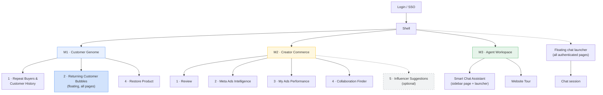
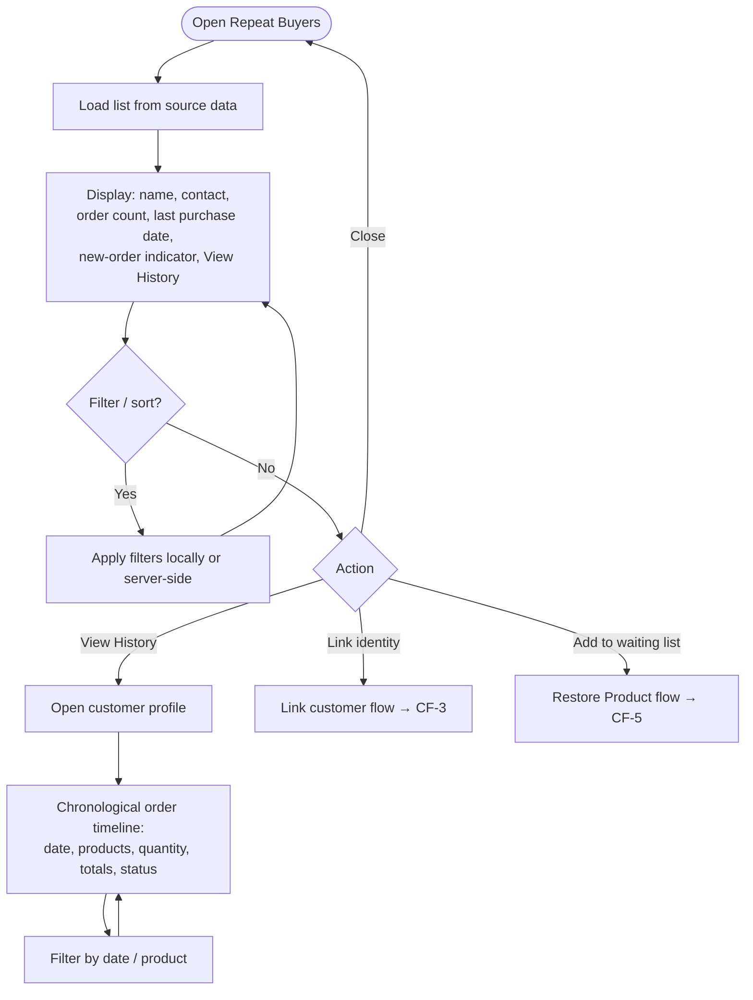
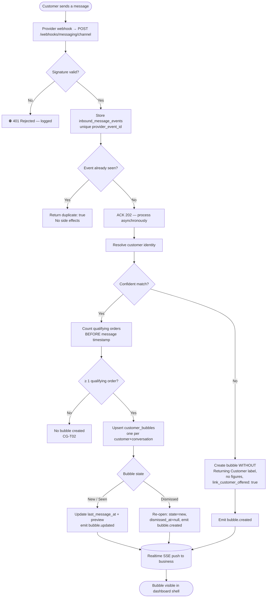
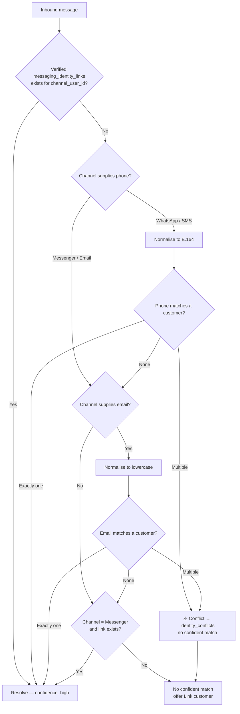
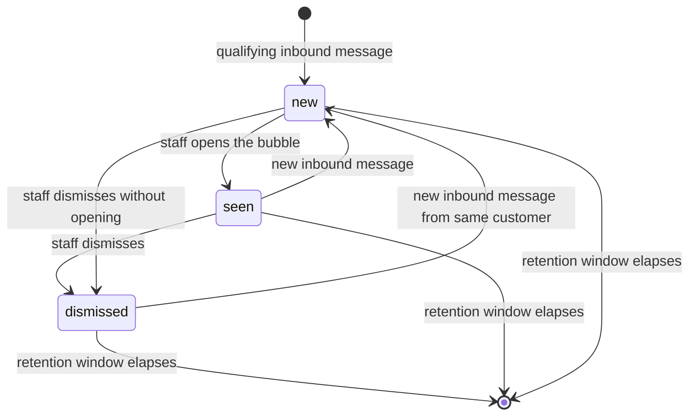
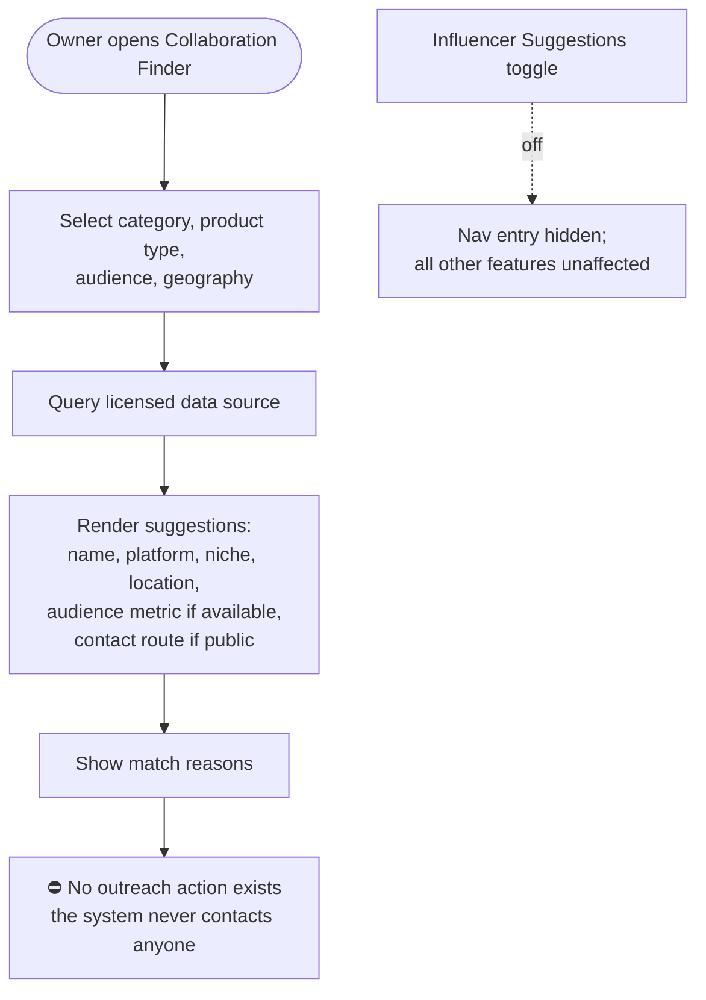
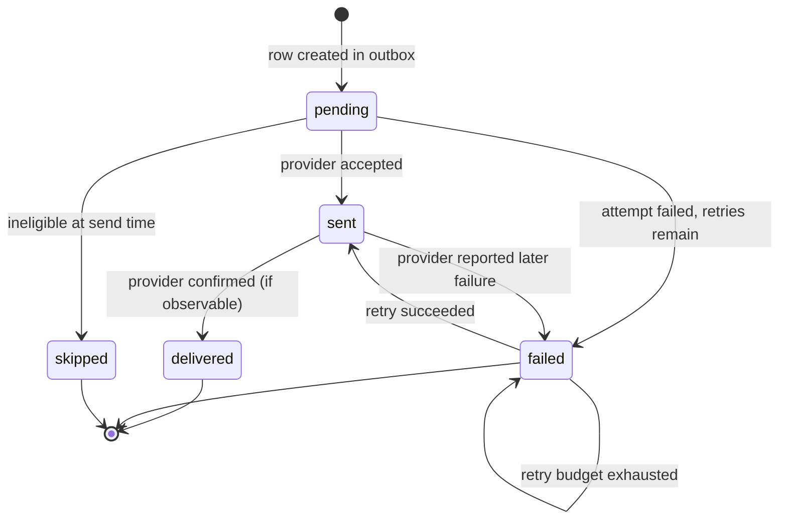
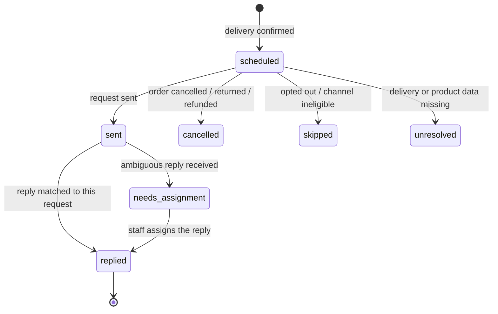
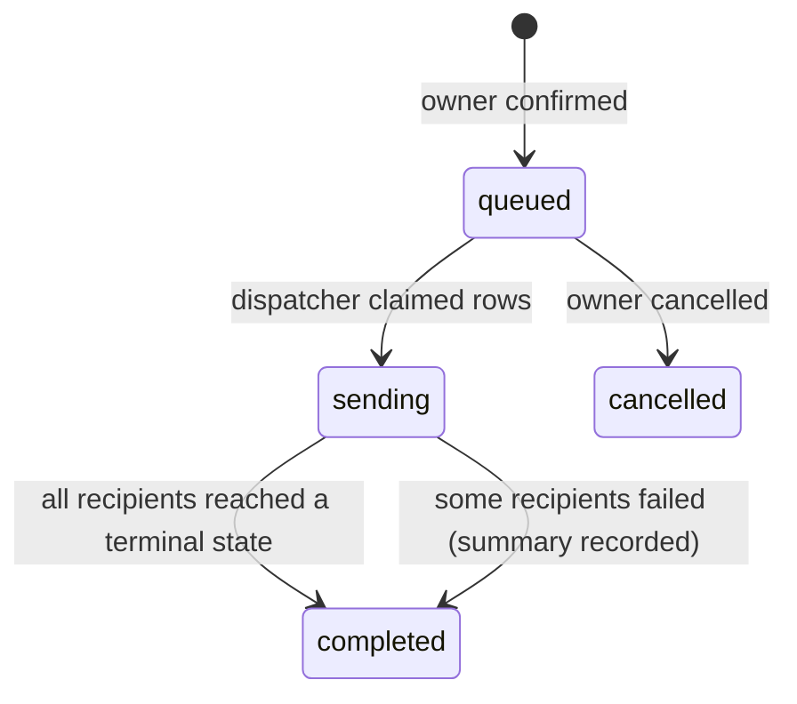
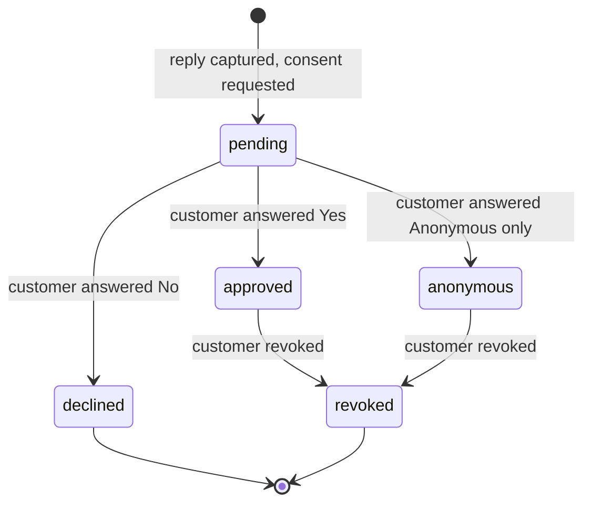

# User Flow Document

**Project:** XenoDesk — Customer Genome · Creator Commerce · Agent Workspace
**Version:** 1.0 (derived from Master Project Documentation v3.0, 16 November 2026)
**Audience:** Product, Design, QA, Developers

---

## 1. Purpose

This document describes how people and systems move through the product: the end-to-end journeys per feature, the state machines behind them, and the error and edge paths that must be designed and tested.

**Legend**

| Symbol | Meaning |
|---|---|
| 🧑 | Human actor (Owner / Admin / Staff) |
| ⚙️ | System / service |
| ◆ | Decision point |
| ⛔ | Terminal blocked state |
| ⚠️ | Warning surfaced to the user |

---

## 2. Actor Summary

| Actor | Primary goals | Modules |
|---|---|---|
| **Owner** | Approve restock batches, connect ad accounts, export review cards, configure everything | All |
| **Admin** | Configure review settings, manage FAQ and tour steps, export cards | All |
| **Staff** | Read bubbles, view history, link identities, add waiting-list entries | M1 (read + capture) |
| **Customer** | Messages the business, replies to review requests, gives consent | Inbound |
| **Platform services** | Messaging Gateway, Scheduler, Realtime, Identity & Consent | All |

---

## 3. Navigation Map



**Bubble behaviour (CG-11 / DECISION):** bubbles render in the dashboard shell, so they are visible on **every** page including Creator Commerce and Agent Workspace. Replies stay in each platform's own inbox — a native inbox is out of scope for V1.

---

# MODULE 1 — Customer Genome

## 4. Flow CF-1: Repeat Buyers & Customer History

**Actors:** Staff, Admin, Owner
**Requirements:** CG-01, CG-02, CG-03, CG-04



**Qualification rule (CG-01 vs CG-06)**

| Customer's qualifying orders | In Repeat Buyers list | Gets a bubble |
|---|---|---|
| 0 | No | No |
| 1 | No | **Yes** |
| 2+ | **Yes** | **Yes** |

### 4.1 Empty, error and unavailable states

| State | Trigger | Display |
|---|---|---|
| No data yet | Source sync has not completed | "Customer data is still loading. First sync will finish soon." + sync status |
| Empty list | Sync done, no customer has ≥ 2 qualifying orders | "No repeat buyers yet. Customers with two or more orders appear here." |
| Source unavailable | Adapter error | "Customer data is temporarily unavailable. Last updated {time}." — retry button, no fabricated data |
| Unresolved order | Order lacks product or amount | Order row shows "Unresolved" in place of the missing field; never a guess |
| History empty | Customer exists, no orders | "No orders recorded for this customer yet." |

---

## 5. Flow CF-2: Returning Customer Bubble — Creation

**Requirements:** CG-05, CG-06, CG-08, CG-10, CG-11
**Trigger:** inbound customer message (system-driven)



**Identity resolution ladder (CG-03)**



> **Display name is never used as a match key.** Names are not unique.

---

## 6. Flow CF-3: Link Customer

**Actors:** Staff, Admin, Owner
**Requirements:** CG-03, CG-10

```mermaid
flowchart TD
    A([Staff sees a bubble without<br/>a Returning Customer label]) --> B[Click "Link customer"]
    B --> C[Search customers by phone, email<br/>or source customer ID]
    C --> D{Exactly one result?}
    D -->|Yes| E[Show candidate with the fields<br/>that matched]
    D -->|No / many| F[Show ranked list;<br/>staff picks one]
    E --> G{Confirm?}
    F --> G
    G -->|Cancel| H[No link created]
    G -->|Confirm| I[Create messaging_identity_links<br/>method = staff_link]
    I --> J[Audit log entry: identity_linked]
    J --> K[Recompute the bubble:<br/>qualifying orders, order count, total]
    K --> L{Bubble qualifies now?}
    L -->|Yes| M[Show Returning Customer label<br/>and figures; emit bubble.updated]
    L -->|No| N[Bubble remains without label]
```

**Rules**

- A conflict is **never** auto-merged; it is flagged for staff review (CG-03).
- Linking never changes the order history — the history is the source of truth.
- Every link is audited with actor and timestamp.

---

## 7. Flow CF-4: Bubble Interaction States

**Requirements:** CG-07, CG-08, CG-11; Decision OD-04



**Card contents (CG-07)**

| Element | Source | If missing |
|---|---|---|
| Initials avatar | Customer name | "?" |
| "Returning Customer" label | `is_returning_customer = true` | **Omitted entirely** (CG-10) |
| Name | `customers.name` | "Unnamed customer" |
| Total previous orders | Live qualifying-order count | "0" |
| Total purchase amount | Live sum, net of refunds | "—" |
| "as of" time | `data_as_of` | Always shown |
| Last purchase date | `last_purchase_at` | "No purchase recorded" |
| Link to history | `history_url` | Disabled |

**Bubble behaviour notes**

- One bubble per customer and conversation (CG-08).
- Bubbles work with browser notifications blocked (CG-T07) — the SSE stream only needs an authenticated session.
- Figures refresh after a qualifying order is recorded (CG-09).

---

## 8. Flow CF-5: Restore Product — End to End

**Requirements:** RP-01…RP-10
**Actors:** Staff (capture), Owner (approve and send)

```mermaid
flowchart TD
    subgraph Capture["Step 1–3 · Interest capture (Staff)"]
        A([Profile / bubble / product page]) --> B[Click "Add to waiting list"]
        B --> C[Select product and variant<br/>variants never mixed]
        C --> D[Confirm customer + contact channel]
        D --> E[Optional quantity]
        E --> F[(product_interests saved)]
    end

    subgraph Detect["Step 4 · Restock detection (System)"]
        G[Inventory poll] --> H{Stock 0 → available?}
        H -->|No| G
        H -->|Yes| I[(restock_events created)]
        I --> J[Create dashboard notification for Owner]
        J --> K[⛔ NO MESSAGE SENT]
    end

    subgraph Preview["Step 5 · Preview (Owner)"]
        L([Owner opens Restore Product]) --> M[Select restock event]
        M --> N[GET /restocks/eventId/preview]
        N --> O[Resolve waiting list for<br/>product + variant]
        O --> P[Determine channel per recipient:<br/>Email default → SMS → Messenger/WhatsApp if eligible]
        P --> Q[Re-check eligibility:<br/>permission, opt-out, channel rules]
        Q --> R{Waiting demand > stock_after?}
        R -->|Yes| S[⚠️ Show stock warning<br/>"Stock may be limited" — no reservation promise]
        R -->|No| T
        S --> T[Show preview: recipients,<br/>channel per recipient, message]
        T --> U{Edit template?}
        U -->|Yes| V[Edit merge fields:<br/>customer name, request date,<br/>product name, business name] --> T
        U -->|No| W[Confirm once]
    end

    subgraph Send["Step 6 · Owner-confirmed send"]
        W --> X[POST /restocks/eventId/notifications<br/>Idempotency-Key required]
        X --> Y[(restock_batches: queued<br/>+ outbound_messages for eligible only)]
        Y --> Z[Audit log: batch_approved]
        Z --> AA[Dispatcher sends with<br/>rate limits + bounded retries]
        AA --> AB[(Delivery history:<br/>pending / sent / delivered / failed / skipped)]
        AB --> AC([Owner reviews outcome])
    end

    F -.->|interest recorded| O
    I --> L
```

### 8.1 Channel routing at preview and send time

| Channel | Role | Conditions |
|---|---|---|
| Email | Default | Authenticated sender domain, valid address, unsubscribe link |
| SMS | Default | Gateway configured, valid mobile number, opt-out honoured |
| Messenger | Conditional | Inside the platform-allowed window/message type at send time |
| WhatsApp | Conditional | Approved template and recorded opt-in |

**Two-stage eligibility**

| Stage | What is checked | Why |
|---|---|---|
| Preview | Permission, opt-out, channel availability, stock vs demand | Shows the owner exactly what would happen |
| Send (dispatch) | The same checks **re-checked** | Consent may have changed between preview and send (RP-08) |

### 8.2 Per-recipient outcomes

| Status | Meaning |
|---|---|
| `pending` | Queued, not yet attempted |
| `sent` | Accepted by the channel provider |
| `delivered` | Provider confirmed delivery (only if observable) |
| `failed` | Send failed; retries exhausted; `error_code` recorded |
| `skipped` | Not eligible; `skip_reason` recorded — `opted_out`, `no_permission`, `channel_ineligible` |

**Rules**

- A restock event never sends anything by itself (RULE — No automatic sending).
- One confirmation queues the batch. Submitting the same confirmation twice sends one message per recipient per channel (RP-T05).
- A failure on one recipient does not affect others (RP-T08).

---

## 9. Flow CF-6: Review — End to End

**Requirements:** RV-01…RV-13
**Actors:** System (schedule), Customer (reply, consent), Owner/Admin (manage, export)

```mermaid
flowchart TD
    subgraph Schedule["Step 1–3 · Request scheduling (System)"]
        A[Delivery confirmed from source] --> B{Order eligible?}
        B -->|No| B1[⛔ No request scheduled — RV-T02]
        B -->|Yes| C[(review_requests created<br/>UNIQUE business + order_id)]
        C --> D[due_at = confirmed_at + delay_days<br/>3 (default) or 4, business timezone]
        D --> E[Queued for due_at<br/>inside send window 09:00–20:00]
    end

    subgraph Send["Step 4–5 · Eligibility and send"]
        E --> F[Re-check at send time]
        F --> G{Order cancelled /<br/>returned / refunded?}
        G -->|Yes| G1[state=cancelled<br/>reason visible — RV-T05]
        G -->|No| H{Permission / opt-out /<br/>channel eligible?}
        H -->|No| H1[state=skipped<br/>reason visible — RV-T06]
        H -->|Yes| I[Send request with reference token<br/>lists delivered products]
        I --> J[state=sent]
    end

    subgraph Reply["Step 6–7 · Reply capture"]
        K[Customer replies] --> L[Match by reference token]
        L --> M{Token match?}
        M -->|Yes| N[Attach to the order]
        M -->|No| O[Match by thread within reply window<br/>default 14 days]
        O --> P{Unambiguous?}
        P -->|Yes| N
        P -->|No / ambiguous| Q[state=needs_assignment<br/>staff assigns manually — RV-T07]
        N --> R[(review_replies inserted<br/>VERBATIM, immutable)]
    end

    subgraph Consent["Step 8 · Publication consent"]
        R --> S[Ask once: Yes / Anonymous only / No]
        S --> T[(review_permissions)]
        T --> U{Answer}
        U -->|Yes| V[state=approved]
        U -->|Anonymous only| W[state=anonymous<br/>identity hidden]
        U -->|No| X[state=declined]
        V --> Y{Customer later revokes?}
        Y -->|Yes| Z[state=revoked<br/>future exports blocked — RV-T10]
    end

    subgraph Use["Step 9–11 · Use and export"]
        V --> AA[Generate marketing card]
        W --> AA
        AA --> AB[Card words EXACTLY equal the original<br/>label "Customer review"<br/>must not imitate Messenger/WhatsApp UI]
        AB --> AC[(review_cards)]
        AC --> AD[Export]
        AD --> AE{Consent current?}
        AE -->|approved| AF[Export with identity]
        AE -->|anonymous| AG[Export with identity hidden]
        AE -->|declined / revoked| AH[⛔ Export blocked]
        AG --> AI[Audit log: export_created]
        AF --> AI
    end
```

### 9.1 Consent state matrix

| State | Card generation | Export | Identity shown | Notes |
|---|---|---|---|---|
| `pending` | No | No | — | Awaiting the customer's answer |
| `approved` | Yes | Yes | Yes | |
| `anonymous` | Yes | Yes | No | Name, contact, order ID hidden |
| `declined` | No | No | — | Reply is kept internally |
| `revoked` | No | No | — | Prior exports remain; future ones blocked |

### 9.2 Reply handling rules

| Rule | Behaviour |
|---|---|
| Verbatim | The customer's original words are stored exactly, with message ID, timestamp, channel, customer, order, product. Never rewritten. |
| All sentiments kept | Positive, neutral and negative replies are all retained. Consent governs use, not sentiment. |
| Ambiguity | An ambiguous reply goes to **Needs assignment** — never auto-attached to the wrong order. |
| Repeated delivery | A repeated delivery event never creates a second request. |
| Missing data | Missing delivery, customer or product data shows as **unresolved** — never invented. |

---

## 10. Flow CF-7: Meta Ads Intelligence

**Requirements:** MI-01…MI-05

```mermaid
flowchart TD
    A([Owner opens Meta Ads Intelligence]) --> B[Enter keyword, country<br/>default Bangladesh, category]
    B --> C[Optional language, price segment]
    C --> D{Tier available?}
    D -->|Tier 1| E[Official Meta Ad Library API]
    D -->|Tier 2| F[Licensed third-party provider]
    D -->|Tier 3| G[Manual intake:<br/>paste ad links or upload screenshots]
    E --> H[Collect observable fields]
    F --> H
    G --> H
    H --> I[Rank Top 5<br/>Relevance 40, Clarity 25,<br/>Offer 20, CTA 15]
    I --> J[Show per-ad fields + rank reasons]
    J --> K{Field available?}
    K -->|Yes| L[Show value]
    K -->|No| M[Show "Not visible" / "Not available"<br/>never a value — MI-04]
    L --> N[Label ranking as AI relevance<br/>and creative quality — never sales/ROAS]
    M --> N
    N --> O[Suggest original creative directions<br/>inspired by patterns, not copies]
```

**Tier fallback**

| Tier | Availability | Coverage shown in UI |
|---|---|---|
| 1 — Meta Ad Library API | Only if country and ad type are covered | Full coverage |
| 2 — Licensed provider | If Tier 1 is unavailable and terms permit | Full coverage |
| 3 — Manual intake | Always available as fallback | "Analysis covers only the items you submitted" |

> **Never bypass platform restrictions by scraping.** If no tier is viable, the feature runs in Tier 3 and says so plainly.

---

## 11. Flow CF-8: My Ads Performance

**Requirements:** MP-01…MP-04

```mermaid
flowchart TD
    A([Owner opens My Ads Performance]) --> B{Ad account connected?}
    B -->|No| C[Connect Meta ad account<br/>OAuth, ads_read scope only]
    C --> D[Select account(s) from list]
    D --> E[(ad_account_connections<br/>token encrypted)]
    E --> F[Sync snapshot → ad_insight_snapshots]
    B -->|Yes| G[Select date range<br/>e.g. 7 days]
    F --> G
    G --> H[Display metrics:<br/>spend, impressions, reach, CTR,<br/>CPC, cost per result,<br/>conversions, CPA, ROAS]
    H --> I{Metric available?}
    I -->|Yes| J[Show value]
    I -->|No| K[Show "N/A, tracking not available"]
    J --> L[Show last-synced time<br/>⚠️ warn if stale]
    K --> L
    L --> M[Ranking by objective<br/>never mixed in one list]
    M --> N{Objective}
    N -->|Sales| O[ROAS → CPA → conversions<br/>guard: min spend]
    N -->|Traffic| P[CTR → CPC<br/>guard: min impressions]
    N -->|Leads| Q[Cost per lead → lead volume<br/>guard: min lead count]
```

**Rules**

- Read-only. No publishing, no budget edits (MP-01).
- Missing conversion tracking ⇒ ROAS and CPA show N/A, but objective ranking remains valid (MP-T02).
- Ranking is deterministic — no model involvement.

---

## 12. Flow CF-9: Collaboration Finder / Influencer Suggestions

**Requirements:** CF-01…CF-03, IF-01, IF-02



---

# MODULE 3 — Agent Workspace

## 13. Flow CF-10: Smart Chat Assistant — Routing

**Requirements:** AW-01…AW-09

```mermaid
flowchart TD
    A([User opens chat<br/>sidebar page or launcher]) --> B[User types or selects a prompt]
    B --> C[Normalise: lowercase, strip punctuation<br/>and extra spaces, Bangla Unicode forms,<br/>Banglish spellings]
    C --> D{Exact FAQ ID match?}
    D -->|Yes| H1[ROUTE: FAQ<br/>fixed answer + link<br/>tokens = 0]
    D -->|No| E{Alias list match?}
    E -->|Yes| H1
    E -->|No| F{Similarity ≥ threshold?}
    F -->|Yes| H1
    F -->|No| G{Deterministic data intent?<br/>e.g. "how many active ads"}
    G -->|Yes| H2[ROUTE: DATA<br/>authorised read-only query<br/>value + data_as_of]
    G -->|No| I{Write / delete intent?<br/>e.g. "delete this customer"}
    I -->|Yes| H4[ROUTE: BLOCKED<br/>clear refusal, no tool executed]
    I -->|No| J[ROUTE: AI<br/>LLM with read-only tool allow-list]
    J --> K{Tool call?}
    K -->|Yes| L[Re-check tenant + role on every call]
    L --> M[Execute read-only tool]
    M --> N[Return evidence-based answer<br/>explain missing data]
    K -->|No| N
    N --> H3[ROUTE: AI<br/>tokens + cost recorded<br/>no invented facts]
    H1 --> P[Record ai_usage_events]
    H2 --> P
    H3 --> P
    H4 --> P
    P --> Q[Return: answer, answer_type,<br/>references, data_as_of, usage]
```

### 13.1 Routing examples

| User asks | Route | Result |
|---|---|---|
| "How do I use Review?" | FAQ | Fixed answer plus link; zero tokens |
| "How many active ads do I have?" | DATA | Authorised query; count with "as of" time |
| "Which of my ads should I pause and why?" | AI | Read-only tools; recommendation with evidence; no changes made |
| "Delete this customer." | BLOCKED | Clear refusal; no write tools exist |

### 13.2 Response shape

```json
{
  "answer": "...",
  "answer_type": "faq | data | ai | blocked",
  "references": [{ "type": "screen", "label": "Review settings", "href": "/creator-commerce/reviews/settings" }],
  "data_as_of": "2026-11-16T09:12:00Z",
  "usage": { "input_tokens": 0, "output_tokens": 0, "latency_ms": 12, "estimated_cost": 0.0 }
}
```

### 13.3 AI safety rules (enforced in the flow)

| Rule | Enforcement point |
|---|---|
| Untrusted content cannot change instructions | Ad copy, reviews and customer text enter the prompt only inside delimited data blocks |
| No write tools | The tool registry is a static read-only allow-list; there is no dynamic registration path |
| Tenant + role checked on every tool call | Authorisation re-checked inside each tool, not only at the entry point |
| Least data to AI | Personal fields redacted before the provider call (OD-10) |
| No invented facts | The model explains missing data instead of guessing counts, rankings or customer facts |
| Images unsupported | Upload rejected with a clear "future feature" message (AW-09) |

---

## 14. Flow CF-11: Website Tour

**Requirements:** AW-10, AW-11

```mermaid
flowchart TD
    A([First visit to an authenticated page]) --> B{Tour already<br/>completed or skipped?}
    B -->|Yes| Z([No tour overlay])
    B -->|No| C[Offer: Start tour / Skip]
    C -->|Skip| D[(tour_progress: skipped)] --> Z
    C -->|Start| E[Step 1 · Main dashboard<br/>"Your overview of customers,<br/>marketing and help."]
    E --> F{Target found?}
    F -->|No| G[Skip the step automatically<br/>or show a centred message<br/>— the app stays usable]
    F -->|Yes| H[Highlight the target,<br/>show the message]
    G --> I
    H --> I{Action}
    I -->|Next| J[Step 2 · Customer Genome]
    J --> K{Action}
    I -->|Previous| E
    I -->|Skip| D
    K -->|Next| L[Step 3 · Creator Commerce]
    L --> M[Step 4 · Agent Workspace]
    M --> N[Step 5 · Finish<br/>"You are ready. Replay this tour<br/>anytime from the Agent Workspace."]
    N --> O[(tour_progress: completed)] --> Z
    Z --> P[Replay available anytime<br/>from Agent Workspace → restarts at step 1]
```

**Step messages**

| Step | Target | Message |
|---|---|---|
| 1 | Main dashboard | Your overview of customers, marketing and help. |
| 2 | Customer Genome | See repeat buyers and history, get alerted when a returning customer messages, and notify customers when a product is back. |
| 3 | Creator Commerce | Collect customer reviews, study competitor ads, track your own ads and find collaborators. |
| 4 | Agent Workspace | Ask common questions for free, or use the AI assistant for unique ones. |
| 5 | Finish | You are ready. Replay this tour anytime from the Agent Workspace. |

**Resilience rules (AW-11)**

- Steps use stable IDs and selectors; a missing target is skipped or shown as a centred message.
- The tour never blocks the app. `Escape` always dismisses it.
- Replay restarts from step 1.

---

## 15. Cross-Flow State Machines

### 15.1 Outbound message



### 15.2 Review request



### 15.3 Restock batch



### 15.4 Review permission



---

## 16. Error and Edge Path Matrix

| # | Scenario | Expected behaviour | Requirement |
|---|---|---|---|
| E1 | Webhook signature invalid | 401, no processing, security log | Security |
| E2 | Same webhook delivered twice | One event processed; second returns `duplicate: true` | CG-08 |
| E3 | Three messages from one customer | One bubble; `last_message_at` updates | CG-T04 |
| E4 | First-time buyer messages | No bubble, no "Returning Customer" label | CG-T02 |
| E5 | Identity unlinked or conflicting | No label, no other customer's data, "Link customer" offered | CG-10 |
| E6 | Bubble figures after a new qualifying order | Card refreshes from authoritative history | CG-09 |
| E7 | Browser notifications blocked | Bubbles still work | CG-11 |
| E8 | Waiting-list entry saved | Interest saves against the correct product and variant | RP-T01 |
| E9 | Stock 0 → available | Restock event + owner notification; **no message sent** | RP-T02 |
| E10 | Owner previews a batch | Recipients, channels, text match the waiting list | RP-T03 |
| E11 | Owner confirms once | Only eligible recipients queued | RP-T04 |
| E12 | Confirmation submitted twice | One message per recipient per channel | RP-T05 |
| E13 | Recipient opted out / ineligible | Skipped with a visible reason | RP-T06 |
| E14 | Stock below waiting demand | Warning shown; message makes no reservation promise | RP-T07 |
| E15 | A send fails | Status failed; retries bounded; other recipients unaffected | RP-T08 |
| E16 | No confirmed delivery | No request scheduled | RV-T02 |
| E17 | Delivery event arrives twice | Only one request exists | RV-T04 |
| E18 | Order returned/refunded before due time | Request cancelled with a visible reason | RV-T05 |
| E19 | Customer replies ambiguously | Lands in "Needs assignment" | RV-T07 |
| E20 | Consent answered Yes / Anonymous / No | States and export behaviour match | RV-T08 |
| E21 | Card generated | Words equal the original; label present; no platform UI imitation | RV-T09 |
| E22 | Consent revoked | Further export blocked | RV-T10 |
| E23 | Cross-tenant review request | Access denied without revealing the record exists | RV-T11 |
| E24 | Ad without a visible price | Shows "Not visible"; nothing invented | MI-T02 |
| E25 | Conversion tracking missing | ROAS/CPA show N/A; objective ranking still valid | MP-T02 |
| E26 | Influencer Suggestions disabled | All other features remain usable | IF-T01 |
| E27 | FAQ prompt selected | Fixed answer; usage log shows zero tokens | AW-T01 |
| E28 | Alias / Bangla / Banglish variant | Same answer, no LLM call | AW-T02 |
| E29 | Prompt injection inside ad copy | Ignored; no tool outside the allow-list runs | AW-T05 |
| E30 | Staff queries another role's or tenant's data | Denied | AW-T06 |
| E31 | Image attached | "Future feature" message | AW-T07 |
| E32 | Tour target missing | Step skipped or centred; app stays usable | AW-T10 |
| E33 | Source system unavailable | "Temporarily unavailable, last updated {time}"; no fabricated data | No fabricated data |
| E34 | LLM provider down | Chat degrades to FAQ + DATA; explicit notice | Reliability |
| E35 | Stale inventory source | Restock events suppressed; staleness warning | RP-04 |
| E36 | Empty state anywhere | Designed, not a blank page | Definition of Done |

---

## 17. Acceptance Test Mapping

| Test | Flow |
|---|---|
| CG-T01…CG-T08 | CF-2, CF-3, CF-4 |
| RP-T01…RP-T08 | CF-5 |
| RV-T01…RV-T11 | CF-6 |
| MI-T01…MI-T02 | CF-7 |
| MP-T01…MP-T02 | CF-8 |
| CF-T01, IF-T01 | CF-9 |
| AW-T01…AW-T08 | CF-10 |
| AW-T09…AW-T10 | CF-11 |

---

## 18. Traceability

| PRD section | Flow |
|---|---|
| §6 Repeat Buyers & History | CF-1 |
| §7 Bubbles | CF-2, CF-3, CF-4 |
| §8 Restore Product | CF-5 |
| §9 Review | CF-6 |
| §10 Meta Ads Intelligence | CF-7 |
| §11 My Ads Performance | CF-8 |
| §12–13 Collaboration & Influencer | CF-9 |
| §14 Chat | CF-10 |
| §15 Tour | CF-11 |
| §4 Roles & permissions | §2 Actor Summary, §16 Edge matrix |
